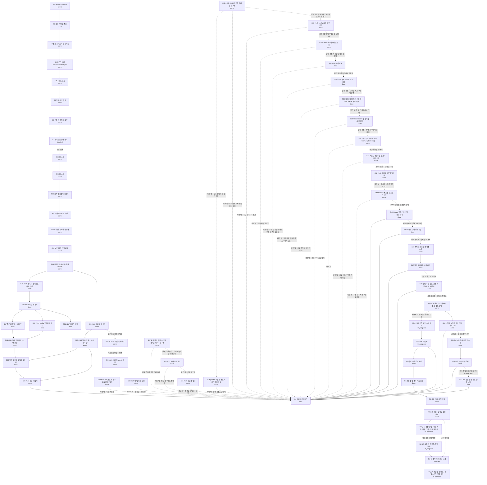

# Current Plan

**Status**: Active control document
**Policy**: [Workflow Governance](WORKFLOW-GOVERNANCE.md)
**History index**: [HISTORY-MAP.md](HISTORY-MAP.md)
**Integration branch**: `skerfolg/pok-final-quality` (main 기준 품질 실행 준비, draft PR #156). PR #154는 병합됐고 PR #155는 양 플랫폼 CI 통과·검토 대기다. UI는 별도 세션 담당이며 전역 PoK 설정 전환은 보류한다.

This is the single live work-control document for the current repository lane. The structure of this file is enforced by `docs/WORKFLOW-GOVERNANCE.md` §12 (Live-Doc Schema) and §13 (Canonical Next Step Discipline) — the guard's `checkLiveDocSchema()` will validate this file on every precommit. Sections appear in the canonical order below; do not insert new H2 sections between CORE sections (consumer-specific sections must be appended after the last CORE section).

## Active Lane

Lane: `M5-proposal-rounds`

M5(3층 제안) — 반사실 캠페인의 창의 층. **무인 라운드 배치**로 짓는다: 사람이 루프의
동력이면 ①노가다 ②탐색이 사람 머릿속 상한에 갇힘 ③사용량에 기대면 축적 빈약, 셋이
무너진다(사용자 지시 2026-08-20). M3 캠페인을 수십 시간 무인으로 돌린 것과 같은 형태다.

사람은 **판정자**로만 남는다 — 정본 진입은 M6 큐레이션 게이트뿐이라 라운드가 아무리
돌아도 정본은 안 움직인다. 기존 기술 설계는 [개정 전 ROADMAP §M5 확정 설계](ROADMAP_PRE_REDESIGN.md). 현재 개선 순서와 통과 기준은 [개정 ROADMAP](ROADMAP.md)을 따른다.

## Status Graph



## Baseline Structure

### M5-proposal-rounds

Status: `active`

Lane scope: 제안을 무인 배치로 생성·측정하고, 사람은 다이제스트만 판정한다.

| Sub | Subject | Status |
| --- | --- | --- |
| S1 | 제안 계약 검증기 — 3필드 강제·갭 라벨 (`engine/proposal.py`) | done |
| S2 | 전개기 + 출처 분리 저장 (`engine/proposal_flow.py`) | done |
| S3 | 라운드 러너 — brief·measure·digest (`engine/proposal_round.py`) | done |
| S4 | 라운드 스킬 `skills/proposal-round/` + 등록 shim | done |
| S5 | 첫 라운드 실행 → 다이제스트 판정 | done |
| S6 | 판정 큐 — 제공 축 분류·요구 기재·측정 경로 (결정적) | done |
| S7 | 에이전트 판정 배치 — 4건 시행 후 **중단**(측정 결함 발견) | blocked |
| S8 | #98 `<Slot active>` 수정 + 통합 시험 | done |
| S9 | #99 수정 — 오염 포함본 병기(`with_tainted`) | done |
| S10 | 재측정(2,689벌) → 재집계 → NodeValue 재승격 | done |
| S11 | 에이전트 판정 14건 — 큐 결함 3건·도구 결함 2건 발견 | done |
| S12 | #100 축 13개 재측정 → 재집계 → 재승격 · 큐 필터 전 축 반영 | done |
| S13 | 남은 판정 큐 37건 에이전트 배치 — 41건 저장, 「가치 없음」 0건 | done |
| S14 | 판정이 드러낸 측정 결함 등재 (#108~#111) | done |
| S15 | #109 수정 — 결측 키를 0.0으로 취급하는 가짜 델타 | done |
| S16 | #108 — 축 열거 제거. 하위 호환은 정본 샤드 바이트 동일로 확인 | done |
| S17 | 좁은 재측정(1,489벌·60분) — 게이트. 41종 중 **16종이 값을 냈다** | done |
| S18 | #104 config 프로파일을 main 직접 커밋에서 브랜치로 회수 (PR #96) | done |
| S19 | #111 — 상태 프로파일 3종 + 스택 결합. 4건 전수 검증 | done |
| S20 | 전량 재측정·재집계·재승격 — 전 축 0인 노드 936 → 583 (PR #104) | done |
| S21 | #117 수정 — 가정 게이트 어간 처리(과거분사 config vs 명사형 공급 문구) (PR #98) | done |
| S22 | #110 대응 — 되살리기 불가 확정, 오라클이 `POK_META`로 자기 갭 신고 (PR #99) | done |
| S23 | #113 — `CombinedDPS`가 속도를 잃는 조건을 신고·축 선택 (`engine/dps_axis.py`) + #119 캐시 판 번호 | done |
| S24 | #113 반영 재집계 — 속도 노드 **5종 부활** · 73노드 손실률 교정(양방향). 재측정 없이 정본만 갱신 | done |
| S25 | #120 — 아이템 룬 소켓 **예산**을 오라클이 신고(베이스/유니크 + 트리 부여), 조립은 PoB가 못 여는 6칸 초과만 거부하고 **우회로를 함께 낸다** (`pob/runner.py::socket_budget`) | done |
| S26 | #121 — 여러 줄 config가 `&#10;`로 나가 PoB에서 조용히 사라지던 것 수정 (`pob/buildxml.py::_pob_attr`) | done |
| S27 | 외부 영상 4편 전사 → 도구 갭 **#122~#126** 등재 · 인사이트 **4건** 승격. 사용자 판정 반영: `as-though-damage-scales-narrowly` → **SUPPORTED_INFERENCE**, 나머지 3건 UNVERIFIED 유지. **#123은 착수 전 코드 대조로 좁혔다** — 「전 경로」가 아니라 `optimize_items` 하나였다 | done |
| S28 | #127 — KB 로드 캐시가 두 겹 다 빗나가 CI pytest가 벽시계의 87~91%(윈도우 11분 58초)를 먹던 것. 키 정규화 + 레코드 단위 검증 메모 + 지문에 `schema/` 포함 + 스냅샷 상한. 회귀는 시간이 아니라 **재검증 횟수**로 잠갔다 (`kb/store.py::_VALIDATION_MEMO`) | done |
| S29 | #131 — **적대 조합**(A가 만드는 것을 B가 금지)을 낸다. 생산·소비 그래프의 역방향이라 어느 도구도 안 보던 축. 금지 담체 14종뿐인데 Brutality가 각 **233종**·불의 화신이 **188종**을 죽인다 — 조립 출고에 **신고**로 부착(거부 아님, AD-3) (`kb/graph/antagonists.py`) | done |
| S30 | #129 2차 — 조립 게이트를 **거부에서 자동 실행으로**. 도장 없는 희귀 슬롯을 `optimize_rare`로 그 자리에서 채운다(가중치는 빌드가 선언한 것을 재사용 — 엔진은 판단을 지어내지 않는다). 훅은 비켜 주고 조립이 못 채우면 거부해 인계 구멍을 막았다 (`engine/autofill.py`) | done |
| S32 | #133~#135 — **조용한 오라클 갭 3건**. 셋 다 「PoB가 못 읽었는데 아무도 말 안 한다」는 한 형태다(§0 ⑩). #135 버려진 아이템은 드라이버가 이미 싣던 `POK_META.items`와 보낸 id를 맞춰 신고(`pob/runner.py::find_dropped_items`) · #134 복원 왕복의 개행 손실 + **statSet 색인 버리기**(코드에 있는 값을 가정으로 덮고 있었다) · #133 표시는 정본에 있었는데 **측정 반환에 없던 것**(`engine/items.py::unread_item_lines`). ⚠ #133·#135는 **접수 진단이 틀렸다**(§3에 등재). ⭐ #132는 **원인을 규명했다** — LuaJIT의 `pairs()` 문자열 키 순서가 프로세스마다 다른데 `CalcOffence.lua:2364-2372`의 전환표 적용이 같은 키에 `=`와 `+=`를 섞어 **순서에 의존**한다. 충돌 조건(전환 대상이 겹치는 전역 전환 2개)을 만들어 윈도우에서 재현했다(10회 5:5로 갈림). 상류 결함이라 우리가 못 고치고(AD-1·AD-2), 대응은 **탐지 도구**(`check_pob_stability`)다. #136은 **사용자 판정으로 기각**(PoB의 한 발 기준이 인게임에 맞는 보수적 모델링) | done |
| S31 | #125 — **조건 성립기**(`scan_enablers`). 「이 노드를 살리려면 무엇이 필요한가」를 낸다. 상태 그래프(#92)의 54축은 **가하는 상태**라 자신이 처한 상태를 못 다뤘다. ⭑ 주체가 **줄 단위**다(사용자 인게임 지적 — Execute III는 자신용·적용을 함께 갖는다). 「살 것이 없는 축」을 갭으로 안 찍는다 (`kb/graph/enablers.py`) | done |
| S33 | #145 — 켠 config의 **유지 비용**을 아무도 묻지 않던 자리. `compute_pob` 반환에 `config_upkeep`이 자동으로 붙고(자원 관문·대상 한계·횟수·반경·쿨다운, 근거는 문구 원문), `audit_config_upkeep(measure=True)`가 조건별 실제 기여까지 잰다. 사용자 신고(레퍼런스 힘스태킹 젬링)를 실측: 조건 13종 전부 참인 빌드가 세팅 없이 팩에 들어가면 표기의 **52.6%**이고, 6종은 Δ0 · 원소 노출 3종은 **끄는 쪽이 높았다**(역저항 축이라 저항을 깎으면 손해). ⛔ 초판의 `unsupplied`(공급원 없음)는 **11건 중 6건 오탐이라 폐기**했다 — 「없다」는 실측이 답한다. ⚠ `bannerPlanted`는 PoB에 관련성 조건이 없어 config를 축으로 삼는 매처로는 누락되는데 **딜의 20.3%가 거기 걸려 있었다**. 곁다리: 아포스트로피 이름이 id화에서 조용히 빠지던 것 수정(`Sniper's Mark`) | done |
| S35 | #146·#147 — Item에 닿는 축이 **이름 하나뿐**이라 세션이 이름 토큰으로 훑었고, 갭이 **0건이 아니라 그럴듯한 부분집합**으로 나와 안 보였다. #146 유니크의 `explicits`·`implicits`가 색인 밖(영어 원문조차 안 걸렸다) → FTS body에 실었다(+`grants`·젬 `quality_stats`) · #147 `category`·`sub_type` 필터 신설(소문자로 접어 대조 — 두 필드의 표기 규약이 다르다). ⭐ 실측 교정: 「신발에는 회피/ES 듀얼 베이스가 없다」던 보고가 틀렸다 — `category="boots"` **217건**, 그 조합 **27종**. 강제 지점은 `test_index_covers_prose_fields` — 정본의 **모든 문장 필드**가 색인되었거나 사유와 함께 제외되었거나 둘 중 하나임을 강제한다(#146은 그 결정을 **아무도 내리지 않아** 생긴 갭이었다) (`index/build.py` SCHEMA_VERSION 10) | done |
| S36 | #148 — **희귀 아이템 왕복이 막혀 있던 자리.** 세 얼굴이 한 뿌리다: PoB 아이템 텍스트는 선언(`Prefix:`)과 렌더 문구를 **함께** 담는데 두 도구가 그것을 다르게 읽었다(§0 ④). ①문구를 재파싱하며 인접 두 줄을 하이브리드로 **탐욕 매칭**해 **판정이 줄 순서에 의존**했고(`+162 to Evasion Rating` 한 줄이 후보 **55건**에 걸린다) ②선언과 다른 id로 잡혀 접두 3개가 **4개로 계수**됐다(문구가 심지어 **룬**으로 잡혔다). 선언이 **자기 문구 줄을 먼저 집게** 해 둘을 함께 닫았다 — 좁히는 것이지 건너뛰는 것이 아니라 티어·스폰 검사는 그대로 돈다(`legality.py::_claim_declared`). ③`compute_pob`이 선언형을 **조용히 버리던 것**은 `unbuilt_declarations`로 매 반환에 신고하고 `check_item_legality`도 `not_computable`을 낸다 — ⚠ **거부가 아니라 신고로 했다**(접수 제안과 다름): 같은 형태의 #135가 신고이고, 거짓 거부는 우회를 학습시키며(§0 ⑪), 대안 경로(`build_items`)가 이미 있어 신고문이 그것을 가리킨다. ⭑ 재현은 `Drakeskin Boots`로만 성립한다 — `Stone Greaves`의 ILLEGAL은 **정상 판정**이다 | done |
| S37 | #152 — **자동 채움이 자기 스펙을 오염시키던 자리.** 희귀 슬롯의 출처 도장(`items[i].derived_from`)을 훅 게이트·`unstamped_rares`·거부문 세 곳이 아이템 단위로 읽는데 `spec_from_dict`만 거부했다 — 첫 칸에 찍은 도장이 둘째 칸의 `optimize_rare`에서 `모르는 키`로 죽었고, 거부문이 안내한 탈출구(「그 슬롯에 derived_from을 명시할 것」)도 같은 자리에서 막혔다(철칙 5 따름정리 — 금지하려면 대안 경로부터). ⭑ 보고보다 넓었다: 채운 스펙은 그대로 조립의 `spec_from_dict`로 가므로 **1칸짜리도 조립 직전에 죽었다.** 최상위 `_SPEC_ONLY_KEYS`와 같은 규약을 아이템에 뒀다(받되 벗겨 낸다, `_make(spec_only=)`) — `ItemSpec`·manifest 해시는 그대로. 강제 지점: **2칸** + 받은 스펙을 스키마에 태우는 엄격한 가짜 최적화기, 거부문을 실제 경로에서 받아 탈출구를 밟는 시험. 둘째 절반(의도한 부품을 지운다)은 **#153으로 분리**하고 빠진 대리 줄만 신고한다 (`pob/buildxml.py`·`engine/autofill.py`) | done |
| S38 | #154·#155 — **같은 세션이 도장을 찍고 나니 다음 벽에 부딪힌 자리.** #154 `check_assumptions`가 아이템이 부여한 스킬을 공급원으로 못 봐 **거짓 차단**했다 — 두 겹이었다: `Grants Skill:` 줄이 스킬 stats로 안 풀렸고, 풀려도 `CanGainRage`→`Gain + Rage`라 「Regenerate … Rage」(영원한 격노)는 못 넘었다. 부여 스킬을 젬과 같은 사전으로 풀고, 능력 동사(`Gain`·`Apply`)를 떼 대상만 키워드로 삼는다(유니크 104종이 `Grants Skill:`을 갖는다). #155 「1800초 무응답」은 ⚠ **진단 정정** — 멈춘 게 아니라 **32분 일하고 반환**했다(텔레메트리 `failed` 행 08:07:52, 발신 07:35:55): 차단될 스펙에 자동 채움(슬롯당 133~156초 실측, 큰 빌드 4칸 32분)을 **먼저** 돌린 뒤 거부했고 클라이언트가 1800초에 포기해 결과를 버렸다. 정적 검사 선행 · 벽시계 예산(`POK_AUTOFILL_BUDGET_S`, 기본 1200초, 다음 칸이 넘칠지 시작 전에 예측) · FastMCP `Context` 진행 알림 · 소요 시간 반환. #150(루프 교착)과 형태가 다르다 — 그대로 미수정. 강제 지점은 인메모리 FastMCP 클라이언트로 서버 래퍼를 실제로 지난다 (`engine/constraints/assumptions.py`·`pob/catalog.py`·`engine/autofill.py`·`mcp/tools/build.py`) | done |
| S39 | #156·#157 — **같은 신성모독 주얼에서 연달아 난 거짓 거부 둘.** #156 접미어 효과 확장이 `origins`만 보고 `scope`를 안 봐 `of the Abyss`((1-2)%, `scope="jewel"`)가 54% 효과 아래 3%로 표시된 것을 「티어 범위 밖」으로 거부했다(사용자가 원인을 짚었다) — `_is_jewel_mod`가 두 형태를 다 본다. 곁가지로 `Effect of Prefixes`의 대칭 확장이 아예 없던 것을 같은 꼴로 닫았다. #157 `applicable_pages` 대조가 클래스 조인 실패에서 **단락**해 주얼(pages가 베이스명, `item_class`는 전부 Jewel) 대상 접사 전량이 「목록에 Emerald가 있는데 밖」으로 거부됐다 — 조인 실패 뒤 **정확 일치**로 한 번 더 본다(제안의 느슨한 부분 문자열 대조는 장비 오통과를 부르므로 택하지 않았다). 요청은 #156이었지만 #156만 고친 시험이 #157에서 막혀 함께 닫았다(보고자 예측 그대로) (`engine/legality.py`) | done |
| S40 | #162 — `compute_pob`의 `items_legal`이 **주얼을 검사하지 않던 것** + 주얼 `derived_from` 대칭(#152·#27이 `items[]`에만 준 규약의 주얼 판). PR #139(`118661c`). 이 행은 S41 작업 중 소급 기재 — 그 PR은 Open Decisions 행만 남겼다 | done |
| S41 | **백로그 미수정 큐 일괄** — 원인이 특정된 엔진 결함 9건 + 지도 2건을 한 PR로 닫았다(포크 4개 병렬 + 본 세션). #161 `optimize_tree`의 `point_budget`을 **총 예산**으로(기반+앵커+그리디 ≤ 예산, 예산 원장 반환) · #158 임플리싯 대조는 `Implicits: N`이 지목한 줄에서만 최종 · #142 수치 없는 임플리싯은 문구 일치로 통과 · #149 스폰 가중치를 **목록 순서로 처음 맞는 태그**로 판정(게임·PoB 규칙)하고 하이브리드 묶음 전에 베이스 적합성 · #164 `find_carriers`가 효과 전량을 평가하고 효과 꼬리표를 낸다(⭑ 가루칸의 결의는 참 거부였다) · #150 `server_info`가 등록 시점 동기 등록부를 읽는다(워커 스레드 `asyncio.run` 교착 — `RuntimeError` 분기는 타지도 않았다) · #144 `main_socket_group` 색인 사상 · #143 교체 세트 접어 싣기 + 잃은 활성 무기는 비교 불가 · #151 지도의 젬 이름을 조건절로 · #137 지도에 인사이트 경로(🔶 부분 — 도구 부착은 미수정). 각 항목이 자기 강제 지점을 가진다(수정 전 실패 확인). 제외: #159·#160·#163(KB 재수집) · #165(설계 논의) · #132·#139(상류) · #138·#140·#141(도구 설계) (`engine/legality.py`·`engine/tree/optimize.py`·`engine/hosting.py`·`mcp/server.py`·`pob/restore.py`·`AGENTS.md`) | done |
| S42 | #166 — **새 PC 셋업이 드러낸 자리.** `text=True`인 subprocess가 **로케일 코드페이지**로 디코딩한다 — UTF-8이 아닌 Windows(한국어면 cp949)에서만 터지고 **CI는 러너가 전부 UTF-8이라 못 잡는다**. 가장 나쁜 자리는 `_git_head`였다: 예외가 **리더 스레드**에서 터져 호출부엔 `IndexError`만 오고 그 위 `except`가 `("", "")`로 삼켜, `_LOADED_COMMIT`과 `source_commit`이 **둘 다 빈 문자열**이 되고 `stale`이 **영원히 False**가 된다 — 이관 D-1이 세운 재시작 신호가 통째로 죽은 채 초록이었다(형태 ①·⑩). 실측 2026-09-12: `source_commit=''`·`stale=False` → 수정 후 `'18d3422'`. #120이 `pob/runner.py` **한 자리**만 고정했고 규율이 주석에만 있어 나머지 **7자리**가 그대로였다(형태 ⑦). 7자리 + 같은 형태의 통합 시험 1자리에 `encoding="utf-8"`을 명시하고, `errors="replace"`는 **라벨인 것에만** 준다 (`kb/store.py`는 **경로**라 strict 유지 — 뭉개면 없는 파일을 가리킨다). 강제 지점은 **로케일과 무관한 정적 검사** `tests/unit/test_subprocess_encoding.py`로, 실행 결과가 아니라 **호출의 모양**을 보므로 UTF-8 러너에서도 잡는다(우회 문법 `from subprocess import run`도 함께 막는다). ⚠ **환경변수로는 못 막는다** — `PYTHONUTF8`은 인터프리터 기동 전에 정해져야 하고, 세션 설정은 그것을 읽는 호스트만 덮는다(`common/stdio.py`가 출력 쪽에서 같은 이유로 코드에 강제 지점을 둔다) (`mcp/server.py`·`kb/store.py`·`kb/ingest/__main__.py`·`pob/{parse_gaps,item_parse_gaps,roundtrip}.py`) | done |
| S43 | #167 — **사용자가 세션마다 다시 설명하던 규칙.** 아이템이 부여하는 스킬 인스턴스는 **젬과 별개**다 — 부재·한탄 목걸이 베이스가 주는 스킬은 **무료**(정신력 점유 없음)이고 같은 스킬 젬을 직접 등록한 것과 **중복해서** 돈다(Cast on Dodge ×2). 레코드에는 `reservation: 100`·`granted_by: [Absent Amulet]`만 있어 세션이 「목걸이 하나뿐」이라고 답했다. `get_entry`가 부여원 있는 Skill에 `granted_instance`(부여원·젬 경로·중복 가부·점유·검증 범위)를 **fields와 무관하게** 자동으로 싣는다. 부여원은 `granted_by`가 아니라 **아이템 문구**에서 뽑는다 — 실측: 문구로 부여되는 126종 중 27종이 `granted_by`에서 부여원을 빠뜨렸다(한탄 목걸이 `Alchemist's Boon` 등). 인게임 확인 범위는 **목걸이 베이스**로 한정하고 나머지 부여원은 `unverified_for`로 낸다 (`index/search.py`·`mechanic.item-granted-skills`·`engine/constraints/axes.py`) | done |

| S44 | Codex MCP 설정 생성기(기동 60초·도구 1,800초), PoE 스킬 7종, 공통 필수 절차 검사, 전체 `spec.json` 보존·재개, 최고 레벨 점유 조회. 단위 **1,221 통과·34 skip**, PoB 통합 **71 통과**. 실제 Codex 발견 7종·도구 48개 및 stdio 조회·거부 검증. Ruff·mypy·import-linter 통과 | done |
| S45 | `poe2-overlay`를 참고한 AI 에이전트 중심 `trade-search`. 원형 query JSON·공개 카탈로그·단발 search/fetch·구조화 결과, Codex/Claude 등록. 표준 라이브러리 실행기, 호스트별 캐시·공유 잠금·헤더 기반 제한. 전체 단위·PoB 통합 **1,341 통과·34 skip**. 후속 Windows 출력 회귀 검사를 포함한 관련 단위/등록 **56 통과**. Ruff·mypy·import-linter·스킬 검증 통과. 글로벌·카카오 무인증 검색→상세 실측 성공. 독립 에이전트의 조건 구성·링크 왕복 및 코드 리뷰 완료 | done |
| S46 | 추천 계약·중첩 출처·현재 입력/실제 비교 결박, 희귀 실제 렌더·제작/심연 한도·합산 접사, 룬 재평가/교체·5접사 주얼, 점화 손실을 놓친 자유석·제외노드 경유, 실효 젬 레벨 축 오진을 수정했다. BACKLOG #168~#178. 최종 v10 단위1,444·PoB통합81, 합계1,525통과·34skip, 306.902초. 전후323개 소스/시험/Lua/판 규칙 해시 일치. [원본 fixture](../tests/unit/gemling_20261012_readiness.json), [실효 레벨 fixture](../tests/unit/gemling_20261019_gem_level.json), [PR #145](https://github.com/skerfolg/poe2-ai-wiki/pull/145). v9의 시험 모형3실패는 실제 반환 구조에 맞춰 수정 후 전량 재검증 | done |
| S47 | 고유·희귀·룬·일반0점 트리·주얼·보조·전직을 실제 재최적화했다. 최종 같은 입력의 장비60/주얼20/트리24/보조8/전직2 대안을 재측정하고 선언 범위의 strict 추천 조립은 ready_with_exceptions. 663개 지표 재입력 일치·uncached XML6회 일치, 일반123+전직8/주얼4/룬17/Spirit97 검증, 한국어29행 결함대조와 수행·누락 목록 완료. 원본 추천은 철회 유지. 미파싱·상류#132·첫팩/전파·실전회복·가격은 미해결로 공개한 조건부 연구 빌드이며 전역 최적성/무개입 성공 인증은 아님 | done |

| S48 | BACKLOG #179~#182: 후보별 미채점 유틸 반환·이동 배율 정규화·Gold 후기 통계·출처에 결박한 유틸 완료 판정 수정. 전체 단위1,501+PoB통합85=1,586통과·34skip, 전후326해시 일치. 유틸12/접사9/대조군2·새장비5축 broad·결합6실측 후 최종 장비27/트리25/주얼11/보조6/전직1과 유틸23판단으로 ready_with_exceptions. 코드재입력666통계·새프로세스6회 일치. Ring2 제작출처 누락은 실제 재생성/비교로 연결. 이전 희귀 벨트 종합우선 결론 철회. 선택안은 직전안 대비 점화 DPS−4.03%·이동 배율+22.21%·현재 적 공격 회피율4→34%, 생명력5981→5757·주력 마나 여유47→18.7/s. 첫 팩/전염 유지·실전 회복·가격은 미검증. 최종 문서 편집 후 CI가 잡은 로컬 산출물 링크는 제거하고 결과 값을 이 행에 보존했다. [PR #145](https://github.com/skerfolg/poe2-ai-wiki/pull/145) | done |

| S49 | 정상 전체 경로 A/B/C와 사용자 실물 검토 반영: 이번 A 우위, B/C 고유·최종 트리 부족, C 열기 성공. 복합 재검토 #190 및 트리 목표 설명 오보 수정, 제거 비용·교체안 비교 경로 연결. 전체 시험+정확한 오류 재실행 1,832통과/9skip(387파일 해시 불변). done은 비교·후속 수정이며 생성 품질 #188·계산 오류 #189는 미완료. [결과·수행 원장](GENERATION_FULLPATH_EVAL.md), [원본 코드](GENERATION_FULLPATH_CODES.md) | done |
| S50 | 완료 범위를 선택적 실험 실행기의 구현·기능 검증으로 한정. 실제 3단계 모델·MCP 연결, 검색→상세 연속 조회, 필드 색인·구성 이력·설계/추천 상태 분리 구현. 창 H1/H2 각1회 조회12/11·동일 재독5/0 관측은 복합 변경의 국소 비교이며 원인을 분리하지 못함. H2 88점, H1 미집계. 전체1,678통과(단위1,594+통합84)·34skip. 기본 경로 지정 철회, 제품 생성 품질 개선 효과는 미검증. #183은 실행기 자체의 잔여 결함. [정정 보고서](GENERATION_CONTROLLED_EVAL.md) | done |

| S51 | 사용자 소유 Serle's Triumph 활의 접미 4개/총 7개 거짓 거부 수정(#191). 실제 룬 선언·슬롯·중복 제한과 시드 검증, 주얼·부재·초과 접사 및 strict 조립 게이트 회귀. 전체 단위 1,828통과/34skip, Windows/macOS 전체 CI 통과. PR #147 병합 후 local main을 `aa2e207`로 ff-only 동기화 | done |

| S52 | #192 홈 획득·타락 결과 공존 검사와 #194 슬롯별 Rune/SoulCore/Idol 종류 복원. 생성·계산·조립 동일 판정, 정상 고유·전직 예외, 원본 287개 룬 레코드 복원. 전체 단위 1,828통과/34skip 및 관련 PoB 통합 11개 통과. Ruff·format·mypy·의존 방향 검사 통과. PR #147의 Windows/macOS CI 통과 후 병합·local main ff-only 동기화 완료. [수행·누락 대조](ITEM_SOCKET_REGRESSION.md). #193/#195는 S53·PR #146에 이미 반영 | done |

| S53 | B/C 원본 더블클릭 오류를 재현하고 #193 생성 선언 위치·입력 검사와 #195 실제 native 편집 출고 검사를 수정했다. 원본 코드 보존, A19+B/C 교정37아이템 콜백 성공, 사전 명세·최종 XML 대조와 별도 진단 코드 제공. 루트의 별도 Serle·획득·종류 변경을 제외한 분리본 전체 단위1,768+통합99=1,867통과/9skip. 문서 큐 누락1건은 수정 후14개 재검사 통과. 구현/시험13파일 해시 불변. PR #146 반영 범위는 편집 결함 수정이다. GUI·상주MCP 교체·새 생성 품질 검증은 미수행. [결함 대조](GENERATION_EDITOR_REGRESSION.md), [진단 코드](GENERATION_EDITOR_REPAIR_CODES.md) | done |

| S54 | #188 정상 비교 종료: A79.6분 제출, B최종 제출 누락/마지막 ready 조립 보존, C90분·파일 존재/not_ready. 이번 이동 맵핑 목표에는 A가 가장 일관되고 C 품질 우위 미입증. 후보20개 반환 및 근거·트리 편집의 후속 연결 확인, A19/B18/C17아이템 native·stock 재입력 통과. #199대량 전달·#189병렬 상태/응답·#200완료 증거 연결 수정·재현 검증 완료. 최종 전체 단위1,991/5skip·PoB통합110통과, 최종 저장 수정 후 관련 native1건 재확인. #189 자동 시간제한·재시작과 #188 품질은 남음. 원본·공유코드 보존, 후속수정은 동결 C에 소급 안 함. [수행·누락과 결함 대조](GENERATION_REOPTIMIZATION_188.md), [공유코드](GENERATION_REOPTIMIZATION_188_CODES.md). PR #149 병합 e7bd429 완료, #147·#148/main d66f26f 하위 모델 병합 완료 | in_progress |

| S55 | PoK R0~R7 재설계. R0~R3 범위 완료의 기존 기준점은 생산38c17cd 단위2509통과/기존2skip·실제 통합149통과다. R4 명시 계산/조립·저장 비교·설계 결박·공동 재투자 실측 확보. R5 동결8회 시도 수집·최종5개 독립 계산/90장비주얼 검사·초기6축 기술 검토 완료, #210/#211 후속 구현의 전체 통합 검증 중. R6 로컬 UI 일부 검증·backend 경계/원격 반영 결정과 R7 실제 배포·기본 전환은 남음. [R3 판정](POK_R3_AUDIT.md) · [R4 감사](POK_R4_TRANSITION_AUDIT.md) · [R5 결과](POK_R5_RESULTS.md) · [초기 품질](POK_R5_QUALITY_REVIEW.md) | in_progress |

## Canonical Next Step

The only next executable step is: **S55 / R5·R7·#188:8b4f226 정식 번들·실제 R6 Node 클라이언트763스탯 일치와 최신 전량 단위2708통과/33skip·관련native9통과를 확인했다. 이전2436 전량native163·원문/비활성 세트/원본 복귀·main UI 실제 MCP 및 원본 추가 백업도 별도로 보존했다. README/클라이언트 계약 정리와 R7 검증·UI 경계 인계를 마무리한다. 남은 전체 완료 기준은 사용자 품질 선호, 현재 coho와 R6 후보의 실제 경계/통합, GUI·실제 모델·원자 적용/undo, 공개/병합 후 동기화와 실제 기본 로드다. #188 종료와 기본 전환은 보류하며 새 모델 비교나 다른 UI 세션 코드 변경/병합을 임의 수행하지 않는다.**

### 참고 이력 — 현재 실행 지시가 아님


R1 대기 중 비동결 보조 작업: ROADMAP의 U0(현행 UI 계약 정상화) 범위에서
별도 `pok-ui`의 `codex/pok-result-transport` 브랜치에 큰 결과 참조의 자동 계산 소비를 재현·보완한다.
UI HEAD d3817f6/원격 main 동일/clean을 재확인했다. 실험 엔진·지침·자료와 참가자 해법은
변경하지 않으며 새 설계 스키마나 R6 전체 통합 완료로 세지 않는다. 무거운 PoB/모델 병행 시험은 하지 않는다.
U0 후속: UI의 참조 소비 실패3회귀를 재현하고 자동 결과 회수·원문 해시·연결 세대·공유 기한을
수정했다. 경계/타입/전체64검사와 최종 빌드 통과, 초안 [pok-ui PR #2](https://github.com/skerfolg/pok-ui/pull/2)를
생성했다(병합 안 함). 실제 앱/최신 엔진/모델/번들 통합은 R6에 남는다.
최종 UI HEAD f6bc07b의 원격 App checks(check+build)도 SUCCESS로 확인했다.
O-2 중 UI 의존성 설치·검사·빌드의 호스트 부하 영향은 미측정이며 원장에 혼란 변수로 기록한다.

R1 첫 과제의 [원본 조건 기술 검증](POK_REDESIGN_RESULTS.md)과
[동일 config 측정](POK_REDESIGN_COMMON_CONFIGS.md)을 분리했다.
검사 통과/안정성/출력 형식과6축 빌드 품질은 구분하며 사용자 선호 평가는 별도로 요청한 상태다.
첫 과제의 [초기 기술 평가](POK_REDESIGN_QUALITY_REVIEW.md)와
[가설/실행 대조](POK_REDESIGN_FIRST_TASK_FINDINGS.md)를 작성했다. 품질 개선 효과나 R1 전체 완료를 뜻하지 않는다.

사용자가 PR #146 원격 반영과 완성 빌드·PoB 공유코드를 남기는 전체 경로 재비교를
명시 승인했다(2026-10-20). 정정 커밋 `4b52cf6`과 `b971a4e`는 반영 완료다.
새 실험은 [전체 경로 비교 원장](GENERATION_FULLPATH_EVAL.md)에 별도로 기록한다.
같은 모델·복구한 원자료·90분 총 실행시간을 통제하고 중간 단계·조회 수는 각 방식에
맡긴다. 원자료 출처 감사와 정상 도구·쓰기 경로 점검을 완료했다. 미복구 원본은
실험 사본에서 제외하고 원본이 확인된 가공 설명은 유지했다. 사전 점검용 모델
호출 8회를 실제 빌드 표본이나 성공으로 세지 않는다. 원래 실험·점수는 그대로 보존한다.
조건 동결 후 2026-10-20 23:24 KST에 실제 A/B/C를 병렬 기동했고 각각
77.80/89.85/89.43분에 자발 종료했다. 원본과 실패를 보존했으며 실행 중 해법·도구
수정에 개입하지 않았다. 종료 후 발견 결함을 재현·수정했다. C 원본은 현재 수정판의
품질 검증이 아니며, 핵심 비용 미해결·추천 not_ready를 완료로 바꾸지 않는다.

2026-10-21 사용자 실물 검토 후에는 이번 A 우위와 B/C 실패를 결론에 명시했다.
C는 실제로 열렸으며 headless 시간 초과와 분리했다. 최종 트리 문맥·복합 증빙·트리
반환 설명을 추가 감사해 #190과 오보를 수정했다. 새 정상 생성 품질 시험은 미수행이며
고유·패시브·주얼·보조를 포함한 품질 해결 #188은 계속 열어 둔다.

사용자 방법론 지적(2026-10-20)에 따라 당시 S49 완료와 전체 PoK 우열 결론을 철회했다. 기존 실행은 공통 PoK 환경에서 지침·조회 일부를 바꾼 실험으로 보존한다. 새 실행기 안의 자료 전달 기능은 검증했지만, 정상 PoK의 근본 원인이나 제품 생성 절차의 개선 효과를 입증한 것은 아니었다. S50은 선택적 실험 도구의 구현·기능 검증만 완료로 남기고 기본 경로 지정을 철회한다. 그 뒤 사용자 승인으로 위의 정상 전체 경로 실험을 별도 실행했다. 옛 동결 파일·KB·원답안·실패 평가는 수정하지 않았다. S49 우선 실행 override를 유지하며 기존 S7 blocked·M6 대기는 그대로 둔다. 전체 M5 레인·버전은 닫지 않는다.

사용자 추가 지적(2026-10-19)에 따른 S48 코드 수정·유한 재최적화·한국어 대조 보고를 완료했다. 기존 S7 blocked 상태와 S46/S47의 코드·측정 기록은 보존한다. S47은 선언한 비교를 수행했으나 피해 중심 후보 선별이 유틸 가치를 빠뜨렸으므로 종합적인 아이템 선정 완료를 뜻하지 않는다. 전체 M5 레인/버전을 닫은 것은 아니므로 HISTORY-MAP의 레인 종결은 만들지 않는다.

PR #145는 사용자 병합 후 로컬 main을 `61167b1`로 동기화했다. S49는 이 커밋에서 분기한다. 기존 데스크톱 연결의 로드 커밋 표시는 이전 squash 전 커밋이므로, 실험은 고정 소스에서 새로 기동한 MCP를 사용한다. 상류#132·전파/실전 회복·조달·설계 파서 스키마는 미해결 범위에 남긴다.

사용자 지시(2026-10-05)에 따른 레인 밖 S45는 구현·검증을 마쳤다. M5 측정·판정 상태는
보존했다. 새 작업에서 `trade-search`를 발견하며, 기존 작업에서도 포함된 실행기를 직접 쓸 수 있다.

사용자 지시(2026-10-04)에 따른 레인 밖 수정 S44는 구현·로컬 검증을 마쳤다.
기존 Codex 작업은 새 작업에서, Claude는 MCP 재시작 뒤 수정된 도구를 사용한다.
PR 머지·로컬 main 동기화는 아래 작업 브랜치 항목으로 추적한다.

측정 층은 닫혔다. S20이 전량을 다시 쟀고(전 축 0인 노드 936 → 583), S23이 #113을 고쳤고,
S24가 그 수정을 정본에 반영했다(속도 노드 5종 부활 · 73노드 양방향 교정). 판정 41건 중
값을 못 낸 15종도 원인이 다 규명됐다(config 미점등 3 + PoB 모델 갭 12).

⛔ **이제 막힌 곳은 정본 진입 경로가 없다는 것이다.** 판정 41건이 쌓였는데 M6 큐레이션
게이트가 없어 정본은 안 움직인다. 라운드가 아무리 돌아도 사람이 판정자로만 남는 구조라
(Active Lane 참조) **정본 진입은 이 게이트 하나뿐**이다.

⚠ 게이트의 **범위·판정 기준은 사용자 합의가 필요하다**(철칙 1 — 구조 결정). 무엇을 정본에
태울지, 어떤 근거를 요구할지가 그대로 정본 품질이 된다.

## Deferred Candidates

- `BI-stacking-axis-exploration` — 스태킹 축 탐색(공급 그래프 #91 기반, 전도성 룬·코스트
  스태킹 컨셉을 PoB 실측까지). **다른 세션이 활성으로 쓰던 레인이다** — 이 레인
  (`M5-proposal-rounds`)과 병합하며 여기로 옮겼다. 거버넌스는 활성 레인이 하나라
  둘을 동시에 못 싣는다. ⛔ 지우지 말 것: 그 세션이 돌아오면 여기서 이어받는다.

Pre-promotion lane candidates and Tier-4 follow-ups belong in a project-specific work backlog (e.g., `docs/WORK-BACKLOG.md`), not in this file. Replace this section's contents with a short list of named candidates when they exist:

```markdown
- `BI-feature-y` — short description (estimated effort, prerequisite, target version unassigned).
- `BI-feature-z` — short description.
```

This section is RECOMMENDED in `between-lanes` state (operators looking for "what's next" should find candidates here).

## Alternate Governance Actions

OPTIONAL. Use this section when the lane has named alternative paths beyond the Canonical Next Step (e.g., pause, fallback to a different lane, scope-extend). Each entry should name the alternative + when it would be chosen.

In the install state, the only alternative is "wait for a lane to be defined." No entry needed yet.

## Cleanup / Worktree Disposition

| Item | Status | Disposition |
| --- | --- | --- |
| `C:/Users/KSK/.codex/worktrees/generation-reoptimization-188/poe2-ai-wiki` | active | #188 도구·정상 생성 개선 전용. 기존 사용자 변경을 분리 보존하고 새 비교 산출물·검증 기록을 남긴다 |
| `C:/Users/KSK/.codex/worktrees/socket-acquisition-fixes/poe2-ai-wiki` | archive queued | PR #147 병합·main 동기화 완료. 검사 기록을 원본 저장소 var에 복사하고 해시 검증. 앱 보관 요청은 queued이며 완료 미확인 |
| `C:/Users/KSK/.codex/worktrees/socket-acquisition-closeout/poe2-ai-wiki` | archived | 완료 상태 문서 PR #148 병합·main d66f26f 동기화 후 앱 보관 완료 확인. #188 코드는 수정하지 않음 |
| `C:/Users/KSK/.codex/worktrees/bc-item-editor/poe2-ai-wiki` | retained evidence | PR #146 병합 확인. 69867cd 트리는 squash main 9aa1a61과 동일하며 #188 실험 B의 수정 전 소스·편집 검증 기록을 보존 |
| `codex/generation-controlled-eval` | merged; main synchronized | [PR #146](https://github.com/skerfolg/poe2-ai-wiki/pull/146) 병합과 main 9aa1a61 동기화 확인. 과거 A/B/C 원본·실패 결론은 보존하며 #188은 새 사례로 별도 검증 |
| 생성 실험의 `artifacts/`·`var/` 원장 | local evidence | v1 무효 시도·v2·별도 창 결과·평가 실패까지 그대로 보존. git 정본은 보고서의 조건·값·인용과 회귀 시험이며 로컬 산출물은 정본 근거 링크로 사용하지 않음 |
| `codex/gemling-optimization-readiness` | merged; main synchronized | PR #145 사용자 병합 후 로컬 main을 `61167b1`로 동기화 완료. 기존 worktree와 다른 세션 브랜치는 정리하지 않음 |
| `var/pytest-*review*`·`var/pytest-*combined*`·검증 스크립트 | disposable | 단위·통합 검증용 파생물. 사용자 전달 감사표·원본/재현 기록은 보존하고 정본 회귀는 추적되는 tests 파일을 사용 |
| `codex/trade-search-skill` | PR open | S45 구현·전체 검사 완료, [PR #144](https://github.com/skerfolg/poe2-ai-wiki/pull/144). `poe2-overlay`는 읽기 전용 참고. 머지는 사용자, 머지 후 로컬 main 동기화는 이 작업 책임 |
| `var/live/trade-search/` | disposable | 거래소 호스트별 공개 카탈로그·제한 상태·검증 자료. 파생물이며 인증정보는 저장하지 않음 |
| `var/pytest-trade-*`·`var/trade-forward-test/` | disposable | S45 단위·통합 검사와 독립 실행 검증의 파생물. 정본 아님, gitignore |
| `codex/codex-compatibility` | PR open | S44 구현·검증 완료, [PR #143](https://github.com/skerfolg/poe2-ai-wiki/pull/143). 머지는 사용자, 머지 후 로컬 main 동기화는 이 작업 책임 |
| `.codex/config.toml` | local | 이 PC의 검증된 Python 절대 경로·MCP 제한. gitignore, 설정 스크립트로 재생성 |
| `var/pytest-codex-*`·`var/codex-protocol/`·`var/codex-native-check.py` | disposable | S44 검증용 파생물. 정본 아님, gitignore |
| CI 환경 가드 규약 | enforced | `tests/unit/test_integration_guards.py` — PoB 쓰는 통합 시험에 `skipif` 강제(내 시험이 CI를 깨뜨린 뒤 도입) |
| `artifacts/ingest-raw/proposals/0-5/` | active | 데이터 repo — 제안·전개·측정(파생). 정본 아님, 유지 |
| `C:/Users/KSK/Documents/poe2-ai-wiki/var/worktrees/pok-desktop-runtime` | retain | 기존 다른 작업의 worktree. 이번 S46/S47에서 생성·수정·삭제하지 않았으며 해당 작업이 정리 책임을 가진다 |
| `artifacts/ingest-raw/counterfactual/0-5/removals-pre87/` | keep | #87 수정 전 1차분 — 대조·감사용 보관 |
| scratchpad `m4final`·`m4v2`·`m4v3` | disposable | 집계 대조용 임시 — 레인 종료 시 폐기 |
| worktree `.claude/worktrees/*` (arc-measure·ecstatic-benz·zealous-dewdney) | **소멸** | 2026-08-24 확인: `.claude/worktrees` **디렉터리 자체가 없다**. 표만 남아 있었다 |
| worktree `.worktrees/ci-fix` (실제 경로는 다른 세션 scratchpad) | prunable | 실재하는 유일한 외부 워크트리 — 다른 세션(`3dee16c4`) scratchpad, detached `9eeb97e`(2026-08-13 「CI 복구 — mypy strict 17건」). **커밋은 main에 흡수 완료**(ancestor 확인)라 잃을 것이 없다. 가드가 「Current Plan에 없는 워크트리」로 경고하는 대상. **미커밋 변경 0건**(2026-08-24 확인)이라 지워도 잃을 것이 없다. ⛔ 그래도 소유 세션 확인 후 `git worktree remove` — 이 표에 적힌 것은 삭제 근거이지 삭제 승인이 아니다 |
| branch `feat/145-dps-inflation-warnings` | merged · 삭제 후보 | PR #134가 스쿼시 머지(`26588a3`, 2026-09-09) — S33·S35·S36을 담았다. **로컬·원격 모두 잔존**. 커밋은 main에 흡수 완료라 잃을 것이 없다. ⛔ 삭제는 사용자 승인 후(아래 「원격 브랜치」 항과 같은 이유) |
| branch `fix/162-jewel-derived-from` | merged · 삭제 후보 | PR #139가 스쿼시 머지(`118661c`, 2026-09-09) — S40. 로컬·원격 잔존, 잃을 것 없음. ⛔ 삭제는 사용자 승인 후 |
| branch `fix/156-jewel-suffix-scope` | merged · 삭제 후보 | PR #138이 스쿼시 머지(2026-09-09) — S39. 로컬·원격 잔존, 잃을 것 없음. ⛔ 삭제는 사용자 승인 후 |
| branch `fix/154-155-granted-skill-mcp-hang` | merged · 삭제 후보 | PR #137이 스쿼시 머지(`a21a4f2`, 2026-09-09) — S38. 로컬·원격 잔존, 잃을 것 없음. ⛔ 삭제는 사용자 승인 후 |
| branch `fix/152-autofill-item-stamp` | merged · 삭제 후보 | PR #136이 스쿼시 머지(`5cde403`, 2026-09-09) — S37. 로컬·원격 잔존, 잃을 것 없음. ⛔ 삭제는 사용자 승인 후 |
| branch `chore/M5-proposal-rounds-close-s33-s36` | merged · 삭제 후보 | PR #135가 스쿼시 머지(`de40859`, 2026-09-09) — S33·S35·S36 종결 기록. 로컬·원격 잔존, 잃을 것 없음. ⛔ 삭제는 사용자 승인 후 |
| branch `feat/m5-proposal-contract` | **소멸** | 머지 후 삭제됨 — 로컬·원격 모두 없다 |
| branch `feat/long-jump-bundles` | stale | main이 #70을 PR #83으로 완결했고 `engine/tree/optimize.py`에 `long_jump`가 실재한다 — 이 브랜치는 **그 이전 작업분**이다. 로컬·원격 모두 잔존 · 삭제 후보 |
| 원격 브랜치 21개 | stale | 스쿼시 머지 뒤 안 지워진 잔재(`fix/restore-item-granted-groups` 등). 일괄 정리는 **사용자 판정** — 소유 세션을 특정할 수 없다 |

## Open Decisions

사용자 답변 완료:12회 R/B/N×2과제×2회, 최대18시간을 선택했다.8/12회 범위는 더 이상 미결이 아니며 재승인을 요구하지 않는다.

이미 확정된 사항: 독립 PoB backend는 기존 모듈 유지·독립 worker A안, 선택 환경변수 경로 분리는 승인됐다. pok-ui 원격 반영도 사용자에게 허용 답변을 받았다. 이를 다시 승인 대기로 취급하지 않는다. 현재 UI는 별도 세션 담당으로 여기서는 상세 작업을 보류하며, 과거 미실행 기록을 최신 UI 상태로 간주하지 않는다.

### 과거 판단/관측 기록


2026-10-30 R1 무개입 보조 관측: 기존 문서 파서·BuildSpec·receipt·산출물/결과 참조의 책임은 [형식 감사](POK_DESIGN_FORMAT_AUDIT.md)에 기록했다. 외부 PoB 앵커·트리 target·설계 조건 앵커의 뜻이 다름을 명시했다. 이는 R2 입력이며 목표 스키마/새 경계를 확정하거나 동결 코드를 변경한 것이 아니다.

2026-10-30 R1 진행 중 보조 작업: 동결된 코드/자료/지침과 참가자 해법은 변경하지 않는다. 비동결 CI 타입 검사 목록을 신규 실행기까지 확대했고 실제5파일 strict 통과·기존 CI 규율2검사 통과. UI HEAD d3817f6/clean을 읽기 전용 재확인하고 [소비 계약 감사](POK_UI_CONTRACT_AUDIT.md)를 작성했다. 이는 R2/R6의 입력이며 UI 구현이나 R1 품질 평가 완료가 아니다.

2026-10-30 사용자 합의: 설계 기록 형식과 근거 의무를 고정하되 생성 호출 순서는 고정하지 않는다. 사용자 고정/필수 조건/잠정 구현/성능 후보를 구분한다. 기존 F/O/P/R 비교 후 별도 앵커 기록 시험을 진행하며 R2에서 정본·파생 및 계약을 확정한다. R0의 다음 실행은 바꾸지 않는다. 문서 개정은 품질/자동 진행 개선의 입증이 아니다.

2026-10-30 추가 사용자 지시: 개선 로드맵을 R0~R7로 전면 개정한다. 현재 R0만 실행 대상으로 두며 구현/품질/UI 통합은 미완료다. 기존 M5 기술 참조와 이력은 개정 전 로드맵에 보존한다.

2026-10-30 사용자 지시: #149를 고정 기준으로 청사진을 전면 개정하고 원인 분리 검증부터 진행한다. 기존 M5 레인과 S7 blocked/M6 대기는 보존하며 S55를 우선 실행한다. 구조 이동/도구 삭제/UI 저장소 수정은 이번 문서 개정에 포함하지 않는다. This lane targets `codex/pok-redesign-blueprint` instead of `main` for this PR only. 기존 S54 직접 재최적화보다 S55 preflight를 먼저 수행한다.

| Decision | Outcome | Date |
| --- | --- | --- |
| S49 전체 경로 재비교·PoB 제출 및 PR #146 반영 승인 | 사용자가 원격 반영과 같은 모델·원자료·총예산에서 세 방식의 정상 완성 절차 실행을 명시 요청. 정정 PR 반영 완료. 준비·실험·사후 평가를 새 원장에 분리하고 본실험 전 자료·변경안·조건을 동결 | 2026-10-20 |
| S49 실제 비교 종료·사후 수정 범위 분리 | A/B/C 원본 코드 제출, C 품질 개선 미입증·B/C not_ready 유지. #184~#187 재현 결함 수정과 #188 전체 구성 비교 절차 변경은 종료 후 적용했으며 새로운 모델 실행으로 효과를 입증한 것으로 기록하지 않음 | 2026-10-21 |
| S49 완료 취소·우선 실행 override 유지 — 사용자 방법론 지적 | A/B에 공통 적용한 PoK 절차와 강제 종료 때문에 전체 비교는 미수행. 기존 국소 실험·원점수는 보존하되 전체 우열 결론 철회. S50은 선택적 실행기 기능 검증만 done, 기본 진입점 지정은 철회. S7 blocked와 M6 대기는 유지 | 2026-10-20 |
| S54 우선 실행 — #188 개선 | 사용자가 병합 작업을 새 하위 모델 에이전트에 위임하고 여기서는 #188을 진행하도록 지정. 이 브랜치는 정상 생성의 실제 대안 구성·비교·재최적화 경로를 수정하고 새 사례로 검증한다. 기존 S7 blocked·M6 대기 유지 | 2026-10-30 |
| Integration branch override — `codex/generation-controlled-eval` | S49/S50 사용자 요청 작업. This lane targets `codex/generation-controlled-eval` instead of `main` for this PR only | 2026-10-20 |
| S48 우선 실행 — 첫 미종결 S7보다 사용자 추가 교정 우선 | 이동·회피·저항 여유와 접사 재배분 누락을 실제 코드/측정으로 교정했다. S48 완료 후 S7의 기존 중단 상태로 복귀하며, 전역최적성·실전성·상주MCP재시작은 별도 범위로 공개한다 | 2026-10-19 |
| S46/S47 종결·Canonical Next Step을 첫 미종결 S7으로 복귀 | 사용자 지시 부수 작업의 수정·실측·재입력·한국어 대조를 완료. M5 자체는 active, S7은 기존 blocked 유지. 이 부수 작업용 순서 override는 종료 | 2026-10-19 |
| S45 — 검색 범위와 실행 경계 | 사용자 요청 「검색 자체만, 주 사용자는 AI 에이전트」. `skills/trade-search/` 내부의 독립 실행기를 사용하며 기존 엔진·MCP 모듈 경계는 바꾸지 않는다. 원형 파라미터와 검색 결과를 반환하고 거래 동작은 구현하지 않는다. 기존 M5 레인 상태를 보존하는 사용자 지정 부수 작업으로 S45 우선 실행 | 2026-10-05 |
| S45 — 검증 범위와 참고 구현의 차이 | 글로벌·카카오 search/fetch는 무인증으로 실측 성공. 로그인 필수라는 참고 스킬의 가정을 복사하지 않았다. 로그인 검색은 미검증. 예제는 출처 미지정 능력치를 `pseudo` 합산으로 표현하며 explicit 접사로 몰래 좁히지 않는다. 실측 결과·독립 시험은 `var/live/trade-search/research/`·`var/trade-forward-test/` 파생물에 남겼다 | 2026-10-05 |
| S45 — 실사용에서 확인한 언어·매물 형식 | 사용자 확인: 글로벌/카카오는 같은 거래 서버의 언어 선택이며 계정 서버를 별도로 묻지 않는다. 금단의 의식 장갑 검색은 카카오 무인증 search/fetch 성공(131건 중 10건 상세). 실제 `explicitMods`가 문자열 대신 `{description,domain,hash,mods}` 객체여서 문구를 버리던 투영을 수정하고 회귀 검증; 관련 단위/등록 **55 통과**. 현재 표시 ES·투사체 +2·룬 홈 2칸도 10건 전부 대조. 결과는 `var/live/trade-search/gloves-projectile2-es250-2s.*.json` | 2026-10-05 |
| S45 — PR 전 독립 리뷰 | Windows 비UTF-8 stdout에서 `Mjölner` 등 매물명이 출력 오류를 일으키므로 JSON을 ASCII escape로 내보내고, 실제 CLI를 `cp949:strict`로 실행해 원문 복원을 검사. 실행기 50건·등록 6건 통과. 기존 전체 검사 완료 후 추가한 회귀 검사도 별도 실행 | 2026-10-05 |
| S44 — Codex 호환성 수정 범위 | 2026-10-04 점검 결과 전체 수정 지시. `.agents/skills/`는 Codex 등록 진입점만 추가하고 정본 절차는 기존 `skills/`에 둔다. `.codex/config.toml`은 로컬 생성, 공통 검사와 스펙 저장은 기존 모듈 경계 안에서 구현한다. M5 진행 상태는 보존 | 2026-10-04 |
| S44 — #129의 현재 강제 지점 | S30·S37 및 2026-08-27 결정에 적힌 훅은 당시 구현이다. 이제 `engine/procedures.py`를 MCP에서 직접 호출한다. 복원·수동 출처 예외와 선언 가중치 자동 채움은 보존하고, 택1 노드는 실제 ID 누락을 검사한다 | 2026-10-04 |
| S44 — 실제 Codex 발견 검증 | 사용자 계정의 `config/read`에서 pok enabled·1,800초, `skills/list`에서 `poe2-ai-wiki:` 스킬 7종·오류 0, `mcpServerStatus/list`에서 도구 48개 확인. 기존 kit 이름이 PoE 스킬에 붙던 플러그인 메타데이터도 프로젝트명으로 정정 | 2026-10-04 |
| Integration branch override — `codex/codex-compatibility` | S44 사용자 요청 호환성 수정. This lane targets `codex/codex-compatibility` instead of `main` for this PR only | 2026-10-04 |
| S41 — 미수정 큐에서 **무엇을 고르고 무엇을 뺄지** | 사용자 지시 「백로그 확인하고 수정 진행」. 원인이 특정된 엔진 결함(코드만 바꾸면 닫히는 것) 9건 + 지도 2건을 골랐다. KB 재수집이 필요한 #159·#160·#163, 설계 논의가 필요한 #165, 상류 결함 #132·#139, 도구 설계가 필요한 #138·#140·#141은 **뺐다** — 한 PR에 섞으면 검토가 불가능해진다. 항목별 커밋으로 나눴다 | 2026-09-12 |
| S41 — 제안과 다르게 판정한 것 넷 | ① #149: `_claim_multi_lines`만 거르지 않고 **스폰 판정 자체**를 게임 규칙(목록 순서 첫 태그)으로 통일 — 판정 주체를 둘로 두지 않는다 ② #143: 「무기 없는 딜 빌드면 비교 불가」 대신 **잃어버린 활성 무기**로 잰다(맨손 빌드) ③ #158: 헤더 없는 텍스트의 범위 안 문구 일치는 임플리싯으로 둔다(#57 경로 보존) ④ #164: 가루칸의 결의는 **참 거부**로 남는다(배제 타입). 전부 백로그 본문에 사유를 적었다 | 2026-09-12 |
| #163~#165 등재문(다른 세션의 미커밋 워킹 트리)을 **S41 PR의 첫 커밋으로 싣는다** | #149~#157과 같은 형태(다섯 번째). 내용은 손대지 않았다 | 2026-09-12 |
| Integration branch override — 작업 브랜치 `fix/backlog-batch-0912` | 레인명과 다름. `main`(`118661c`)에서 분기 — 레인 밖 결함 수정 묶음. 이 PR 한정, 머지 시 소멸 — This lane targets `fix/backlog-batch-0912` instead of `main` for this PR only | 2026-09-12 |
| #157을 **#156과 함께** 고친다(요청은 #156) | 보고자가 「#156을 고쳐도 #157이 남아 막으므로 함께 고쳐야 주얼이 통과한다」고 적었고, #156만 고친 시험이 실제로 #157에서 막혔다. 한 분기 변경이라 분리 PR의 이득이 없고, 요청 범위 밖임은 PR·백로그에 명시했다 — **세션 판단** | 2026-09-09 |
| #156·#157 등재문(다른 세션의 미커밋 워킹 트리)을 **수정 PR의 첫 두 커밋으로 싣는다** | #149~#155와 같은 형태(세·네 번째). #157은 이 작업 **중에** 이어 써졌다 — 저장 시점 diff를 각각 떠서 분리 커밋했다. 내용은 손대지 않았다 | 2026-09-09 |
| #162의 **최초 진단이 틀렸다는 것을 본문에 남긴다**(지우지 않는다) | 접수 시엔 「주얼에 도장을 못 찍어 자동 채움이 30분을 쓴다」였는데, `unstamped_rares`는 `jewels[]`를 보지도 않는다(로컬 계측 0.00초). 증상에서 원인을 지어낸 것이라 **그 사실 자체가 기록 가치**가 있다 — #155의 진단 정정과 같은 취급 · **세션 판단** | 2026-09-10 |
| 곁가지(주얼 `derived_from`)를 **#162와 한 PR로 낸다** | 조사 중 함께 재현됐고 둘 다 「#152·#27이 `items[]`에만 준 규약의 주얼 대칭 부재」라는 **한 뿌리**다. `pob/buildxml.py` 한 줄이라 분리 PR의 이득이 없다 — **세션 판단** | 2026-09-10 |
| Integration branch override — 작업 브랜치 `fix/162-jewel-derived-from` | 레인명(`M5-proposal-rounds`)과 다름. `main`(`508339a`)에서 분기 — 레인 밖 결함 수정. 이 PR 한정, 머지 시 소멸 — This lane targets `fix/162-jewel-derived-from` instead of `main` for this PR only | 2026-09-10 |
| Integration branch override — 작업 브랜치 `fix/156-jewel-suffix-scope` | 레인명과 다름. `main`(`a21a4f2`)에서 분기 — 레인 밖 결함 수정. 이 PR 한정, 머지 시 소멸 — This lane targets `fix/156-jewel-suffix-scope` instead of `main` for this PR only | 2026-09-09 |
| #154·#155 등재문(다른 세션의 미커밋 워킹 트리)을 **#154·#155 수정 PR의 첫 커밋으로 싣는다** | 아래 #149~#152와 같은 형태·같은 이유(두 번째). 등재문은 손대지 않았고, #155의 진단(「#150과 같은 형태」)은 본문에 **정정 절을 덧붙이는** 방식으로 남겼다 — 틀린 진단도 기록이다(§3 「검증으로 뒤집힌 보고」와 같은 취급) | 2026-09-09 |
| Integration branch override — 작업 브랜치 `fix/154-155-granted-skill-mcp-hang` | 레인명과 다름. `main`(`5cde403`)에서 분기 — 레인 밖 결함 수정. 이 PR 한정, 머지 시 소멸 — This lane targets `fix/154-155-granted-skill-mcp-hang` instead of `main` for this PR only | 2026-09-09 |
| #149~#152 등재문(다른 세션의 미커밋 워킹 트리)을 **#152 수정 PR의 첫 커밋으로 싣는다** | `[빌드]` 세션이 `docs/BACKLOG.md`에 #149~#152 등재와 #148 얼굴 ② 철회를 써 두고 커밋하지 않았다(S33의 #145와 같은 형태). #152를 고치려면 같은 파일을 만져야 해 갈라 낼 수 없고, 등재문을 버리면 수정이 가리키는 항목이 git에 없다. 사용자 부재라 **세션 판단**으로 별도 커밋에 실어 출처를 남겼다 — 내용은 손대지 않았다 | 2026-09-09 |
| S33(#145)과 S35(#146·#147)를 **한 PR로 낸다** | #145는 이전 세션이 워킹 트리에 남긴 미커밋 작업이고(문서엔 이미 「해결」로 적혀 있었다), 두 작업이 `mcp/server.py`·`AGENTS.md`·`BACKLOG.md`·`CURRENT-PLAN.md`에서 겹친다. 갈라 내면 중간 커밋이 깨질 위험이 있어 **사용자 판정으로** 하나로 묶었다 — 커밋 메시지에 #145의 공이 이전 세션 것임을 적는다. **머지 완료**(`26588a3`) — 뒤이어 다른 세션이 올린 #148(S36)도 같은 이유로 이 PR에 붙였다 | 2026-09-09 |
| #136을 **기각**한다 — PoB의 「한 발 기준」은 결함이 아니라 의도된 보수적 모델링 | 인게임에서 투사체가 한 몹에 전부 맞는 구조가 아니다(위치·각도). **사용자 판정**. ⚠ 형태 ②(축이 측정에 없으면 점수 0)는 강력한 렌즈라 **오라클이 일부러 낮게 잡은 것까지 결함으로 읽게** 만든다 — 가르는 질문은 「인게임에서 그 상한이 실제로 걸리나」이고 정본에도 PoB에도 그 답이 없다 | 2026-09-01 |
| 버려진 아이템 판정을 **우리가 다시 구현하지 않는다** | 베이스명 대조를 우리 카탈로그로 하면 PoB와 어긋나는 순간 조용히 틀린다(AD-1). 드라이버가 이미 `POK_META.items`를 싣고 있어 **보낸 id와 맞추기만** 하면 된다 — 주얼도 그 목록에 들어와 오탐이 없다 | 2026-09-01 |
| 복원은 **코드에 있는 statSet 색인을 쓴다** — 가정은 없을 때만 | 「PoB 코드는 어느 모드로 계산했는지 안 남긴다」가 틀렸다(`SkillsTab.lua:508`). 있는 값을 버리고 1번을 가정하면 **파트별 20배**가 조용히 갈린다. ⚠ #132가 statSet 1에서만 갈린다고 보고된 것과 겹친다 — 복원본이 전부 1번이었다 | 2026-09-01 |
| PoB 못 읽는 문구 신고는 **변형 단위**로 낸다 | 유니크 raw에는 안 고른 변형의 줄까지 들어 있다 — 레코드 단위로 울리면 정상 구성(The Vertex 변형 1·3)에 거짓 경보가 붙는다(형태 ⑪ 거짓 거부는 우회를 학습시킨다) | 2026-09-01 |
| #132의 대응은 **탐지**다 — 원인은 규명됐지만 상류에 있다 | 결함이 PoB 안(`CalcOffence.lua`)에 있고 스냅샷은 손대지 않는다(AD-2 — 새 버전은 새 클론). 회피책(「N회 재서 최빈값」)은 문서에만 있었다(§0 ⑫) — `check_pob_stability`로 **인용 전에 잴 수 있게** 했다. ⚠ 정적 예측(충돌 쌍 찾기)은 전환 규칙을 우리가 다시 모델링하는 일이라(AD-1) 착수 전에 합의가 필요하다 | 2026-09-01 |
| Integration branch override — 작업 브랜치 `fix/152-autofill-item-stamp` | 레인명(`M5-proposal-rounds`)과 다름. `main`(`de40859`)에서 분기 — #152는 레인 밖 결함 수정(`pob/buildxml.py`·`engine/autofill.py`)이라 레인 파일과 겹치지 않는다. 이 PR 한정, 머지 시 소멸 — This lane targets `fix/152-autofill-item-stamp` instead of `main` for this PR only | 2026-09-09 |
| Integration branch override — 작업 브랜치 `feat/125-enablers` | 레인명(`M5-proposal-rounds`)과 다름. `main`에서 분기 — #125는 KB 그래프 층 신규 모듈이라 레인 파일과 겹치지 않는다. 이 PR 한정, 머지 시 소멸 | 2026-08-27 |
| 조건의 주체를 **줄 단위**로 잡는다 | 한 레코드가 자신용·적용을 함께 갖는다 — `support.execute-iii`가 *"while **you** are on Low Life"*와 *"against **Enemies** that are on Low Life"*를 둘 다 갖는다(혼재 4종). 레코드로 뭉개면 낮은 생명력 빌드가 **자기한테 맞는 젬을 후보에서 잃는다**(사용자 인게임 지적) | 2026-08-27 |
| 주체 판정 규칙을 **페이오프/성립기로 나눈다** | 창(window) 방식이 양방향으로 틀렸다 — `Require (2-4) fewer enemies to be Surrounded`는 창에 `enemies`가 있지만 포위되는 것은 **나**고, `Enemies in your Presence count as being on Low Life`는 `Enemies`가 창 **밖**으로 밀리지만 대상은 **적**이다. 페이오프는 조건 문구 앞 창(가까운 쪽 우선), 성립기는 **문장 주어** | 2026-08-27 |
| 「살 것이 없다」와 「못 찾았다」를 **축에 선언**한다 | `behaviour`(조작)·`equipment`(슬롯)·기본 상태(`full_life`)는 성립기 0건이 **답**이지 갭이 아니다. 섞으면 **없는 갭을 쫓는다** — `satisfy_by`와 `DEFAULT_STATES`가 갈라 `gap_candidate`를 켠다 | 2026-08-27 |
| Integration branch override — 작업 브랜치 `docs/backlog-status-drift` | 레인명(`M5-proposal-rounds`)과 다름. **문서 정합 + 강제 지점**만 — #129·#131 머지 후 큐/우선순위 표를 본문과 대조하다 발견한 표류를 고친다. 이 PR 한정, 머지 시 소멸 | 2026-08-27 |
| 큐·우선순위 표의 상태 정합을 **시험으로 강제한다** | 손으로 맞추면 어긋난다 — 실측 2026-08-27: 큐↔본문 **6건이 양방향으로** 어긋났고, 우선순위 표는 **11건 중 8건이 이미 닫힌** 항목이었다. 「무엇부터 하나」에 답하는 표라 그 답이 통째로 틀린다(철칙 5 — 감지되면 도구에) | 2026-08-27 |
| 기각된 항목의 **옛 진단은 §3에 남기고 큐에서는 지운다** | #130이 기각된 뒤에도 큐가 옛 진단(`CalcOffence.lua` `=` 덮어쓰기 · 「최대 40% 낮게」)을 **사실로** 싣고 Tier 1에 세워 뒀다 — 다음 세션이 그대로 착수할 자리다. 지우되 §3(뒤집힌 보고)에 등재해 **왜 틀렸나**를 보존한다 | 2026-08-27 |
| Integration branch override — 작업 브랜치 `feat/129-autofill-rares` | 레인명(`M5-proposal-rounds`)과 다름. `main`에서 분기 — #129 2차(자동 실행)는 조립 파이프라인이라 레인 파일과 겹치지 않는다. 이 PR 한정, 머지 시 소멸 | 2026-08-27 |
| 자동 실행의 가중치는 **지어내지 않고 재사용한다** | `optimize_rare`의 `weights`는 빌드 판단이라 엔진이 정하면 철칙 3 위반이다. 이 빌드가 다른 슬롯에서 이미 선언한 것을 쓰면 *판단*이 아니라 **선언된 판단의 적용**이다. 선언이 없으면 안 돌리고 훅이 거부한다 | 2026-08-27 |
| 훅 게이트를 **좁히고** 인계 지점을 잠근다 | 가중치 선언이 있으면 훅이 비켜 준다 — 막으면 자동 실행에 도달조차 못 한다. 대신 조립이 **못 채우면 거부**한다: 안 그러면 훅은 조립을 믿고 조립은 침묵해 두 겹이 다 있는데 구멍이 남는다(형태 ⑭) | 2026-08-27 |
| 주얼은 자동 실행에서 **뺀다** | `optimize_rare`는 `slot="Jewel@<node_id>"`를 받는데 스펙의 슬롯 이름을 그대로 넘기면 델타가 전부 0이 되고 그리디가 아무거나 고른다(실측 2026-08-06 저스펙 출고). 채우는 것보다 **안 채우고 말하는 것**이 낫다 | 2026-08-27 |
| Integration branch override — 작업 브랜치 `feat/131-antagonist-pairs` | 레인명(`M5-proposal-rounds`)과 다름. `main`에서 분기 — #131은 KB 그래프 층 신규 모듈이라 레인 파일과 겹치지 않는다. 이 PR 한정, 머지 시 소멸 | 2026-08-27 |
| 적대 짝은 **거부가 아니라 신고**로 낸다 | 적대라도 **대가를 알고 쓰는 선택**일 수 있다 — 거부하면 #117·#118과 같은 거짓 거부가 된다. 반환에 사실만 싣고 판정은 호출자 몫(AD-3) | 2026-08-27 |
| 금지 축을 **피해 타입으로 정규화**하고 그 밖(`Deal no Spell Damage` 등)은 뺀다 | 타입이 아닌 금지를 섞으면 어휘가 흐려져 「무엇이 죽는가」를 못 낸다. 축을 좁히는 대신 **무엇을 뺐는지 회귀가 잠근다** | 2026-08-27 |
| 게이트는 「안 울리는가」뿐 아니라 **「실제 계기에 울리는가」**를 같은 커밋에서 잰다 | #131에서 증명 — `passive.{nid}`로 조회하도록 짜 실제 빌드 노드 **131개 중 0개**가 맞았는데, 오탐 시험만 돌렸으면 전부 통과한다. 계기가 트리 키스톤이라 신고기가 정작 그 사고에 침묵했을 것이다 | 2026-08-27 |
| Integration branch override — 작업 브랜치 `skerfolg/ci-test-duration` (CI 시간 수정을 **#106과 분리**) | 이 세션은 다른 세션보다 한참 뒤에 있다(머지분 #103·#109·#118·#122~#126). 옛 브랜치에 얹으면 CI 수정만 따로 머지할 수 없어, #106 머지 확인 후 `origin/main`에서 새로 땄다 (사용자 지시: *CI 부분만 머지될 수 있도록*) | 2026-08-26 |
| 성능 회귀를 **시간이 아니라 「횟수」로** 잠근다 | 초는 기계마다 달라 임계값을 못 정한다 — 느슨하면 안 걸리고 빡빡하면 다른 기계에서 깜빡인다. `test_unchanged_records_are_not_revalidated`가 **재검증 호출 수**를 센다 | 2026-08-26 |
| 거부 시험의 정본 사본을 **최소 정본**(스키마 전량 + 레코드 1건)으로 바꾼다 | 레포의 **기존 관례**다 — `test_mods`·`test_tree`·`test_uniques` 등 12곳이 이미 `knowledge/schema`만 복사한다. 정본 **전량**의 정합은 `test_seed_kb_loads_and_validates`·`test_all_relation_targets_resolve`·`test_translation_pairs_line_up_across_the_whole_kb`가 그대로 본다 — 줄인 것은 사본 비용이지 검사 범위가 아니다 | 2026-08-26 |
| `_LOAD_CACHE`에 상한(LRU 4)을 둔다 | 캐시가 속도를 사면서 메모리를 무한정 쓰면 GC·스왑으로 되갚는다 — 실측 2.1GB. 실사용은 정본 하나라 4면 남는다 | 2026-08-26 |
| M5를 사람 트리거가 아니라 무인 라운드 배치로 | 배치 확정 — 사람은 판정자로만 | 2026-08-20 |
| 제안 3필드(메커니즘·전제·검증 경로)를 문서가 아니라 검증기로 강제 | `engine/proposal.py` | 2026-08-20 |
| 검증 경로 없는 제안을 배제하지 않고 **갭 라벨**로 보존 | 라벨 누적 = 다음 측정기 우선순위 | 2026-08-20 |
| 유형 할당량으로 스태킹 쏠림 방지 (가로등 밑 열쇠 찾기) | `TYPE_QUOTA` | 2026-08-20 |
| M4.5(메커니즘 그룹 조건)는 보류 — 홀드아웃 일반화 실패 | BACKLOG #89 · 재료 보존 | 2026-08-19 |
| 「측정 0 = 가치 없음」 전제 폐기 — 축을 못 잡은 것으로 재해석 | #97 · habit 판정 봉인 | 2026-08-20 |
| 기계적으로 안 되는 판정은 **에이전트**가 근거를 찾아 수행 (사용자에게 미루지 않음) | 근거 경로 필수 | 2026-08-20 |
| 에이전트 판정 배치를 중단하고 측정 결함부터 수정 | #98·#99 — 오염된 큐로 판정하면 판정도 오염된다 | 2026-08-20 |
| #94는 제외 대신 **병기**(with_tainted) — 축 단위 제외는 기각 | 주얼이 어느 축에 얹었는지 모르는 경우가 많다 | 2026-08-20 |
| 측정 축을 3 → 13개로 확장 | #100 — PoB가 이미 내보내는 값을 안 읽어 계열 전체가 0이었다 | 2026-08-21 |
| PoB 모델 갭 3건은 조치 불가로 기록만 | #101 — Jade·플라스크 가동률·투사체 수 | 2026-08-21 |
| Integration branch override — 작업 브랜치 `feat/96-umbrella-states` | **다른 레인**(`BI-stacking-axis-exploration`, 탐색 도구)의 작업이다. M5 레인과 파일이 겹치지 않아 병행했고, `origin/main`을 병합해 레인 구조는 M5(정본)를 따른다. 백로그 번호는 충돌을 피해 #102·#103으로 재발급했다. 이 PR 한정, 머지 시 소멸 | 2026-08-22 |
| Integration branch override — 작업 브랜치 `feat/105-tool-gaps` | **다른 레인**(`BI-stacking-axis-exploration`) — 탐색 중 발견한 도구 갭 3건(#105~#107) 등재. 문서만 바꾸므로 M5 레인과 충돌 없음. 백로그 번호는 본체 로컬의 미푸시 #104를 피해 #105부터 잡았다. 이 PR 한정 | 2026-08-22 |
| Integration branch override — 작업 브랜치 `feat/m5-proposal-contract` | 레인명(`M5-proposal-rounds`)과 다름. 레인 승격 **전에** 브랜치를 열었고 PR이 이 이름으로 진행 중이라 유지. 이 레인 한정, 머지 시 소멸 | 2026-08-20 |
| 코스트 스태킹 컨셉 | **조건부 기각** — 동일 생명 예산에서 완드+래스피스에 x2.0~3.2 열세(슬롯 기회비용). 재평가 조건: 코스트 배수 합산 x2.5+ 확인 또는 +레벨급 코스트 무기 등장 | 2026-08-20 |
| 로우라이프 연계 | **제외** — 문턱 35% vs 시전당 코스트 10~17%로 산술 불성립. 판정 시점 논쟁은 이 산수로 무의미 | 2026-08-20 |
| 묠니르-전도성 룬 연계 | **불가 확정** — 천둥신의 진노 에너지 조건이 Melee 적중인데 전도성 룬에 Melee 타입 없음. 묠니르는 +레벨 스탯막대로만 가치 | 2026-08-20 |
| 판정 27건 중 「가치 없음」 **0건** — 0의 원인은 전부 측정기 쪽이었다 | #97 전제(「가치 없는 노드는 없다」)가 실측으로 확인됨 | 2026-08-22 |
| 축 확장을 「목록에 더 넣기」가 아니라 **열거 제거**로 간다 | #108 — 세 배치가 독립적으로 같은 결함에 도달했다. 목록은 강제 지점이 아니다(철칙 5) | 2026-08-22 |
| #109를 #108보다 **먼저** 고친다 | 결측→0.0 대체가 축을 넓히는 순간 가짜 델타를 대량 생산한다 | 2026-08-22 |
| PoB v0.23.1이 플레이어 트리거·미라주를 꺼 놓은 것 | #110 — 상류 상태. 되살릴지는 **사용자 판정**(상류가 왜 껐는지 모른다) | 2026-08-22 |
| Integration branch override — 작업 브랜치 `docs/108-measure-defects` | 레인명(`M5-proposal-rounds`)과 다름 — 이 PR은 측정 결함 등재·수정이라 레인 이름을 안 쓴다. ⚠ 처음엔 `feat/105-tool-gaps`(다른 세션) 위에서 분기했으나, **그 브랜치가 원격에 없어** 남의 미푸시 커밋이 실려 나가는 것을 피하려 `origin/main` 위로 리베이스했다. 백로그 #104~#107은 그 세션 몫으로 **비워 두었다**. 이 PR 한정 | 2026-08-22 |
| Canonical Next Step이 첫 미종결 항목(S7)과 다름 | S7은 **측정 결함 발견으로 중단**된 것이고 그 결함 연쇄(#98~#101·#108~#111)를 푸는 것이 S8~S16이다. S7은 결함이 닫힌 뒤 재개한다 | 2026-08-22 |
| config 프로파일 기본은 **빌드 원본 그대로** | #104 — 상태이상은 빌드 메커니즘에 달린 판단이라 엔진이 일괄로 못 켠다(일괄 시 +97.6% 부풀림). 액트 보상은 이미 복원본에 실려 온다 | 2026-08-22 |
| Integration branch override — 작업 브랜치 `feat/104-config-profiles` | #104 작업이 **`main`에 직접 커밋돼 있었다**(협업 규율 1 위반). 원격이 앞서가며 갈라져 로컬 main을 당길 수 없게 됐다 — 코드를 브랜치로 빼 `origin/main` 위에 다시 얹었다. 이 PR 한정 | 2026-08-23 |
| 좁은 재측정을 전량 전의 **게이트**로 삼는다 | 41종 중 16종이 값을 냈고 예측한 축에서 나왔다 — 전량이 정당화됨. 안 나왔으면 수시간을 버릴 뻔했다 | 2026-08-23 |
| 상태(config)와 스택(결합)을 갈라 다룬다 | #111 — 상태는 상황이라 노드와 독립, 스택은 노드가 생산하므로 제거 시 0이 되어야 한다. 실측이 이 구분을 확인 | 2026-08-23 |
| `#101`의 「조치 불가」 2건을 정정 | `Endless Munitions`·`Enduring Elixirs`는 DPS엔 안 닿지만 `ProjectileCount`·ES 재생에서 보인다 — DPS만 보고 닫았던 것 | 2026-08-23 |
| Integration branch override — 작업 브랜치 `feat/111-config-coupling` | 레인명과 다름. #96 머지 후 `main` 위로 옮겼다. 이 PR 한정 | 2026-08-23 |
| #110 되살리기를 **불가로 확정** | 트리거·미라주 둘 다 `skillFlags`(nil)에서 크래시 — PoE2 이식 미완성. 우리 스냅샷이 이미 상류 dev HEAD라 승급 경로도 없다 | 2026-08-23 |
| 못 재는 것은 **오라클이 스스로 신고**하게 한다 | 철칙 5 — 감지되면 문서가 아니라 도구에. `POK_META`에 갭 3종을 얹어 드라이버·데몬 양쪽에 흐르게 | 2026-08-23 |
| Integration branch override — 작업 브랜치 `feat/110-oracle-gaps` | 레인명과 다름. `main`에서 분기. 이 PR 한정 | 2026-08-23 |
| PR #99(#110)를 **다른 세션에서 인계**받아 CI를 되살렸다 | 올린 세션을 특정할 수 없고 `main`이 2커밋 앞서 **충돌 3파일 + mypy 3건**으로 머지 불가였다. S20(전량 재측정)이 이 PR 뒤에 서 있어 방치하면 레인 전체가 멈춘다 | 2026-08-24 |
| 인계 방식은 리베이스가 아니라 **`main` 병합** | 리베이스는 남의 커밋 SHA를 갈아엎고 **force-push**가 필요하다 — 그 세션에 미푸시 작업이 있으면 날린다. 병합이면 일반 푸시고 충돌 해소가 병합 커밋으로 읽힌다 | 2026-08-24 |
| 충돌 해소 기준 — **항목별 나중 갱신본** | `#110`은 이 PR이(대응 완료), `#111`은 `main`이(해결·4건 전수 검증) 최신이라 각각 그쪽을 택했다. `counterfactual_campaign.py`는 **양쪽을 합쳤다** — `wanted`·`on_drop`은 main(#108의 `only` 좁히기가 여기 걸려 있다), `oracle_gaps` 추출은 이 PR | 2026-08-24 |
| mypy 수정은 **계약을 안 건드리는 쪽**으로 | `int(object)`를 `_gap_count` 헬퍼로 좁혔다. 「없는 키 = 0」이라는 원저자 계약(`test_옛_스냅샷의_meta에도_안_깨진다`)은 **그대로 뒀다** — 뒤집으면 갭 없는 정상 빌드까지 「못 잼」이 된다 | 2026-08-24 |
| 그 계약이 깨지는 자리를 **#119로 분리 등재** | 캐시 키에 드라이버 프로토콜이 없어 갭 키 없는 payload가 적중한다(로컬 26건 전량). 단 **잠복이다** — `measures_all_damage` 소비처 0, 캠페인은 데몬 경로라 S20 코퍼스는 무오염. 그래서 이 PR을 막지 않고 별건으로 뺐다 | 2026-08-24 |
| Integration branch override — 작업 브랜치 `docs/backlog-priority` | 레인명과 다름. **문서만** — 백로그 우선순위 고정 + #113의 S20 결합 기록. 이 PR 한정, 머지 시 소멸 | 2026-08-24 |
| ⛔ **#113을 S20 재집계 전에 고친다** | **원본에서 확정**(`CalcOffence.lua:6136` — `showAverage`면 `CombinedDPS`에 `AverageDamage`가 들어가 속도 배수가 빠진다). 집계는 잰 축 전부를 싣지만 **판정하는 쪽이 `CombinedDPS`에 하드코딩**돼 있다 — `node_necessity.py:291`(S7 판정 큐) · `proposal_round.py:229`(M5 다이제스트) · `items.py:493` · `leverage.py:100`. ✅ **재측정 불필요** — `TotalDPS`·`Speed`가 이미 관측에 있다(#108). 축만 바꾸면 된다 | 2026-08-24 |
| §3과 #113은 **둘 다 맞다 — 다른 것을 말하고 있었다** | §3이 검사한 것은 「그 플래그가 스킬 피해 모델의 결함을 표시하는가」이고 답은 아니오다(`TotalDPS = Avg × (HitSpeed or Speed)`는 정상, `:4447`). #113이 짚은 것은 **`CombinedDPS` 하나**다. 증상만 보고 어느 한쪽을 기각했으면 틀렸을 자리 — 원본을 읽어 갈랐다 | 2026-08-24 |
| 열린 백로그 10건의 우선순위를 **BACKLOG에 고정** | 세션마다 다시 고르면 급한 것이 밀린다. Tier 0~4로 §1 머리에 기록 — 판단 축은 조용한 오류·정본 오염·강제 지점·일정 결합 | 2026-08-24 |
| Integration branch override — 작업 브랜치 `feat/118-116-legality` | 레인명과 다름. #116 해결. **#118은 다른 PC에서 진행**하기로 해 이 PR에서 뺐다 — 브랜치명에 118이 남아 있는 것은 그 때문이다. 이 PR 한정 | 2026-08-24 |
| #116의 끝수 처리를 **한쪽으로 박지 않는다** | PoB는 내림(`ItemTools.lua:48` floorSymmetric), 사용자 기억은 반올림, 웹은 확정 못 함(품질 상한 20%·브리치 반지 50%만 확인). ⛔ 올리면 **없는 아이템 통과**(#115 형태) · 내리면 정상 거부로 **ILLEGAL 목록을 통째로 무시하게** 만든다(#27). 그 **한 칸만** `CONDITIONAL`로 열고 가정을 사유에 적었다 | 2026-08-24 |
| #116의 원래 진단(「검사기가 촉매를 모른다」)은 **틀렸다** | 재현해 보니 촉매 분기는 `#34` 때부터 발동하고 있었다. 거부는 산수였다(`+3` x 1.20 = 3.6 < 4.0). 증상 보고를 그대로 받았으면 있는 기능을 다시 만들 뻔했다 — §3에 한 줄 더 늘 자리였다 | 2026-08-24 |
| Integration branch override — 작업 브랜치 `feat/113-dps-axis` | 레인명과 다름. #113 수정 + #119 동반 해소. 이 PR 한정 | 2026-08-24 |
| #113 수정은 **합성이 아니라 축 선택**으로 | `TotalDPS`로 바꾸면 DoT·상태이상 가산분이 빠지는데, 그걸 우리가 더해 `CombinedDPS`를 재구성하면 **PoB 재구현**이다(AD-1). 가산분은 `TotalDot` 등 별도 축에 그대로 있으니 **필요한 쪽이 더한다** | 2026-08-24 |
| 저장된 관측은 **수치로** 가른다 | S20이 신고 없는 드라이버로 돌고 있어 플래그만 보면 이번 재집계에 안 걸린다. #108로 전 축을 담게 되어 `CombinedDPS`·`TotalDPS`·`AverageDamage`가 이미 행에 있다 — 동일성으로 갈린다. ⛔ 가산분이 있어 못 가르면 **`unknown`을 내고 기본 축 유지**(형태 ①) | 2026-08-24 |
| #119를 #113과 **같이** 닫는다 | #113이 드라이버에 신고를 붙이는 순간 #119가 잠복이 아니게 된다 — 캐시 키가 안 움직이면 신고 없는 payload가 그대로 적중한다. 따로 두면 새 결함을 만들면서 닫는 셈 | 2026-08-24 |
| S24 실측 — #113 교정이 **양방향**으로 나왔다 | 속도 노드 5종이 작동률 0 → 100%로 부활(`Initiative` 중앙손실 5.82% 등)했고, 반대로 `Instability`·`Savouring`은 100% → 41.35%로 **과대평가가 걷혔다**. 한쪽으로만 움직였으면 축을 잘못 바꾼 것을 의심했을 자리 | 2026-08-25 |
| ⚠ **데이터 repo도 뒤처진다** — 협업 규율 2의 사각지대 | 재집계를 시작조차 못 했다. `artifacts/ingest-raw`(별도 repo `poe2-ai-wiki-data`)가 **112커밋 뒤**였고 최신이 바로 S20 관측이었다. 규율 2는 정본 repo만 말하는데 **데이터 repo에도 그대로 적용된다** | 2026-08-25 |
| 지시문을 M6로 옮긴다 (S24 종료) | 정본이 이제 옳은 축으로 서 있으므로 정본 진입 게이트를 열 순서가 됐다. ⚠ 게이트의 범위·판정 기준은 **사용자 합의 필요**(철칙 1) | 2026-08-25 |
| Integration branch override — 작업 브랜치 `feat/103-weapon-types` | 레인명과 다름. #103 해결(백로그 Tier 2). 이 PR 한정 | 2026-08-25 |
| #103이 빠져 있던 이유는 **형태 차이**였다 | 수집기가 **이미 같은 Lua 블록**을 읽고 있었는데 `weaponTypes`만 놓쳤다 — `["Staff"] = true` 형태라 `SkillType.X`를 찾는 `_TYPE_REF`에 안 걸린다. 「같은 곳을 읽고 있으니 다 읽고 있다」는 가정이 틀리는 자리 | 2026-08-25 |
| ⭑ **스키마가 먼저 거부했다** | 수집을 돌리자 `Additional properties are not allowed ('weapon_types')`로 막혔다 — 정본이 임의 필드를 안 받는다는 규율이 실제 강제 지점으로 작동했다(철칙 5의 성공 사례) | 2026-08-25 |
| Integration branch override — 작업 브랜치 `feat/123-unique-parse-gap` | 레인명과 다름. #123 해결(백로그 Tier 1). 이 PR 한정 | 2026-08-25 |
| #123 규모가 **후보 풀의 절반**이었다 | 열거 대상 유니크 468종 중 **214종(45.7%)**이 파싱 갭. 「아무도 안 쓴다」의 원인이 약해서가 아니라 **계산기가 못 읽어서**인 경우가 조용히 섞여 있었다 — 남들도 같은 계산기를 보므로 갭 유니크에는 저평가가 **구조적으로** 쌓인다 | 2026-08-25 |
| Integration branch override — 작업 브랜치 `fix/118-hybrid-affix` | 레인명과 다름. #118 해결(백로그 Tier 1). 이 PR 한정 | 2026-08-25 |
| #118은 **세는 쪽을 안 고쳤다** | 매칭 단계에서 두 줄이 같은 모드 id로 잡히게 하니 `matched`가 dict라 접사 수·group이 자동으로 접혔다. 카운터를 손대는 쪽으로 갔으면 group 검사·총한도·접두한도 **세 곳을 각각** 고쳐야 했고 그중 하나를 빠뜨렸을 것이다(형태 ⑦) | 2026-08-25 |
| Integration branch override — 작업 브랜치 `fix/115-runeforged-gate` | 레인명과 다름. #115 해결(백로그 Tier 2). 이 PR 한정 | 2026-08-25 |
| #115도 **수집 갭이 아니라 읽는 쪽이 없던 것**이었다 | 접수는 「판별 근거 미정·poe2db 대조 필요」였는데, 정본이 `spawn_tags.runeforged`를 **730건 이미 싣고 있었다**. #123과 같은 형태 — 오늘만 두 번이다. **「데이터가 없다」를 의심하기 전에 「읽는 코드가 있나」를 먼저 볼 것** | 2026-08-25 |
| Integration branch override — 작업 브랜치 `feat/125-prereq-links` | 레인명과 다름. Tier 3(#125·#124) 대조. **코드 변경 없음** | 2026-08-25 |
| #125 축소 — 우려 2건이 **둘 다 이미 해소**돼 있었다 | ①최적화기는 주어진 spec에서 **실측**하므로 전제 없는 노드는 Δ0이라 안 뽑힌다(구조적으로 안전) ②`NodeValue`가 `active_share`·`when_active`를 실어 「가치 없음 0」과 「조건 미충족 0」이 **구별된다**(조건부 신호 736건). 남는 알맹이는 「무엇을 사야 이 노드가 사나」인데 **1:1 링크로는 표현 불가**(조건은 상태이고 담체는 여럿) | 2026-08-25 |
| #124 좁힘 — 셋 중 **하나만** 우리 결함 | 갱신 주기(8초)는 **문구에 있는데 안 읽는다**(§0 ⑧, 진짜 갭) · 배타는 문구에 없다 · 선점 악화는 미검증. ⭑ 게다가 같은 레코드가 **와류끼리는 배타가 아니라 병합·강화**라고 말한다 — 접수 전제와 반대다 | 2026-08-25 |
| Integration branch override — 작업 브랜치 `feat/105-spawn-weights` | 레인명과 다름. #105 조사·기각. **코드 변경 없음** | 2026-08-25 |
| ⛔ **#105 기각 — 정본도 도구도 옳았다** | 접수 진단(「1/0 정규화로 가중치를 잃었다」)이 틀렸다. 정본은 `acquisition: poe2db:corruption_upgrade`로 이미 구분하고, `enumerate_base_affixes`는 그 접두를 **배제**하며 같은 group이라 하나만 붙는 것까지 낸다. 「접두+접미 150%」는 **도구를 썼으면 안 나올 결론**이었다 — `spawn_weights`를 파일에서 직접 읽은 것이 원인 | 2026-08-25 |
| ⚠ 접수 진단의 「틀림」을 **유형별로 가른다**(먼저 쓴 「네 번 뒤집혔다」를 정정) | 한 덩어리로 세면 다음 세션이 **「접수는 못 믿는다」로 과잉 일반화**한다. 실측 하루치: **(a)원인 가설** #116 · **(b)범위·비용** #123·#115 · **(c)문제 부재** #105·#125 · **(d)과소평가** #124·#106. **(c)만 진짜 기각**이고 (b)는 문제가 실재했으며 ⛔**(d)는 접수가 옳았고 착수가 더 찾은 것**이라 오류가 아니다. 상세는 BACKLOG §3 머리말 | 2026-08-25 |
| 판정에는 **「답한 질문」을 함께 적는다** | `show average damage` 플래그가 세 번 판정됐는데 #93(틀림)·§3(피해 모델은 정상)·#113(CombinedDPS는 망가짐)이다. **뒤의 둘은 서로 다른 질문에 답한 맞는 판정**인데 범위가 없어 모순처럼 보였다 — 진동이 아니라 **범위 누락**이다 | 2026-08-25 |
| 뒤집힘의 절반은 **역할 분리의 대가**다(결함 아님) | 보고자는 구조적으로 엔진 밖에 있다(AGENTS.md §운용 — 「빌드 세션이 결함을 찾아내는 이유는 도구를 만들지 않았기 때문」). 밖에서는 증상만 보이고 `items.py`에 참조가 있는지는 못 본다. 그래서 접수 규약이 **미검증으로 등재하고 착수 시 검증**하게 설계돼 있다 — (b)(d)는 그 설계의 정상 동작이다 | 2026-08-25 |
| Integration branch override — 작업 브랜치 `fix/112-fox-idol` | 레인명과 다름. #112 해결 + #127 등재. 이 PR 한정 | 2026-08-25 |
| ⛔⛔ **`mods merge`가 정본 435건을 삭제한다 — #127 등재** | #112 작업 중 정본 반영을 시도했다가 잡았다. `modifiers`·`base-items`가 **10,343 → 9,908**, 삭제 샤드 3·**신규 0**(옮겨간 곳이 없다). 즉시 되돌렸고 #112는 **코드만으로 성립**해 merge가 불필요했다. ⚠ **그때까지 `mods merge` 금지** | 2026-08-25 |
| 정본을 건드리는 명령은 **전후 대조를 붙인다** | 이번에 잡은 것은 실행 직후 id 집합을 비교했기 때문이다. 「도구가 돌았으니 맞겠지」로 넘겼으면 훼손 접사 풀이 통째로 사라진 채 머지됐다 — 철칙 4(게이트는 아는 결함만 막는다)의 실례 | 2026-08-25 |
| Integration branch override — 작업 브랜치 `feat/106-scaler-recall` | 레인명과 다름. #106 해결(Tier 4). 이 PR 한정 | 2026-08-25 |
| #106 — **원인이 둘이라 하나만 고치면 무변화**였다 | ①도입부(`per`만 봄) ②`per_slot` 미독(287 레코드·1,116줄, 룬은 `texts`가 없다). 보고된 누락이 **둘 다에 걸린다**. 표현형만 고쳤으면 여전히 안 잡혔다 — #116에서 밟은 함정과 같다 | 2026-08-25 |
| ⭑ Power 축이 **0 → 61**이 됐다 | #102가 「per Power 곱연산은 5건뿐」이라 결론냈던 자리다. 그때 축이 0으로 보인 것은 **입력을 놓쳤기 때문**이었다 — 재현율이 정밀도보다 먼저다 | 2026-08-25 |
| Integration branch override — 작업 브랜치 `feat/124-state-duration` | 레인명과 다름. #124 회전수 부분 해결. 이 PR 한정 | 2026-08-25 |
| #124 — 접수가 본 것보다 **구조화 신호가 훨씬 컸다** | 접수는 문구의 「갱신 주기 8초」를 봤는데, 실측하니 문구 지속은 **11건**이고 담체 `cooldown_s`는 **408건**이다. 사슬 회전수를 정하는 것은 쿨다운이다 — 보류 컨셉(냉기 주입 순환)이 정확히 그것으로 막혀 있다 | 2026-08-25 |
| 0·양수·None **세 상태를 갈랐다** | `0`=명시적 쿨다운 없음 304 · `>0`=회전 제약 104 · `None`=모름 800. 0과 None을 뭉치면 「상시 걸 수 있다」와 「모른다」가 같아진다 — **정확히 반대 성질**이다 | 2026-08-25 |
| Integration branch override — 작업 브랜치 `fix/127-merge-record-loss` | 레인명과 다름. #127 차단. 이 PR 한정 | 2026-08-25 |
| #127 — **기존 안전장치가 샤드 단위라 못 봤다** | `store.write_shard`는 근거 없는 감소를 거부하는데, 파일을 통째로 `unlink`하는 경로가 그 검사를 **지나간다**. 같은 규율을 그 경로에도 세웠다 | 2026-08-25 |
| **사후 검사는 반쪽이다** | 첫 판은 쓰기 뒤에 검사해 435건을 잡고도 **정본이 훼손된 채** 끝났다. 「거부했다」가 무의미해진다 — 순서를 시험으로 고정했다 | 2026-08-25 |
| 게이트를 세우며 **거짓 거부를 두 번 만들 뻔했다** | ①`pob_key` 부분문자열 사면 매칭(508건) ②보존 샤드를 계산에 포함해 정상 실행 차단(기존 시험이 잡음). 오늘 #117·#118에서 고친 그 형태를 **내가 다시 만들었다** — 게이트를 세울 때마다 반대 방향을 같이 재야 한다 | 2026-08-25 |
| Integration branch override — 작업 브랜치 `docs/diagnosis-taxonomy` | 레인명과 다름. 진단 유형 구분(§2-9) 신설 + 내 앞선 뭉갠 기록 정정. **코드 변경 없음** | 2026-08-25 |
| Integration branch override — 작업 브랜치 `feat/114-alternate-starts` | 레인명과 다름. #114 해결(Tier 4 마지막 코드 항목). 이 PR 한정 | 2026-08-25 |
| #114는 **접수가 정확했다** — §2-9 유형 해당 없음 | 정본에 6종이 수록돼 있고 `shortest_path`가 이미 다중 소스를 받아, **씨앗만 넓히면 됐다**. 실측 33 → 16포인트 | 2026-08-25 |
| 접수의 「26」과 실측 「16」은 **모순이 아니라 범위 차이** | 접수는 주얼 소켓 경로 10을 포함한 수치이고 실측은 순수 연결 비용이다 — §3 범위 규율이 말하는 그 자리라 백로그에 명시했다 | 2026-08-25 |
| Integration branch override — 작업 브랜치 `feat/122-124-user-rulings` | 레인명과 다름. 사용자 인게임 판정 2건을 정본·도구에 반영. 이 PR 한정 | 2026-08-25 |
| #124 배타 — **접수가 맞았다**(사용자 판정) | 와류는 원소 지면을 **하나만** 흡수한다. `concurrent_cap`으로 지면 축 47건에 한도 1. ⚠ 착수 중 같은 레코드의 「…grants it a stage」(와류끼리 **병합·강화**)를 지면 규칙으로 읽어 **「접수가 틀렸다」고 잘못 판단할 뻔했다** — §3 범위 규율이 말하는 자리 | 2026-08-25 |
| #122 — **메커니즘은 실재, 지반은 불안정** | 웨폰셋 스냅샷은 인게임 경험으로 맞다. ⛔ 단 **버그성 기재로 볼 여지가 있어** 쓸 때 경고를 함께 낸다(사용자 지시) — 패치로 사라지면 빌드 척추가 무너진다. **세 줄을 함께**: 실재 ✅ · 측정 경로 없음 ⛔ · 지속성 미확정 ⚠ | 2026-08-25 |
| 사용자 판정은 **인사이트 스토어**에 쌓는다(정본 레코드에 섞지 않는다) | `mechanic.whirlwinds`는 `verification: GAME_DATA`(poe2db 원문)라 거기 판정을 섞으면 **출처가 뭉개진다**. `label: IN_GAME`으로 갈라 두면 「무엇이 원문이고 무엇이 판정인가」가 남는다 | 2026-08-25 |
| Integration branch override — 작업 브랜치 `fix/130-conversion-table` | 레인명과 다름. #130 기각 + #131 등재. **코드 변경 없음** | 2026-08-27 |
| ⛔ **#130 기각 — PoB는 정상이다** | 「불의 화신을 찍으면 딜이 내려간다」는 사실이지만 원인이 전환표 덮어쓰기가 아니다. ①「피해의 N%」는 **화염에도 걸린다**(`CalcOffence.lua:2270` — `fromType` 무관) ②`Xoph's Pyre`(Fire→Extra Chaos)와 **정면 적대**. 물리 전용 전환은 0→100%에서 **단조 증가**한다(1,745,265 → 2,088,330) | 2026-08-27 |
| ⚠ 이 조사에서 **내 측정이 세 번 틀렸다** | ①최소 탐침으로 「재현 실패」 결론(탐침은 물리가 거의 전부라 조건을 대표 못 한다) ②두 실험이 **다른 문구**를 썼다(`Physical Damage` vs `Damage`) ③키스톤을 `pruned` 상태로 쟀다(철칙 4 계열에 내가 걸렸다). **측정 조건을 고정하지 않은 것**이 매번 원인이었다 | 2026-08-27 |
| #131 등재 — **적대 조합을 못 낸다** | 「비화염 생산」과 「비화염 금지」는 **둘 다 정본 문구에 있는데** 대조 경로가 없다. §0 ⑧의 역방향 — 「없는 공백」이 아니라 **「있는 충돌」**을 못 본다. ⚠ 거부가 아니라 **신고**여야 한다(의도한 선택일 수 있다, AD-3) | 2026-08-27 |
| Integration branch override — 작업 브랜치 `feat/129-assembly-hooks` | 레인명과 다름. #129 1차 해결(훅). 이 PR 한정 | 2026-08-27 |
| #129 — **경고를 거부로 올렸다** | MCP 반환 경고는 세션이 읽고 무시할 수 있다(실측: 보고서에 옮겨 적고 실행은 안 했다). `PreToolUse` 훅은 하버스가 실행해 우회 불가. ⚠ **`compute_pob`도 막는다** — 조립을 피하고 수치만 보고하는 경로가 이번 사고의 실제 경로였다 | 2026-08-27 |
| 게이트를 세우며 **또 거짓 거부를 만들 뻔했다** | 첫 판이 **복원한 실물 빌드를 막았다** — 복원본에는 `derived_from`도, 코드에 없는 택1 선택도 있을 수 없다. `restored_from` 표식을 남겨 **읽기는 열고 쓰기는 막는다**. 오늘만 두 번째다(#127에서도 같은 일) — **게이트를 세울 때는 반대 방향을 같은 커밋에서 잰다** | 2026-08-27 |
| Integration branch override — 작업 브랜치 `docs/s20-close` | 레인명과 다름. **문서만** — S20 종결 반영 + S24 신설. 이 PR 한정 | 2026-08-25 |
| S20을 `done`으로, 지시문을 S24로 옮긴다 | PR #104가 **산문은 갱신했는데 상태 행과 지시문은 안 건드렸다** — 머지된 일이 `next`로 남아 다음 세션이 끝난 일을 다음 할 일로 읽는다(§13.1은 지시문·Baseline·Open Decisions를 **같은 커밋에서** 갱신하도록 요구한다) | 2026-08-25 |
| ⛔ **S20 재승격이 #113 수정보다 먼저 돌았다** — 재집계를 다시 돌린다(S24) | 정본 `NodeValue` 2,665종이 속도 빠진 `CombinedDPS`로 집계돼 있다. 판정 큐(`node_necessity`)·제안 다이제스트(`proposal_round`)가 그 축을 읽으므로 **그 위에서 판정하면 판정도 같이 틀린다**. ✅ 재측정 불요 — `collect()`는 PoB를 안 쓰고 `TotalDPS`가 이미 행에 있다 | 2026-08-25 |
| 지시문을 M6가 아니라 S24로 둔다 | 문서의 산문은 「막힌 곳은 M6」라고 적고 있고 그건 맞다. 다만 §13.1의 지시문은 **단일 실행 가능 행동**이어야 하는데, 정본이 틀린 축으로 서 있는 상태에서 M6(정본 진입 게이트)를 여는 것은 순서가 뒤집힌 것이다 — 틀린 값을 정본에 태우는 문을 먼저 여는 셈. M6는 S24 다음이다 | 2026-08-25 |
| Integration branch override — 작업 브랜치 `docs/110-plan-sync` | 레인명과 다름. **계획 문서만** 고친다(#110 종결 반영) — 코드 변경 없음. 다른 PC의 S20 작업과 파일이 겹치는 곳은 `CURRENT-PLAN.md` 하나뿐이라 충돌 시 이 PR 쪽을 양보한다. 이 PR 한정, 머지 시 소멸 | 2026-08-24 |
| #110 종결을 계획에 반영 — S22 신설 | PR #99가 Open Decisions만 채우고 **상태 그래프·Baseline·Canonical Next Step은 안 건드렸다**. 거버넌스가 「상태가 바뀌면 갱신」을 요구하는데 「남은 판정 하나: #110」이 이미 답이 나온 채로 남아 있었다 | 2026-08-24 |
| ⚠ S22 번호는 **이 세션이 발급**했다 | 다른 PC에서 S20이 병행 중이라 그쪽이 같은 번호를 쓸 수 있다. BACKLOG의 선례대로(번호 충돌 2회) **머지 시점에 재발급**하는 것이 유일한 해소다 — 충돌하면 이 행을 근거로 뒤쪽을 옮길 것 | 2026-08-24 |
| ⛔ **S20의 후속 범위가 미확정** — 재집계·재승격이 기술에 없다 | 같은 성격의 S10은 「재측정 → 재집계 → NodeValue 재승격」을 한 묶음으로 잡았는데 S20은 **측정까지만**이다. #108로 축 열거를 없앤 뒤 처음 도는 전량이라 관측 축이 바뀌었고, 정본 `NodeValue` **2,665종**은 옛 축으로 집계된 값이다 — 측정만 반영하면 정본과 관측이 어긋난다. **S20 PR을 받을 때 재집계 포함 여부를 확인할 것**(미포함이면 후속 단계로 잇는다) | 2026-08-24 |
| S7의 `blocked`는 **그대로 둔다** | 결함 연쇄(#98~#101·#108~#111)는 #110으로 전부 닫혔지만, S7 재개는 S20 코퍼스 위에서 하는 것이 맞다 — 옛 축으로 잰 큐에 다시 판정하면 같은 자리를 두 번 돈다. 첫 미종결 항목이 S7이고 Canonical Next Step이 S20인 불일치는 기존 override 항목이 이미 근거를 적어 두었다(§13.1) | 2026-08-24 |
| S34 | **pok MCP가 Windows에서 조용히 죽던 자리**. `.mcp.json`이 첫 커밋 이래 `.venv/bin/python`(POSIX)이라 Windows에선 경로가 없고, 호스트는 `CONNECTION_CLOSED` 한 줄만 낸다 — 서버 코드는 멀쩡해서 원인이 안 보인다. 세션 4개(09-03·09-03·09-04·09-08)가 전부 같은 진단을 처음부터 다시 하고 매번 스크래치패드 우회 호출기를 새로 만들었다. `${POK_PYTHON:-.venv/bin/python}`로 바꿔 macOS 무변경·Windows는 `settings.local.json`이 덮게 하고(호스트의 `${VAR:-default}` 확장은 구현에서 확인), `checkMcpLaunchPath()`로 실행 경로 실재를 검사한다. ⚠ 곁다리로 **경고가 브리핑에 안 실리던 버그**를 고쳤다 — 가드는 경고를 stderr로 내는데 `execFileSync`는 stdout만 잡아 경고 4건이 매 세션 조용히 버려지고 있었다. 이걸 고치지 않으면 어떤 체크를 넣어도 무용지물이다 (철칙 5) | done |
| 정본에 **움직인 축만** 싣고 조용한 축은 개수로 | 전량 집계가 414MB로 터졌다 — 잰 축의 90.7%가 한 번도 안 움직였다. 정본은 큐레이션이고 전량은 데이터 repo에 있다 | 2026-08-24 |
| ⚠ 하위 단계 번호를 **머지 시점에 재발급**했다 (S24·S25 → S25·S26) | 이 브랜치가 `eaefc4f`에서 갈라진 뒤 `origin/main`이 **S24를 먼저 썼다**(#113 반영 재집계, PR #105). 병렬 브랜치는 서로의 발급을 못 보므로 BACKLOG의 선례대로 **나중에 도착한 쪽**(이 PR)을 뒤로 옮겼다. 지시문은 main의 것(M6 큐레이션 게이트)을 그대로 따른다 — 이 PR은 레인 진행이 아니라 사용자 신고 결함 수정이다 | 2026-08-25 |
| Integration branch override — 작업 브랜치 `skerfolg/item-rune-slot-validation` | 레인명(`M5-proposal-rounds`)과 다름. **사용자 신고 결함(#120)** 수정이라 레인 이름을 안 쓴다. `main`(eaefc4f)에서 분기했고 M5 측정 코드와 겹치는 파일이 없다(`pob/runner.py`의 `_META_PROTOCOL`만 공유). 이 PR 한정, 머지 시 소멸 | 2026-08-25 |
| 룬 소켓 사실의 **관측 주체는 PoB 하나** | #120 — KB `socket_limit`(베이스)으로 재면 **정상 유니크 셋을 거부한다**(Atziri's Splendour 6>4 · Runeseeker's Call 5>3 · Darkness Enthroned 2>0). 그중 Runeseeker's Call은 정본에 소켓 문구조차 없다(수집 갭). 판정 주체가 둘이면 어긋난다(형태 ④) — 오라클이 `data.uniques`·`base.socketLimit`·**할당 노드 문구**를 보고 사실을 낸다 | 2026-08-25 |
| ⛔ **막는 것은 「6칸 초과」 하나뿐** — 예산 초과는 보고만 한다 | 사용자 판정 2026-08-25: *"물리적으로 불가능한 수치의 소켓이 아니라면 허용하는 게 안전하다"*(갑옷 4칸이 타락하면 5칸). 넘기는 경로를 우리가 다 알지 못한다 — 유니크 정의 · 트리 부여 · 타락. 6칸 초과만이 **인게임 가부와 무관한 확정 사실**이다: PoB가 룬 드롭다운을 6개만 만들어 그 아이템을 클릭하면 죽는다(`ItemsTab.lua:696` vs `:2016`). 열어 볼 수 없는 빌드 코드는 산출물이 아니다 | 2026-08-25 |
| 6칸을 넘는 칸은 **우회로와 함께** 거부한다 | 철칙 5 따름정리(금지하려면 대안 경로를 먼저 만든다). `Sockets:`를 6칸으로 줄이고 넘치는 칸의 값을 `ItemSpec.substitutes`(아이템별·추산 자동 기록) 또는 config `customMods`(전역)로 주입한다. 실측 2026-08-25(모리오르 7칸 → 6칸 + `customMods` 4줄): `Life`·`Spirit`·`TotalEHP`·`CombinedDPS` **소수점까지 동일**. ⚠ 보정 둘 — 룬 증폭 미적용 · `per Socket filled`은 실제 룬 수를 센다(`RunesSocketedIn`) | 2026-08-25 |
| ⛔ 우회로를 만들다 **#121을 발견** — 여러 줄 config가 조용히 사라지고 있었다 | `quoteattr`이 개행을 `&#10;`으로 내보내는데 PoB의 XML 파서는 이름 있는 엔티티 5개만 알고 나머지를 **빈 문자열로 지운다**(`runtime/lua/xml.lua:11`). 오류도 경고도 없다(형태 ①). `_pob_attr`로 개행을 리터럴로 둔다 — PoB 자신의 인코더와 같은 규약이다(AD-1) | 2026-08-25 |
| ⚠⚠ 첫 판이 **정상 3건을 거짓 거부**했다 — 사용자가 뒤집었다 | 마셜 아티스트 `Runic Meridians`(39552)가 투구+1·갑옷+2·장갑+1·장화+1을 준다. PoB는 이 노드를 **한 줄도 파싱하지 못해**(`pob_modeling.supported: false`) `base.socketLimit`에 절대 안 들어온다 — 그래서 「베이스 한도 초과」로 보였다. 실측: 신고 빌드 4건 중 3건이 이 노드 하나로 정확히 설명되고, 데몬에서 39552를 빼자 경고가 1→4로 늘어 인과가 확인됐다. 예산 = 베이스/유니크 + 트리 부여(`socket_budget`) | 2026-08-25 |
| #120 신고를 **드라이버 메타에 얹는다**(별도 PoB 호출 아님) | 조립은 이미 PoB를 1회 부팅한다 — 아이템 검증만 따로 띄우면 출고마다 부팅이 하나 더 붙는다. `POK_META.items`에 얹으면 **비용 0**이고 `compute_pob`(설계 반복 경로)까지 같은 사실을 받는다(#27의 「매 반환에 싣는다」) | 2026-08-25 |
| ⚠ `_META_PROTOCOL` 2 → 3 — **`var/pob-cache` 전량 무효화** | #119의 규약(드라이버를 고치면 판을 올린다)을 따른 것이다. 캠페인(S20)은 데몬 경로라 캐시를 안 쓰므로 코퍼스에 영향 없고, 단발 호출은 건당 ~2초 재계산이다. 안 올리면 옛 payload가 적중해 **소켓 신고가 조용히 사라진다** | 2026-08-25 |
| 단, **핵심 축은 0이어도 싣는다** | 빼 봤더니 판정 큐가 통째로 비었다 — 「재서 0」과 「안 쟀다」의 구별이 정본에서 사라진다 | 2026-08-24 |
| ✅ **S20은 재집계·재승격까지 포함한다** | 다른 세션이 「S20 PR을 받을 때 재집계 포함 여부를 확인하라」고 남겼다 — 포함이다. 정본 `NodeValue` 2,665종을 새 축으로 다시 승격했다(샤드 54개·48MB) | 2026-08-24 |
| ⚠ **#113(딜 축)은 이 PR 뒤에 와도 된다** | 우선순위 표는 「#113을 S20 재집계 전에」로 잡았지만, #113 자신이 **재측정 불필요**라고 적었다(`TotalDPS`·`Speed`가 이미 관측에 있다). 축만 바꾸면 **재집계 30분**이면 반영된다 — 9시간짜리 재측정을 막을 이유가 아니다 | 2026-08-24 |
| `main`이 빨간불이던 것을 고쳤다 | `8832787`(우선순위 절)이 머지되며 위생 검사가 그 절을 **결함 항목**으로 보고 상태 줄을 요구했다. 규칙 대상을 **번호 붙은 항목**으로 좁혔다 — 규율이 엉뚱한 곳을 막으면 우회를 부른다 | 2026-08-24 |
| Integration branch override — 작업 브랜치 `measure/full-recampaign` | 레인명과 다름. #97·#99를 합친 측정 브랜치에서 전량 재측정을 돌렸다. 이 PR 한정 | 2026-08-24 |
| 냉기 주입 순환 컨셉 | **성립 가능 · 보류** — 수지·발동률 모두 흑자로 계산됨. 진행 전 해결 과제는 **쿨다운 병목 하나**(아래 §보류 컨셉 참조). 재개 조건: 쿨다운 회복 예산 100%+ 확보 경로 확인 | 2026-08-21 |
| 자로크의 봉기 컨셉 | **보류** — 쿨다운 10초가 최대 병목. 회복 265%로 상쇄하려면 무기·목걸이까지 유니크 강제라 슬롯 손실이 큼. 재평가 조건: 쿨다운 회복이 **다른 축과 공유**되는 구성 발견 시(냉기 주입 순환이 그 사례) | 2026-08-20 |

## Explicit Non-Actions

- Do not treat old roadmaps, drafts, or spike write-ups as active control unless this document explicitly reactivates them.
- Do not delete project documents before durable facts are absorbed into `HISTORY-MAP.md` or a closure artifact.
- Do not assign a release/version label to a lane up front; version assignment happens at release composition (`release compose`).
- Do not insert new H2 sections between the 9 CORE sections above (would fail the guard's `section-unknown-interleaved` check). Consumer-specific sections may be appended after `## Explicit Non-Actions`.

## 탐색 도구 (BI-stacking 레인 산출물)

M5 레인과 별개로 진행한 탐색 도구 작업. **파일이 겹치지 않아** 병행했고, 레인 구조는
M5(정본)를 따른다. 여기에는 **무엇이 생겼고 왜 생겼는지**만 남긴다.

| 도구 | 무엇을 막나 | 백로그 |
| --- | --- | --- |
| `kb/graph/mechanism.py::umbrella_relations` | 상위 상태(속박·연소)를 몰라 「공급이 마름」이라는 **없는 공백**을 보고하던 것 | #96 |
| `kb/graph/predicates.py::_NEGATION_BEFORE` | 극성 검사가 패턴마다 달려 안 단 패턴이 뚫리던 것(3번째 재발) | #96 |
| `kb/graph/scalers.py::scan_scalers` | **담체 개수를 배율 크기로 착각**하던 것(하루에 3번 반복) | #102 |
| (미해결) | 정본에 무기 계열 제약이 없어 **조용한 거짓 성립**이 나는 것 | #103 |

`scan_scalers` 적용 결과: 「X당 Y」 872건 → 획득 불가 260건 자동 배제 → 곱연산 88건 →
`player` 귀속·상한 제외 시 **61건**. 나머지는 게이지·횟수·희석·반경이었다.

## 보류 컨셉 (탐색 산출물)

빌드 설계 본체는 `artifacts/builds/<id>/design.md`(gitignore·미보존)라 사라진다. 여기에는
**다시 집어들 수 있을 만큼의 골자와 재개 조건만** 남긴다. 판정은 사용자 게임 지식 게이트다(AD-3).

### 냉기 주입 순환 (Ice Nova · CoEA×2 · Snap · 으스스한 기둥) — 2026-08-21

**한 줄**: 빙결 1회가 메타 젬 에너지·주입 잔류물·얼음 수정 기폭을 **동시에** 켜는 보스 특화 순환.

**배치** — 버튼 1~2개, 정신력 230 고정비

| 자리 | 담체 | 역할 |
| --- | --- | --- |
| 손 | Ice Nova (+얼음화살 병용) | 빙결 담당 · 냉기 주입 **소비자** · `Verglas` 부착처 |
| CoEA #1 (100) | **Snap** | 빙결 소모 → 얼음 수정 일제 기폭 + 잔류물 생성 + 유니크 50% more |
| CoEA #2 (100) | **Grim Pillars** | 룬 수호 소모 → 얼음 수정 8개 (상한 20) |
| 상시 (30) | Siphon Elements | 빙결마다 냉기 잔류물 (Power 20 → 100%) |

CoEA 2개는 `Absent Amulet`(변형 1)로 하나를 더 얻는다 — 대가는 접두·접미 각 −1.

**⛔ 최대 병목 — 쿨다운. 이걸 풀어야 Snap이 원활히 돈다.**

Snap의 기본 쿨다운 **4초**가 순환 전체의 회전수를 정한다. Snap이 빙결을 **걷어내야**
재빙결이 가능하므로(빙결은 중첩 불가·기본 4초), **빙결 주기 = Snap 주기**다. 즉 Snap이
느리면 공급·발동·버프가 **한꺼번에** 느려진다:

| 쿨다운 회복 | Snap 주기 | 냉기 잔류물/초 | +추가생성 40% | Archon 가동률 |
| ---: | ---: | ---: | ---: | ---: |
| 0% | 4.00초 | 0.50 | 0.70 | 50% |
| **100%** | 2.00초 | 1.00 | **1.40** | **100%** |
| 200% | 1.33초 | 1.50 | 2.10 | 100% |
| 265% | 1.10초 | 1.83 | 2.56 | 100% |

수요는 Ice Nova 냉기 1개/시전 = 1.00/초(기본 시전 1.0초). **쿨다운 회복 100% 미만이면
주입이 적자**고, 100%에서 흑자로 돌아서면서 `Elemental Archon`도 동시에 상시화된다.

이 축 하나가 네 곳에 걸린다: ①Snap 주기(공급률) ②빙결 빈도(CoEA 에너지) ③Archon 가동률
④Frost Bomb 쿨다운. 자로크의 봉기에서 "쿨다운 회복은 스킬 하나에만 걸려 값어치 없다"고
기각했던 것과 **정반대 구조**다.

**계산 근거 (도구 실측 2026-08-21)**

- `compute_trigger_rate`: CoEA는 동결에 **Power당 10 에너지**(감전·점화는 1). 유니크는 Power
  고정 20이라 빙결 1회 = **230 에너지**(품질 +15%). 소켓 2.6초(최대 260)도 매 빙결마다 찬다.
  일반 몹은 11.5/빙결이라 팩 AoE로 벌충한다 — **맵핑이 약하고 보스가 강한** 비대칭.
- `uptime`: Archon 지속 10초 / 회복주기 20초 → `required_cooldown_recovery` = **+100%**.
- 룬 수호는 병목이 **아니다**(초기 판단 철회): 정본 담체 조립 시 최대 2,355 → 재생 118/초,
  기둥 비용 81 → **초당 1.45회**(재생 접사 포함 2.18~2.91). 팩·희귀 발동률을 덮는다.

**아직 안 쓰이는 축 3종** (이 컨셉의 실제 신규성)

1. **얼음 수정 최대 생명력**이 숨은 딜 스탯 — `Verglas`가 *"파괴한 수정 최대 생명력 2,000당
   피해의 1%를 추가 냉기로"*. 기둥 만렙 9,536 × `Glacier`(100% more) × `Ice Walls`(200% inc)
   → 개당 **28~33%**. ⚠ 기둥 20개 **누적 여부는 정본에 없다(미판정)**.
2. **룬 수호 비용이 양방향 축** — `Verisium`은 *비어 있는 동안* 추가 화염 42~52%, 별도 접사는
   *비용 50당* 추가 번개 4~6%. 반대로 `Explosive Transmutation`은 비용 효율 +30%. CoEA가
   룬 수호를 자동으로 비우는 게 결함이 아니라 **기능**이다.
3. **주입 이종 강제** — 소비자 대부분이 다른 원소를 먹는다(스파크←냉기, 혜성←화염, 아크←번개).
   `Refracted Infusion`(수집 시 **다른** 원소 확정 1개)이 이 족쇄를 풀고, 잉여 이종은 CoEA
   소켓에 혜성·아크를 함께 넣어 소비한다(보스는 에너지 과잉이라 소켓 증설이 공짜).

**미검증 (진행 전 확인 필요)**

- `Verglas`는 *"Skills **you use yourself**"* — CoEA 트리거 Snap에는 안 붙을 수 있다.
  그래서 Verglas는 **Ice Nova에 붙이고 노바가 수정을 깨야** 한다는 게 현재 판단.
  (`Olroth's Hubris`·`Runic Infusion`은 *"use or Trigger yourself"*로 트리거를 **명시** —
  이 문구 차이가 판정 근거다.)
- 기하: 기둥은 **내 주변 4m**, Snap 적 폭발은 **적 위 1.6m**. 두 원이 겹쳐야 기폭된다 →
  밀착 시전 또는 Snap AoE 확장 필요.
- 기둥 *"80% less damage if destroyed within 0.5 seconds by something other than you"* —
  **사용자 확인 완료(2026-08-21): CoEA로 시전한 Snap은 「자기 자신」으로 판정된다. 문제 없음.**
- 벨트 3접두(`Glacial`/`Erupting`/`Energising`, 각 41~59%·서로 다른 group이라 공존 가능)는
  **PoB가 못 읽는다**(`pob_modeling.supported: false`) — `substitutes`로 추산해야 한다.
- 보스 빙결 축적을 목표 주기로 채울 수 있는지 **미측정**.

**재개 조건**: 쿨다운 회복 100%+ 예산이 다른 슬롯을 과하게 잡아먹지 않고 서는지 확인.
그다음이 얼음 수정 생명력 → `Verglas` 환산 실측.

### 몽크 무술가 · 양손 철퇴 강력기절 (진행 중) — 2026-08-23

**한 줄**: 마셜 아티스트가 `Split Personality`로 워리어 권역에 들어가 `Giant's Blood`를
찍고, **양손 철퇴 + 방패(Svalinn)** 로 강력 기절을 통화 삼는다. 강력 기절은 정본상
**속박에 포함**되므로(#96) 전직 노터블 `Way of the Mountain`(받는 피해 40% less)이 그대로 켜진다.

**전직 8포인트 확정** — 노터블마다 전용 소형이 1:1로 달려 있어 노터블당 정확히 2포인트다.

| 소형 (1p) | 노터블 (1p) | 짝이 맞는 이유 |
| --- | --- | --- |
| 추가 권능 충전 확률 +10% | **공허의 형상 기술** | 공허의 형상은 **권능 충전 1개당 분신 +2** |
| 이동 불가 축적 +20% | **산의 도** | 속박 시 가르침 획득 — 강력 기절이 속박에 포함(#96) |
| 회피 및 에너지 보호막 +15/15% | **돌주먹의 도** | 장갑 → 돌주먹 변환(사용자 확정) |
| 능력치 +5 | **룬 기혈** | 룬 전용 소켓 5칸(투구1·갑옷2·장갑1·신발1) |

탈락: 무예 숙련자·무예 달인(콤보 — 철퇴 스킬은 콤보를 안 씀) · 공허의 집중·공명(종·크리 축).

**⛔ 최대 제약 — `Giant's Blood`가 무기 요구치를 3배로 만든다**

`거대한 대망치` 힘 163 → **489**. 실측: 트리 96포인트를 **전부 힘에 몰아도 323**이
천장이고, 균형 배분에서는 348이다. **트리만으로는 도달 불가.**

| 해법 | 실효DPS | 대가 |
| --- | ---: | --- |
| (요구치 무시 — 불법 기준선) | 83,772 | — |
| 무기 접미 `35% 요구치 감소` ← 공격속도 희생 | **75,679** (−9.7%) | 접미 한 칸 |
| 부식 임플리싯 20% + 힘 룬 3개(+45) | **83,772** (0%) | 발업 도박 · 룬 3칸 |

`Runemastered`/`Runeforged` 접두 베이스(물리 1.8배·크리 2배)는 **고유 전용**이라 못 쓴다
(사용자 판정 2026-08-23 → #115).

**거인의 피를 쓸 값어치가 있나** (같은 트리·실측)

| | 실효DPS | EHP |
| --- | ---: | ---: |
| 거인의 피 + 스발린 + 요구감소 | 75,679 | **15,933** |
| 거인의 피 없음 · 양손 · 방패 없음 | **83,772** | 11,610 |

**−9.7% 딜 ↔ +37% EHP.** 거인의 피 자체가 「힘이 주는 기본 생명력 절반」이라
생명력 1,711 vs 2,087로 손해를 보면서도 방패가 그것을 덮는다.

**이중인격의 값은 스탯이 아니라 포인트다**: 몽크 시작 → 거인의 피 **33포인트** vs
이중인격 경유 **26포인트**(주얼 소켓 10 + 워리어 가지 16). 워리어 가지 16칸이 전부
`+5 능력치`라 힘으로 몰면 +70이고 주얼 소켓을 하나 더 얻는다. 도구 갭은 #114.

**미결**
- 정신력 배분 — 재의 전령(과잉살상 폭발·물리 빌드에 유일하게 맞는 전령) 확정 후보.
  A안은 정신력 100 전량, B안(모리오르)은 179라 여유가 있다. `Eternal Rage`가 **100 전액**을
  먹으므로 A안에서 목걸이 부여 격노와 전령은 **양립 불가**
- 공허의 형상에 무엇을 소켓하나 — `Rolling Slam`이 유일한 철퇴 전용 후보이고
  자체 기절 축적(50% more)으로 **자기 자신을 강력 기절 상태로 만든다**(1버튼 성립).
  ⚠ PoB는 **분신 개수를 모델링하지 않는다** — 「15% less 피해·30% less 속도」만 걸리므로
  PoB 수치는 언제나 손해로 보인다. 분신 수 실측은 인게임 몫
- 보조젬 미선정

### 몽크·철퇴 탐색 (Power 스태킹) — 2026-08-22 · **척추 불성립으로 보류**

**결론**: `Sadist's Mercy`의 Gruelling Madness(적 Power +10)는 **작동하지만 빌드 척추가
못 된다.** Power를 읽는 페이오프가 (a)대부분 게이지·횟수이고 (b)딜 계열은 `player` 귀속이라
공허의 형상에서 차단되며 (c)상한에 걸린다. `scan_scalers` 실측: `per Power` 곱연산 5건 중
3건이 프록시 차단, 배제 2건(`unused`·`carrier_unknown`).

**그래도 살릴 값어치가 있는 것** (Power와 무관하게 그 자체로 좋음):
- `Sadist's Mercy` — 물리 240~300% · 기본 치명타 13%급 · APS 1.8 (한손 철퇴)
- `Way of the Stonefist`(무술가) — 장갑을 돌주먹으로 변환: 카오스 **%전환**(고정 아님) ·
  레벨당 회피+3/ES+1 · 맹공 · 속성 요구 면제. **핵심 아이템을 강화하는 노드**
- `Way of the Mountain`(무술가) — **받는 피해 40% less**(Power는 중첩 수만 정함, 상한 30)
- `Hollow Form`(무술가) — 무기 스탯을 그대로 복사하는 딜 배수기. 사용자 실측: **사용감 좋음**,
  시전시간 긴 스킬일수록 이득(이미지가 코스트 80%로 대신 시전)
- 마무리 타격 임계치 — 보스 실효 딜 ×1.2~1.44 (전량 투자 시 유니크 4개 필요)

**확정된 사실 (인게임 실측)**:
- 공허의 형상: **무기 귀속 옵션은 통과**(Gruelling Madness 10/10 확인), **플레이어 귀속은
  차단**(광기의 선구자 발동 안 함)
- `Crushing Fear`는 **육척봉 전용** — 철퇴와 배타 (#98)
- 마무리 타격은 **유니크에도 걸린다**(임계 5%) · 단 일부 스크립트 보스는 예외
- `Glacial Cascade`는 **끝점 조준 문제로 실전성 낮음** — 범위(AoE)로 못 당기고,
  현재 버전이 근처 적을 강제 조준해 `Frozen Locus` 콤보를 방해한다(공식 포럼 불만 확인)

**재개 조건**: 「Power를 곱연산으로 바꾸는 담체」가 새로 나오면(시즌 갱신 등).
그전까지는 위 목록을 **평범하지만 저점 높은 무술가 철퇴 빌드**의 재료로만 쓴다.

### S55 R3 후속 — XML 측정 연결 공개 (2026-11-01)

현재 근거를 정확한 XML 및 native 선택 관측에 연결하는 형식과
`attach_pob_document_measurement`를 구현했다. 관련88검사, 실제 PoB1검사,
MCP/서비스19검사 통과. 계약 문서의 XML 측정 근거 연결 추가 검증 절에 범위를 기록했다.
R3는 진행 중이며 위 S55의 XML 근거 형식 미완료 표기는 이 좁은 범위에서 대체한다.
다음은 원문 XML 공급자 binding과 편집 후 설계/획득 근거 재결박이다.
실행 정체성/전체 수명, UI와 R4~R7은 여전히 미완료다. Mermaid의 R3 진행 상태는 유지한다.

S55 R3 XML 공급자 binding 추가: 원문 element 경로와 정확한 subtree 해시를 대조한다.
관련74검사 통과. 값 변경/노드 소실은 재검토, 다른 material의 동일 값은 별도 상태로 보고한다.
활성 공급자 의미/게임 성립은 미검증이며 편집 후 획득 근거 재결박·실행 정체성/수명,
UI 채택과 R4~R7이 남아 있다. R3 진행 상태는 유지한다. 상세는 계약 마지막 절 참조.

S55 R3 소켓 선언 재결박: 원본/목표 XML과 기존 sidecar 검증 후 같은 selected slot의
아이템 문구가 유지된 경우만 새 불변 근거를 발행하는 엔진/MCP 경로를 추가했다.
관련18검사 통과, 기존 묶음/설계 현재 참조 불변을 유지한다. 계약 마지막 절에 범위 기록.
다음 주요 잔여는 실행 정체성·요청 소유/기한/취소/복구이며 UI 원자적 적용도 미완료다.
R3 및 R4~R7 완료로 보고하지 않는다.

S55 R3 실행 수명 일부: 상주 PoB 명령의 절대 기한/잠금 대기 제한·소유 자식 종료 확인·
새 프로세스 복구를 추가했다. 관련29단위, native9검사 및 마지막 변경 뒤 복구1검사 통과.
#189와 계약 문서에 증거/한계를 갱신했다. 전체 MCP 요청 기한·취소 전파·프로세스 트리,
단발 runner 정리와 실행 정체성은 남아 있다. R3 진행 상태를 유지하며 R4~R7도 미완료다.

S55 R3 단발 runner 출력 정리: 임시 일반 파일과 고정 크기 스냅샷으로 시간 초과 후
하위 프로세스 출력 파이프의 무한 drain을 피한다. 실제 재현 포함16단위·실제 PoB2검사
통과. 부분 출력/오류는 예외에 보존하고 실패 시 캐시를 발행하지 않는다. #189/계약 갱신.
다음은 전체 MCP 요청의 소유 ID·절대 기한·취소 전파·종료 상태 연결과 실행 정체성이다.
R3 전체 및 R4~R7은 미완료다.

S55 R3 요청 컨텍스트 코어: 요청 ID/소유자·절대 기한·취소와 종료 확인 구분을 추가하고
단발 runner/데몬에 전달했다. 관련30단위·실제 PoB 단발+데몬1검사 통과. #189/계약 갱신.
다음은 MCP 경계 생성/취소/조회·예외 변환과 전체 예산/저장/재연결 복구다.
등록 자원 범위의 내부 구현이며 전체 프로세스 트리·모든 native 경로·실행 정체성 및
R3 전체와 R4~R7 완료를 의미하지 않는다.

S55 R3 MCP 요청 감독: 실행 ID/소유자·기한을 MCP 경계에서 만들고 상태/취소/완료 결과
회수를 추가했다. 관련64검사 및 AnyIO 진행 보고 후속41검사, 실제 PoB 시작→MCP취소→
종료 확인→후속 계산1검사 통과. 로컬 대기 취소만으로 서버 취소가 되지 않는 SDK 동작도
분리해 검증했다. 전체 단위 검사 session75045 실행 중이며 아직 전량 통과로 보고하지 않는다.
서버 재시작 영속 복구·모든 native/프로세스 트리·실행 정체성·R3 전체 및 R4~R7은 남아 있다.
상세 계약과 UI 인계 문서를 갱신했다. UI 저장소/번들 채택은 아직 미수행이다.

전체 단위 session75045에서 실패1건 관측(검사 계속 실행 중). 원인/종료 결과 확인 전
전량 통과로 보고하지 않는다. 구현 소스는 검사 중 유지했다. 별도 격리 cache-key 감사에서
protocol/commit/XML이 같으면 driver 바이트 변경에도 키가 같은 것을 재현했고 계약에 기록했다.
실제 산술 오류를 주장하는 증거는 아니며 후속 실행/캐시 식별 보강 대상이다.

전체 단위 session75045 종료:2412개 중2408통과/2v6문서부재 skip/2실패.
환경 가드와 server_info 크기 회귀 수정 후 관련13검사 통과. 런타임 부재 가드도
1건 skip/실패0을 확인했다. 전체 실패 원본과 교정 범위를 계약/완료 판정에 기록했다.
다음은 격리 감사에서 재현한 실행/캐시 내용 식별 보강이다. 수정 후 전체 단위 재실행과
PR 직전 전량 통합은 아직 수행하지 않았으며 R3 진행 상태를 유지한다.

S55 R3 캐시 내용 결박: XML/protocol/commit과 loaded 어댑터 code object 및 실제 파일 내용
관측으로 캐시 키를 만들고 결과 체크섬/키를 검증한다. 관측 불가 때 캐시 비활성화,
계산 중 변경/사후 관측 실패 때 미게시와 상태 구분을 추가했다. 관련59검사·후속22검사,
실제 PoB4검사·최종 캐시 재사용/격리 Lua 변경 무효화1검사 통과. 비용/범위는 계약에 기록.
전체 KB/Python 메모리 및 데몬 로드 정체성·영속 실행 복구·프로세스 트리·UI/R4~R7은 남아 있다.
현재 전량 단위/통합을 다시 완료한 것은 아니며 R3 진행 상태를 유지한다.

S55 R3 로드 메모리 관측: 실제 코드 객체와 이미 캐시된 KB raw/subjects 내용을 디스크
관측과 분리해 측정 receipt에 자동 보존한다. 불안정했던 marshal 직렬화 해시는 정규화한
코드 필드 해시로 교정했고 캐시와 공유한다. 관련44검사·실제 MCP 측정1검사·실제 캐시1검사 통과.
실제 KB19758레코드의 관측 비용1.131/1.157초를 별도 기록했다. 관측 API의 강제 KB로드는 없다.
다음은 장수명 native 데몬의 로드 관측/현재 파일 분리와 영속 복구·프로세스 트리다.
관측 범위 밖 globals/서드파티/native 모듈은 미검증이며 R3 전체 및 R4~R7은 미완료다.

S55 R3 데몬 시작 관측: PID/generation에 결박된 시작 전후 관측을 계산/TREE/POWER에
보존하고 현재 파일과 분리했다. inspect_pob_runtime은 기존 공유 데몬만 비차단 조회하며
큰 현재 파일 비교는 명시 요청에만 수행한다. 선택 driver/LUA_PATH도 캐시 입력에 포함했다.
관련30검사·MCP/비차단 후속20검사 및 실제 PoB11검사 통과. 원본 PoB/Lua는 유지했다.
다음 잔여는 영속 요청/서버 재시작 복구·전체 프로세스 트리·추가 native 경로와 R3 종합 감사다.
관측 범위 밖 native 모듈 인증과 R3 전체·UI/R4~R7은 미완료다. 계약에 범위/증거를 갱신했다.

S55 R3 소유 프로세스 기반: Windows 정지 생성→Job 배정→재개와 Job 전체 종료 확인을
common 모듈에 추가했다. 실제 Windows5검사(손자 구성원·다른 소유 작업 격리·배정 실패
미실행·소유 프로세스 종료·동시 정리) 통과. Ruff/mypy 통과, 계약에 근거/한계를 기록했다.
아직 PoB runner/daemon 연결 전이며 현재 제품의 트리 정리 완료로 보고하지 않는다.
다음은 연결과 자원 ledger/미확인 핸들 보존·실제 PoB 회귀, 그 뒤 영속 복구다.
POSIX 실제 검증 및 R3 전체·UI/R4~R7도 미완료다.

S55 R3 소유 트리 연결: runner(scope 유무 양 경로)/daemon에 연결하고 자원 원장의
정리 scope/status/미확인 핸들을 보존했다. 불완전 EOF/I/O 프레임도 정리한다.
관련50검사·실제 PoB4검사·실행 중 데몬 기한 정리/재시작1검사 통과. #189/계약 갱신.
다음은 item_editor/roundtrip/parse_gaps 계열의 남은 native 호출 통합과 영속 요청 복구다.
POSIX 실제 검증·전량 재검증·R3 종합 감사 및 UI/R4~R7은 미완료다.

S55 R3 남은 native 네 경로 통합: 공통 캡처/소유 수명 경계로 이동하고 공유 입력 파일을
호출별 UUID로 분리했다. 취소 시 아이템 편집 부분 증거를 보존하며 AST로 직접 spawn
재유입을 막는다. 관련61검사·후속27검사·실제 PoB 네 경로4검사 통과. #189/계약 갱신.
전체 단위 v3(session99258) 실행 중. 구현 소스는 전량 검사 중 유지하고 결과를 확인한다.
다음은 영속 요청/서버 재시작 복구이며 POSIX 실제 검증·R3 전체 및 UI/R4~R7은 미완료다.

영속 복구 사전 점검: 기존 artifacts/builds 불변 저장을 재사용하고 execution-checkpoint를
기존 빌드 목록과 구분할 계약을 정리했다. 시작만 있는 기록은 unknown/nonterminal,
과거 PID 자동 종료/자동 재실행은 하지 않는 방향이다. 아직 구현 전이며 계약 마지막 절 참조.
전체 단위 v3 session99258은 계속 실행 중이고 구현 소스는 그 검사 동안 유지한다.

영속 저장 사전 실험은 byte 보존/manifest 검증에 성공했고 새 execution-checkpoint kind가
현재 legacy 빌드 목록에 섞이는 것을 재현했다. 다음 구현에서 필터/회귀를 함께 보강한다.
증거: execution-checkpoint-storage-probe-v2/result.json. 요청 영속 복구 구현 자체는 아직 미완료.
전체 단위 v3 session99258은 실행 중이며 아직 종료 판정을 내리지 않는다.

S55 전량 단위 v3 종료:2450개 중2448통과/기존 v6문서2skip/실패0(479.919초).
그 뒤 영속 저널 기반을 추가해 실제 저장/해시/입력·종료 상태/부모 연결과 목록 분리를
관련52통과/기존문서1skip으로 검증했다. RequestManager/MCP 연결·실제 서버 재기동은 아직 미완료.
다음은 연결과 저장 실패/재기동 검증이며 R3 전체·UI/R4~R7은 진행 대상이다.

S55 R3 영속 연결: RequestManager/MCP에 시작 전 저장·종료 게시·과거 서버 증거 회수를
연결했다. 시작 저장 실패는 작업 미실행, 종료 저장 실패는 실제 live 결과와 별도 표시한다.
관련21검사·MCP/설계 서비스57검사, 실제 stdio 재기동/중단 및 PoB 취소 회수3검사 통과.
다음은 R3 요구별 종합 감사와 누락 수정·비용/원문 편집 범위/플랫폼 및 전량 검증이다.
영속 증거를 자동 재실행/빌드 적용/PID 종료로 사용하지 않는다. R3 전체 및 UI/R4~R7은 미완료다.

S55 R3 요구 감사: POK_R3_AUDIT.md에 현재 요구/증거/미완료를 대조했다. Item 본문 편집
누락을 발견해 set_text를 추가하고 원자 속성+텍스트 batch/원문 보존을 구현했다.
관련56검사·실제 PoB 장비+노드+젬 변경/원본 재계산1검사 통과. 비용 목표는 계약 §12에
이미 고정돼 있으며 다음은100결정/500근거7회와 변경 요약8KiB 직접 측정이다.
예산 상세·POSIX 실제 검증·전량 단위/통합 및 R3 전체·UI/R4~R7은 아직 미완료다.

S55 R3 비용 목표: 고정100결정/500근거 입력의 중앙값1.373초 미달을 반복 schema 검증
메모로 교정했다. 같은 입력 중앙값0.139초/최초0.631초로1초 목표 충족. 기본 MCP 요약도
정보 누락을 보강해1883바이트(8KiB 목표), 변경/재검토 건수·미검증 상태·상세 참조를 보존했다.
관련118/119검사·후속13검사 통과. 근거/소스 해시는 계약과 benchmark artifacts에 보존했다.
다음은 예산 정합성·플랫폼과 최근 변경 후 전량 검증으로 R3 출구를 재감사한다.

S55 R3 예산 정합성: 단일 계산180초, 선택 탐색300/1200초, generic600초를 분리하고
optimize_tree 기본도300초로 맞췄다. 관련26검사 통과. 기존 Ubuntu Python3.12.3에서 실제
POSIX 자식/손자 그룹 정리·별도 소유자 격리 확인. Linux helper 검증이며 macOS/PoB Linux가 아니다.
현재 전체 단위 v4(session46952) 실행 시작.
종료 결과/전량 통합·macOS 실제/CI와 R3 출구 감사 및 UI/R4~R7은 미완료다.

CI 사전 감사: 일반 CI의 macOS는 native 환경을 준비하지 않고, 기존 native smoke는
pob_smoke.lua만 실행해 새 adapter/수명/복구 전체를 검증하지 않는다. 전량 단위 v4 종료 뒤
이 CI 간극을 보강할 대상이며 현재 macOS 실제 통과로 간주하지 않는다.

S55 R3 v4 대기 중 읽기 전용 정적 검사: ruff check src/tests/skills-build-generation 통과,
mypy175소스 통과, import-linter175파일/514의존·계약1 kept/0 broken 확인.
format --check는 test_mcp_server_info.py의 한 assert 표현 서식1건을 보고했다.
현재 전량 단위 session46952 종료 뒤 형식 교정/재검증할 예정이며 검사 중 구현은 유지했다.

S55 전량 단위 v4 종료:2484통과/기존문서2skip/실패0(2486개,524.030초).
서식1건 교정 후 전체 ruff/428파일 format/mypy175소스 통과. native CI를 실제 integration과
소유 프로세스 검사로 확장했고 관련10검사/pin/YAML 확인. 원격 macOS 실행은 아직 미검증이다.
현재 전체 통합 v1 session42931 실행 중이며 구현은 유지한다. R3 출구/원격 matrix 확인이 남았다.

통합 검사 중 R4 사전 대조를 읽기 전용으로 수행해 POK_R4_TRANSITION_AUDIT.md에
기존 procedure/readiness/출처 도장/3티어·조립 순서 강제 지점과 보존할 사실 의무를 기록했다.
이는 전환 위치 식별이며 R4 구현이나 효과 입증이 아니다. 현재 전체 통합 session42931은 실행 중.

PR 사전 확인: 저장소 skerfolg/poe2-ai-wiki, 현재 codex/pok-redesign-blueprint 브랜치의
열린 PR 없음. 최신 fetch 후 HEAD..origin/main 비어 있음. Git 전역 설정은 변경하지 않았다.
통합 종료 후 게시할 R0~R3 foundation draft 설명을 artifacts/reviews/redesign-foundation-draft-pr-body.md에
준비했다. 현재 문서에 integration RUNNING 표시가 있어 종료 결과를 대조/갱신하기 전 게시하지 않는다.
R4~R7 미완료/품질효과 미입증과 private artifacts/.local 제외를 명시했다.

전량 통합 v1 session42931에서 실패1건 관측. 실행은 계속 진행 중이며 원인/최종 합계는
종료 보고서를 받은 뒤 확인한다. 원본 로그/부분 산출물을 보존하고 현재 소스를 바꾸지 않았다.
전체 통합 통과나 R3 완료로 표시하지 않는다.

S55 전량 통합 v1 종료:140건/139통과/1실패/skip0,978.448초.
실패는 test_pob_roundtrip의 raw POWER 검증이 _exclusive 명령 경계 없이 _readline을
직접 호출해 deadline assertion에 도달한 것이다. 제품 기한을 완화하지 않고 테스트의
raw frame 전체에 같은 잠금/기한/정리 경계를 적용했다. Lua 오류 응답과 이후 정상 TREE
계산 검증은 유지했다. 해당 파일 전체7건 재검증 통과(session24545 종료0),
근거 redesign-r3-roundtrip-recheck-v1.xml. 기존 실패 보고서는 보존했다.
R3 전량 검증 증거를 갱신했으며 원격 native matrix/최종 감사와 R4~R7은 미완료다.

S55 foundation 커밋0ef75412c0ed5c262248766d124af0d4b1208c9c 게시 및 초안 PR #150 생성:
https://github.com/skerfolg/poe2-ai-wiki/pull/150
137파일의 구현/테스트/문서만 포함했으며 .local 및 비공개 artifacts/external/knowledge 변경 없음.
생성 실행기 strict mypy5소스도 통과. 원격 pob-smoke run41258088777 시작을 확인했다.
원격 결과는 아직 미확인으로 유지한다. 병합하지 않았으며 R3 최종 감사/R4~R7은 미완료다.
다음 실행: 원격 native matrix 실패를 확인·수정하면서 R4의 v2 추천/명시 장비 계약을
기존 v1과 분리하여 구현한다. 실제 근거 검사를 유지하고 호출 순서·도장 의존을 제거한다.

S55 R4 첫 구현: compute_pob(input_policy=explicit)은 명시 입력을 자동 완성 없이 계산하고
기존 procedure 누락을 calculation_contract 진단으로 반환한다. legacy 기본/조립 관문 유지.
실제 MCP 포함23검사 통과(r4-explicit-calculation-v1.xml), Ruff/mypy2소스 통과.
이는 추천 v2 전체가 아니라 독립 계산 계약이다. 대체 근거/추천·스킬 개편은 계속 미완료.
원격 CI 실패 확인: MCP 최신 major의 wire/types 변경과 macOS LuaJIT의 #@ header 거부,
Windows 수집 시 McpError 이름 변경. 검증된 mcp1.x 범위를 명시하고 공통 headless 로더가
PoB 원본 변경 없이 launcher header만 메모리에서 제거하도록 수정했다. 실제 native 관련
재검증 진행 중이며 원격 통과로 간주하지 않는다.

CI 호환 보정 로컬 검증 종료: native-ci-compatibility-v1.xml 12통과,
아이템 편집 경로 추가 적용 후 native-loader-all-paths-v1.xml 8통과.
#@/shebang/헤더 없음과 원본 bytes·오류 line2 보존을 실제 LuaJIT로 검증했다.
전량 Ruff/429파일 format/mypy175소스 통과. mcp1.x/fastmcp4미만 호환 범위를 명시했다.
원격 재실행 결과는 아직 미검증이며 이 수정으로 macOS 통과를 선포하지 않는다.

S55 R4 저장 비교 기반 추천 v2 첫 구현: 실제 저장 evaluate_delta 원본/현재 선택 입력의
서명과 config를 대조하고 요청 영역이 실제로 비교되었는지 검사한다. v1 회귀 포함105통과,
Ruff/mypy 통과. 실제 MCP/native 출고·다층 판정과 스킬 개편은 미완료이며 기본 전환 아님.
원격 CI run41258676748은 SDK/type 단계를 통과했으나 tests 전체 수집에서 새 unit/integration
동명 파일2개 충돌. 통합 파일에 _native 접미를 붙이고 전체 collect-only로 재검증 중이다.
원격 native run41258676698/41258671643의 마지막 관측은 실행 중이며 종료 확인 전 재시작 안 함.
전체 tests collect-only session9507 종료0, 동명 충돌 해소 확인. 수집 성공은 전체 테스트 통과가 아니다.

R4 실제 MCP/native 추천 v3 통과: evaluate_delta로 저장된 비교 결과를 v2 계약에서 읽고
선택한 수동 희귀 장비를 input_policy=explicit 조립으로 전달해 실제 PoB 공유 코드와
version2 recommendation_ready를 확인했다. 자동 희귀 탐색/교체 없음.
v1은 잘못된 저장 경로 fixture로 시작 전 실패, v2는 Spark20의 지능142 부족을 비교기가
정확히 신고해 차단했다. v3은 요구치 충족 fixture로 정상 흐름을 검증했으며 실패 원본 보존.
근거 r4-comparison-native-v3.xml. 다층 성립 판정/범위 일반화·스킬 개편·R5~R7은 미완료다.

R4 명시 조립·추천 기존/신규 관련 단위127통과(r4-explicit-assembly-unit-v1.xml).
전체 Ruff/431파일 format 통과. 실제 native 추천 v3 통과를 전환 감사에 반영했다.
macOS 완료 job124707200652 로그에서 Launch.lua의 중첩 #@ header 거부를 확인했다.
공통 loadfile/dofile을 메모리 호환 로더로 감싸고 원본 bytes/오류 줄 번호와 중첩 모듈
합성 및 실제 PoB 왕복을 재검증 중이다. 해당 원격 실행 Windows 작업은 마지막 관측 실행 중.

중첩 헤더 로더 native-nested-loader-v1.xml 종료:12통과(실제 LuaJIT 중첩/원본 보존·
줄 번호5건과 실제 PoB 왕복7건). R4 스킬에 명시 v2 자율 설계/조립 경로를 추가했다.
기록의 역할·조건/공급자 구분·근거/리비전·질문 재개방을 안내하고 고정 호출 순서나
요청하지 않은3티어는 v2에 요구하지 않는다. v1 지침은 이행 전 소비자용으로 보존했다.
Codex/Claude 등록 설명4개를 동일 지원 범위로 갱신했다. validator 기본 cp949 읽기 실패를
확인했으며 UTF-8 모드 재검증한다. 문서 규율의 자동 준수/모델 품질 개선은 아직 미입증이다.

원격 native run41258676698 Windows job124707200484 성공: POK_OK 및149통과/598.33초.
이는 커밋2702a38 범위의 Windows 증거다. macOS는 Launch.lua 헤더 실패로 현재 로컬 보강을
재게시해야 한다. v2 스킬 등록4개 UTF-8 quick_validate 통과, 등록 회귀6통과,
추가 capability/CI 관련4통과. 현재 R4 전체/모델 효과·R5~R7은 미완료다.

R4 유한 탐색 감사: 트리는 보호 기반 성장/새 가지 정리이며 기존 트리 전체 재배분 아님,
희귀는 지정 슬롯·베이스/롤의 단독 접사 순위·조립 그리디임을 search_evidence에 자동 부착했다.
보호 기반/예산/제외/희귀/추천 회귀146통과(r4-search-scope-audit-v1.xml), 관련 mypy/Ruff 통과.
v2에서 일반 패시브 tree_sig 변경을 전직 비교로 과대 인정할 수 있음을 찾아 실제 노드
소유 정보로 분리했다. component-scope 회귀 실행을 별도로 보존한다. 공동 재투자 출구
세 실제 사례와 전체 R4 감사는 여전히 남아 있다. 원격 최신 run41259946514 및 native
41259946493/41259941382는 마지막 조회 시 실제 실행 중이며 종료 전 재시작하지 않는다.
전직/일반 트리 범위 구분 회귀13통과(r4-component-scope-v1.xml). 검색 결과 서식1건 교정 완료.

R4 공동 재투자 v1의2개 계산 성공 뒤 수치를 재감사했다. 마나 기본안은 이미 비용 보조
없이도 지속 가능해 인과 대조로 약했으므로 필수 공급을 입증했다고 하지 않는다.
v2에 보조 조기 교체 대조를 추가했고 원래/조기교체의 지속 경계는 갈렸으나 최종안도
31.2<19*1.642857143으로 미세 부족했다. 원본 실패 보존. 회복 접사25% 명시안으로 v3 재검증.
저항 사례는 부족한 저항을 캡핑한 빌드가 아니라 같은 저항을 유지하는 부위 재배분 fixture다.
일반 CI run41259946514 양쪽 OS 성공. native macOS142통과/3skip/룬 probe6오류 확인 후
probe에 실제 공통 로더 경로를 전달하도록 수정했고 로컬 룬 재가져오기6검사 통과했다.
공동 재투자 v3 종료2통과. 마나 조기 교체 실패/공급 후 회복과 저항 재배분의 실제 수치·대가를 R4 감사에 기록했다. 원격 run41259946493 Windows success/macOS fixture6오류로 종료를 확인했다. 전체 R4 완료 아님.

R4 세 번째 대조 준비: 현재 소스의 실제 MCP KB로 Controlled Destruction의25% more hit/
crit 금지와 True Strike61601(+10dex/20%crit), Raw Power51184의 연결/효과 확인.
다른 전직 전용·연결 불가 초기 후보는 배제했다. 큰 search 응답은 structuredContent와
get_tool_result 페이지로 회수했으며 SDK data 자동 Root 파싱의 참조 누락 차이를 UI 인계에
기록했다. 실제기재변경/죽은앵커제거/전체명시트리교체 native session25270 실행 중.
단순 지식 조회나 테스트 착수로 R4 출구를 완료하지 않는다.

R4 세 번째 대조 native session25270 종료0: crit앵커/핵심보조/전체트리교체1통과.
실제 CritChance11.7→0, 원래17노드/죽은앵커제거16노드 모두 변경 후DPS5.0,
대체5노드DPS6.42857. 원본 불변·전체요청대안계산 확인. 작은 fixture이며100레벨 완성
최적빌드/인게임성능/모델효과로 확장하지 않는다. 세 출구 예시의 수치는 R4 감사에 기록했다.
다음은 최종 추천과 설계 기록 연결·미해결/주장 범위 및 실제 소비 경로 감사다.

R4 최종 추천/기록 연결 보강: v2 최종 purpose에는 design_ref를 필수 검사한다.
원본 material과 현재 구성의 서명/config, 참조/근거/공급자 결박·채택 결정 재검토를 확인한다.
비교-only 탐색과 v1은 유지한다. 진단·열린 질문과 인게임 미인증은 구분해 반환한다.
조건/scope fixture 오류 두 원본 실패 보존 후 관련143검사 통과. 최종 필수/실제MCPnative
session30132 실행 중. 원격 commit78deffb의 native41260957788 양쪽 OS 실제 success 확인.
새 연결 경로 검증과 R4종합 출구/최신 전량 검증·R5~R7은 여전히 미완료다.

R4 기록 필수 최종 경로 session30132 종료0: 실제MCP/native 포함20통과
(r4-record-native-v1.xml). create_design_record→capture_design_material→set_material→
v2 최종 assemble의 같은 record_ref/input_bound와 원래 장비/공유코드 보존을 확인했다.
require_design_record=false로 최종 우회 불가 회귀 포함. capability/스킬에 design_ref
최종 필수 조건을 반영했고 전체 Ruff/mypy175소스 통과. 기존 v1/탐색 비교는 유지한다.
기록의 의미/인게임 성립이나 일반 모델의 자동 준수를 인증한 것은 아니다.

최종 기록 층 보강 종료: r4-design-layers-v1.xml20통과, 서버 capability3통과.
전체 Ruff/433파일 format/mypy175소스 통과. 인게임 질문을 자동 resolved로 만들지 않으며
설계 누락과 비교 통계의 층을 구분한다. 다음은 이 실제 연결 근거와 기존 세 대조를 포함한
R3/R4 요구별 출구 감사 및 최신 전량 검사다. 전체 목표나 R5~R7을 완료하지 않는다.

R3/R4 출구 감사 착수:38c17cd 전체 단위 session57336 실행 중, 구현은 고정했다.
R3 표의 오래된 비용/플랫폼 미완료 표기를 실제 근거로 교정하고 최신 전량 미완료와 분리했다.
R4 각 요구의 소스/작은 실측/실제 모델 미검증 범위를 표로 대조했다.
R5 사전 조사에서 기존 native CLI 명령의 --ephemeral, 단발 run_codex와 R1 카탈로그 제한을
확인했다. 공식 non-interactive 문서와 고정 CLI exec resume --help는 명시 session ID 재개를
지원하지만 현재 실행기는 그 경로를 구현/검증하지 않았다. 실제 모델 재개는 아직 미실행이다.
단위 완료 전 소스 변경/모델 실행·기준판 변경은 하지 않는다.
R5 실행 사전 감사는 POK_R5_EXECUTION_PREFLIGHT.md에 기록했다. 실제 native 도움말의 명시 ID 재개/출력 스키마 지원과 기존 --ephemeral/R1 표면 제한을 구분했으며 실제 모델 재개는 미실행이다. 전체 단위 session57336은 진행 중으로 확인했다.

R6 읽기 전용 재확인: UI HEAD f6bc07b, clean. v1/XML-only undo이며 새 기록 소비는 미구현.
UI의 POK_DATA_HOME/POK_CACHE_HOME을 현재 core가 읽지 않아 실제 쓰기 경로 계약이 어긋난다.
기존 경로 기본 유지·명시 절대 환경변수 분리안을 POK_RUNTIME_PATH_PROPOSAL.md로 준비하고
AGENTS 철칙1의 저장 위치 협의 질문을 비동기로 전달했다. 답 전 의존 경로 수정은 보류하되
전체 단위 session57336 및 R5 준비는 계속한다. 전체 목표 일시정지나 blocked 상태가 아니다.

전체 단위57336 종료:2511개 중2509통과/기존 v6문서2skip/실패0,533.562초.
전체 통합27612 시작 후 진행 중. R3/R4 kernel은 유지하고 R5 별도 product_server만 추가했다.
R5 경로/기계 근거 쓰기/전체 카탈로그 보존10검사 통과, strict mypy6소스 통과.
실제 stdio probe51949 종료0: baseline51/improved-working74도구(제품50/73+공통1),
각2회 재연결 후 메모 유지·기계 근거 쓰기 거부·기준판921파일 변경0 확인.
모델 재개/개선판 동결/본평가는 미실행이며 제품 도구 목록을 R1 제한으로 줄이지 않았다.

R3 범위 출구 완료를 POK_R3_AUDIT.md에 근거별 판정했다. 생산src/scripts/knowledge 변경 없음,
38c17cd 전체 단위2509/2skip·실제통합149 및 원격 일반/native 양쪽OS success 확인.
R5 별도 수집32검사·strict7소스/Ruff438파일 통과. 최초0.14초 정리 미확인 실패를 보존했다.
비게임 Astra/ultra toy79678 종료0: baseline/improved-working 각2턴, 같은 UUID 재개,
대화 전용값·기존 메모·후속 공개 입력 확인, 각턴MCP2호출·정리confirmed, 기준921파일 변경0.
이것은 모델 문맥/서버 격리의 증거이지 빌드 자율 설계·품질 효과가 아니다. R4의 실제빌드행동/
R5품질·개선판동결/캠페인·R6/R7은 미완료, 사용자 저장경로 협의 답도 아직 없다.

R5 개선 제품worktree codex/pok-r5-improved 준비 및 실제 동결v2 완료:
7875ea2 /1292소스/공통KB697/외부25087 검증, archive3054a475e15e5f397a828c16f37fa4fb726d4b0d1c8c50be82da5a143d1dd1be,
manifest921812e4538721713fb61b620c035a603b3f7a5845d185afe15114d2b86b426c.
KB4줄바꿈 재현 overlay만 허용, v1 clean 검사 실패 보존. heldout 논리0149922a...와
원문4742edb5... 구분 및9입력 검증. 공통 collector는 별도이며 UTF-8 잘린 꼬리35회귀·
기존 실제4로그 재판독 통과. 다음은 두 제품/공유 입력 무결성과 단계 공개를 캠페인 runner에
연결하는 일이다. H1/H2미실행, R4행동/품질·R6/R7미완료, 저장경로 협의 답도 아직 없다.

사용자 명시 승인: POK_DATA_HOME/POK_CACHE_HOME 선택 경로 분리를 적용한다.
현재 paths.py는 unset 기본 유지/명시 root 우선/절대 경로·실패 no fallback을 구현했고
server_info.runtime_paths 및 capability에 표시한다. 관련28단위 통과, 변수 타입 추론/unused
import 정적 검사 오류 보정 후 mypy2소스/Ruff 통과. 실제 stdio v1은 응답에 없는 cached
필드를 테스트가 가정해 실패; 실제 meta.execution_inputs.cache로 고쳐 v2(session7652) 진행 중.
R5 동결 제품과 기준판은 수정하지 않았다. 승인 대기 상태를 해제했으며 전체 R6는 미완료다.

승인한 R6 저장 경로 연결의 engine 범위 검증 완료: r6-storage-native-v2 실제1통과
(새 stdio3서버, 기록 재연결/별도 공간 미존재, index 및PoB cache miss/hit/miss),
기본/실패/명시 root/독립 설정13단위 통과, 기존server_info/무결성 포함28통과 및 mypy175/Ruff.
전체 R6 GUI/번들은 미완료이며 저장 경로 승인 대기는 해제했다.
R5 새 product_integrity 검사14통과(실제 junction 포함), 전체 동결26379파일/예상 밖 소스
실제 적용 probe를 별도로 실행했다. 그 결과를 확인한 뒤 캠페인 runner에 연결한다.
R5 무결성 실제 probe22621 종료0: 동결 개선판·명시 공유 경로26379파일 및 소스 inventory verified/진단0.14검사에는 실제 junction 허용/오대상 거부·추가 소스 검출 포함. SourceRoot 변경이나 R5 본 평가를 시작한 것은 아니다.
승인 경로/기존 server_info/R5 제어를 함께 실행한65회귀 통과(r6-storage-and-r5-controls-unit-v1.xml). 실제MCP/PoB 저장 경로1통과, 전체 Ruff/442파일 format/mypy175 및 별도strict8소스 통과. 다음은 동결 제품·입력과 단계 공개를 공통 캠페인 runner에 연결하고 R6 UI 소비를 이어가는 일이다.
R5 product_campaign.py/회귀 구현: 단계 공개·미완료 동일문맥 재개·예산 미이전·8순서 한번수집·source/종료 실패 중단을 검증했다. 관련56검사 통과, 추가 출력경계/비용기록 후7회귀 통과. 본 캠페인 descriptor/실행 스크립트 연결은 다음이며 H1/H2미실행이다.

R5 실제 고정8회 캠페인94784 시작. config eed457fe38b55d28c5abc8692719f7e8516705a3d399e6218330993304e5ab16,
controller20파일·두제품/입력/공유자료/바이너리 최종preflight verified. oracle preflight15097 종료0:
새 어댑터의 두 동결제품 모두 기존비보류45,052.68404/Life2394/ES5085 재현.
현재H1기준1의 모델시작전 검사, process.json 없음으로 확인했다. 모델시작/결과를 소급추정하지
않는다. 다음턴은94784 실제handle을 계속 관측하고 시험을 재시작하지 않는다. source20파일과
동결제품/입력은 바꾸지 않으며 heavyhost 작업을 병행하지 않는다. 전체평가/R6/R7미완료.

R5 94784 handle 실제live 확인. H1기준1 phase1 Codex PID39528 Get-Process로 살아 있음을
확인했고 turn.started/완료MCP76콜 관측(결과·성공 아님). trial.json의 preflight 표시는
phase실행중 RAM상태 미저장으로 늦게 갱신되는 관측 한계다. 수집기코드 변경 없이 실제handle/PID로 본다.
UI PR2 병합d15bdab 확인 후 원본main을ff동기화. Orca 격리작업트리
C:/Users/SKKim1107/orca/workspaces/pok-ui/pok-r6-design-records, branchskerfolg/pok-r6-design-records
생성(에이전트·setup없음). coho4b86309 최신사용자요구/128검사기록 읽음: 독립PoB수동작업,
PoK선택연동, 백엔드공유방식미결정. POK_UI_STANDALONE_BACKEND_PROPOSAL.md의기존pob코어
독립worker(A)/공통패키지분리(B)를구체화해사용자협의질문전달. R5는계속하며승인전백엔드경계는변경안함.
격리UI브랜치에서coho+main/U0병합5충돌을양쪽검증/진단보존방향으로해소·staging했다.
UI check/build/GUI는R5큰부하금지중미실행이며병합완료/전체R6완료로보고하지않는다.

### R6 UI 입력 스냅샷 보강 — 2026-11-01

별도 Orca 작업 트리 `pok-r6-design-records` / 브랜치
`skerfolg/pok-r6-design-records`에서 main/d15bdab과 coho/4b86309를 통합 중이다.
coho 원본은 수정하지 않았고, merge는 전체 검증 전이므로 아직 commit하지 않았다.
새 shared/build-revision은 XML·설계 JSON 원문/참조·획득 메타데이터를 같은 입력 단위로
적용/undo하며 UI 리비전과 설계 기준 리비전을 모두 비교한다. 설계 없음도 null로
명시하고 안전 정수 리비전 상한을 검사한다. 원문 숫자 재직렬화 없이 보존한다.

`artifacts/reviews/r6-ui-input-revision-v1.txt`: 원자 적용/undo·낡은 기준 거절·잘못된 기록의
반쪽 적용 방지·수동 XML 변경 시 과거 설계 보존·설계 제거 복구·동일 입력 무변경의
작은 단위7개 통과. 기존 의존성에 junction으로 연결했으며 설치/전체 빌드는 하지 않았다.
이 helper는 아직 workspace.v2 저장/렌더러/AI 제안에 연결되지 않았다. 엔진 근거 검증이나
실제 앱 동작의 증거로 사용하지 않는다. v1 파일에 새 필드를 저장하지 않았다.

R5 PTY94784와 CLI39528의 실제 생존 및 새 MCP 이벤트를 확인했다. 같은 실행을 유지하고
무거운 빌드/전량 검사는 대기한다. 독립 PoB backend의 새 공개 실행 경계는
POK_UI_STANDALONE_BACKEND_PROPOSAL의 사용자 판단을 기다리며, 이와 독립적인
v2 입력/저장 연결을 계속한다. 승인된 환경변수 경로 분리와 별개의 결정이다.

### R6 v2 저장·편집 경로 연결 — 2026-11-01

UI 별도 브랜치에서 workspace.v2.json 저장과 v1 원본/백업을 보존하는 읽기 이행을 연결했다.
v2가 존재하면 v1을 자동 승격하지 않고, 미지원 미래 버전은 손상 복구와 구분한다.
수동 편집/기존 AI XML 제안은 전체 입력 snapshot undo를 사용하고 JSON v2 왕복은
설계/획득 JSON 원문과 undo를 유지한다. 브라우저 개발 저장도 별도 v2 키로 분리했다.

r6-ui-storage-v1.txt의16단위, 추가 JSON 왕복을 포함한 r6-ui-storage-v2.txt의17단위,
실제 기존 AI 제안 경로 r6-ui-existing-proposal-v1.txt의6단위가 통과했다.
v2 실행 명령에 없는 main-build-proposals.test.ts 경로를 포함했으나 tsx는 그 경로를
검사하지 않았음을 확인했고, 실제 build-context.test.ts를 별도로 실행한 결과가6개다.
TypeScript는 최초 병합 테스트 닫기 구문 누락으로 실패했고 수정 후 통과했다.
UI 계층 경계 검사 통과. 전체 check/build·실제 앱·설계 수신 검증은 아직 남아 있다.
R5 수집기/동결 제품은 수정하지 않았다.

### R6 설계 조회 소비 무결성 — 2026-11-01

UI PokConnection.readDesign은 read_design_record 결과를 큰 결과 회수 경로로 읽고
연결 generation 변경을 거절한다. main/design-records는 요청 참조 일치·원문 UTF-8 SHA·
설계/현재 보고서 리비전을 비교한다. XML blob이 verified_blobs일 때만 실제 보고서와
선언 hash를 비교해 입력 hash를 연결하고, unavailable/unbound를 검증 완료로 승격하지 않는다.
shared의 설계 전용 shape 검사는 XML 검사와 분리했다.

r6-ui-design-consumer-v1.txt 관련10단위 통과. r6-ui-design-real-v1/result.json과
consumer.json은 현재 엔진 create_design의 실제 불변 저장/읽기 결과를 UI 소비 코드에
전달해 record_json 원문·참조가 보존되는 것을 확인했다. 이 합성 기록은 XML 미연결이다.
이는 MCP IPC/앱 화면/인게임 성립/계산 호환 전체 검증이 아니다. 최신 TypeScript·계층·
git diff 검사 통과. IPC·화면에서 기록을 연결하고 후보/앵커/재검토를 표시하는 작업은 남았다.

R5 PTY94784/CLI39528은 계속 살아 있고 새 compute_pob 이벤트를 확인했다.
수집기·제품·공통 입력은 변경하지 않았다.

### R6 설계 화면·IPC와 시각 확인 — 2026-11-01

별도 UI 브랜치에 readDesignRecord DesktopApi/preload/IPC를 연결하고 빌드 설계 화면을
추가했다. 사용자 고정/필수/잠정/성능 후보와 채택 상태, 공급자, 근거/질문/재검토 보고서,
원문 문서를 표시한다. 조회와 적용은 분리하고 기준 UI/설계 리비전을 검사한 뒤 전체 입력
snapshot으로 적용/undo한다. 저장된 보고서를 현재 문서의 새 검증으로 표시하지 않는다.

브라우저 미리보기에서 실제 엔진 합성 설계와 합성 XML을 사용해 1920×1080·1024×768을
확인했다. 최초 visual-v1은 요소 존재/가로 넘침 검사만 통과했으나 스크린샷 직접 확인에서
내용이 잘린 것을 발견했다. 제목 표시줄 없는 브라우저에도 첫 grid 행이 예약된 기존
window-frame 문제를 browser 전용 행으로 고쳤다. visual-v2에서 실제 section 높이
965/659px·가로 넘침0·페이지 오류0, 두 스크린샷을 직접 확인했다.
Playwright 기본 browser가 없어 첫 launch는 실패했고 설치 없이 기존 Chrome을 사용했다.
로컬 Vite 서버79411은 확인 후 Ctrl-C로 종료했다. 전체 배포 build는 하지 않았다.

MCP 병합 단위 v1은36중34통과/2실패였다. 과거 테스트가 needs_decision이 남은 복원도
계산하기를 기대하고, 새 restoration 진단을 예상값에 포함하지 않은 계약 충돌이었다.
계산 차단은 유지하고 페이지 복원 fixture를 해결된 선택으로 고쳐 v2에서36통과했다.
실패 원본/시각 원본은 보존했다. 실제 Electron IPC/연결·설계 적용 사용자 동선과 내용이
있는 여러 앵커의 시각 시험은 남아 있다. R6 완료를 뜻하지 않는다.

### R6 실제 기록을 사용한 렌더러 적용 동선 — 2026-11-01

엔진 API로 4종 역할의 합성 후보·미해결 질문·실제 XML material snapshot을 생성했다.
r6-ui-design-flow-v1은 sandbox 임시 게시 디렉터리 권한으로 실패했고, 별도 v2 경로에서
동일 API를 권한 허용 실행해 verified_blobs를 확인했다. 게임 지식/실제 사용자 빌드가 아니다.

r6-ui-design-flow-v2/flow-evidence.json: 실제 엔진 기록을 UI 소비 코드로 읽고 DesktopApi
대역을 통해 실제 렌더러의 조회→적용(rev1)→저장→페이지 재로드→undo(rev2)→낡은 조회
적용 거절을 통과했다. 원문 JSON·Unknown XML·4개 카드가 보존됐다. 두 해상도에서
가로 넘침/페이지 오류0, 실제 표시 높이를 확인하고 스크린샷을 직접 읽었다.
서버50995는 Ctrl-C로 종료했다. Electron IPC/MCP 실제 연결을 사용한 시험은 아니며,
대역 연결을 제품의 실제 connected 상태 검증으로 사용하지 않는다.

다음 UI 검증은 실제 엔진/IPC의 연결 지원과 XML+설계+획득 메타데이터가 함께 바뀌는
AI 제안 경로다. 독립 backend 공개 경계 협의 전에도 기존 저장·원문 계약 보강은 계속한다.
R5 PTY94784는 같은 실행에서 관찰 중이며 자동 재실행하지 않았다.

### R5 첫 1차 단계 종료 관측 — 2026-11-01

01-H1-baseline-1/phase-1/execution.json은 timed_out=true, answer_valid=false,
turn_completed=false, cleanup.status=confirmed(scope=windows_job)를 기록했다.
실제 CLI39528은 종료됐고 원래 캠페인 PTY94784는 살아 있다. 같은 canonical session ID
01a19532-0e83-74a1-b7a2-ed63c6002cc6가 기록돼 있다. 현재는 단계 사이 무결성 검사 중이며
2차 프로세스는 아직 관측하지 않았다. 1차를 성공/빌드 품질 확인으로 세지 않는다.
사후 최선 부분 답안 선택이나 실행 재시도 없이 동결 프로토콜을 유지한다.

### R5 같은 세션 2차 시작·R6 AI 원자 제안 — 2026-11-01

R5 after_phase_1 검사가 verified인 것을 확인했다. phase-2는 CLI42648로 실제 시작했고
thread.started가 원래 ID 01a19532-0e83-74a1-b7a2-ed63c6002cc6와 일치했다.
2차 budget_s=2925.797은 단계 사이 검사 시간이 전체5400초에서 차감된 결과다.
같은 PTY94784와 CLI 생존 및 새 optimize_rare 이벤트를 확인했다. 첫 단계 timeout을
고치기 위한 재시도나 소급 성공 처리 없이 계획한 후속 사용자 변경 단계를 계속한다.

UI에는 pok_ui_propose_build_inputs를 추가했다. 기준 UI/XML/설계 리비전과 전체 XML,
엔진 설계 ref 또는 null, 획득 JSON 원문 또는 null을 받아 한 제안으로 만든다.
설계 본문은 AI 제공 본문 대신 PokConnection.readDesign으로 조회한다. 조회 중 취소·
turn 변경이면 게시하지 않는다. main은 저장된 문서에서 현재 designRef/획득 원문을
AI 요청에 공급하고, BuildProposals는 XML 일치·설계 기준 검사·입력 shape를 확인한다.
수락 시 전체 입력을 적용/undo하고 제안 등록 시 caller mutation과 분리해 snapshot한다.
기존 XML-only 도구는 유지한다. 검토창에는 설계 문서와 획득 메타데이터도 표시한다.

r6-ui-atomic-agent-v1.txt 관련38단위 통과, TypeScript/계층/diff 검사 통과.
검사는 브리지 대역·제안 host 단위이며 실제 모델/앱 연결 검증을 뜻하지 않는다.
획득 JSON의 문법/보존과 인게임 획득 적법성·설계 material과의 전체 의미 일치는 별개다.
실제 Electron·연결 호환·전체 check/build 및 R6 최종 감사는 아직 남아 있다.

### R6 로컬 설계 무결성·획득 입력 신고 — 2026-11-01

가져오기/저장/제안의 설계 검사가 해시 형식만 보던 빈틈을 확인해 main의
assertLocalDesignIntegrity로 실제 record_json UTF-8 SHA를 비교하고, XML/획득 binding
hash가 원문 material 선언과 일치하는지 검사했다. 이는 로컬 bytes/link 검사이며
manifest/게임 의미/전체 스키마 검증을 대신하지 않는다. 엔진 조회 경로는 별도로 유지한다.

verified_blobs 기록의 metadata SHA도 snapshot에 보존한다. 제안 검토와 설계 화면에서
현재 획득 메타데이터의 입력 불일치/연결 미확인을 표시한다. 의미를 알고 채택할 수 있도록
불일치 자체는 거부가 아니라 신고다. 획득 JSON은 엔진 material과 같은 객체 형식을
요구하며 null/배열/원시값이면 XML도 게시하지 않는다.

r6-ui-local-integrity-v1.txt 관련30단위 통과. r6-ui-acquisition-binding-v1.txt 관련17단위는
추가로 큰 정수 원문이 다른 JSON의 hash 차이를 검출하고 신고 후 명시 적용이 가능함,
비객체 JSON의 반쪽 적용 방지를 확인했다(중복 검사를 합산하지 않는다).
TypeScript·계층 검사 통과. 실제 Electron/새 획득 표시의 시각 확인과 전량 check/build는
남아 있다. R5 PTY94784와 2차 CLI42648의 실제 생존을 확인하고 그대로 유지했다.

### R6 비동기 입력 hash의 원문 귀속 — 2026-11-01

기존 effect에서 입력이 바뀐 다음 hash state를 지우므로 그 전 render에 이전 hash가
새 입력의 결과처럼 보일 여지를 확인했다. renderer/state/useInputDigest가 원문+문서 ID에
귀속한 결과만 render에서 즉시 사용하도록 하고 App XML/DesignView metadata에 연결했다.
옛 effect의 늦은 결과는 cleanup으로도 버리며 계산 오류는 입력에 귀속해 표시한다.

r6-ui-input-digest-v1은 실제 엔진 API로 XML+획득 blob을 캡처/연결한 합성 기록이다.
브라우저 DesktopApi 대역에서 최초 두 입력 일치→AI 변경 대역 적용→WebCrypto 두 응답
의도 보류→두 항목 확인 중/옛 일치 표시 없음→응답 재개→두 항목 불일치를 확인했다.
큰 정수 메타데이터의 원문도 바뀌는 사례다. evidence.json과 두 mismatch 스크린샷 보존,
1920×1080·1024×768 직접 확인/가로 넘침·page error0. 서버86923 종료 확인.
실제 Electron IPC/모델 검증으로 세지 않는다. TypeScript는 helper 연결 직후 통과했고
최신 계층·diff 정적 검사를 이어서 확인한다. R5 캠페인과 2차 CLI42648은 유지했다.

### R7 저장 이행·복귀 사전 시험 — 2026-11-01

r7-ui-storage-rollback-v1/result.json: 실제 원본 UI main/d15bdab과 새 브랜치의
StateStore/pob-files/state 모듈을 불러 합성 v1 작성→v2 이행/설계·획득 추가→구 UI v1
읽기·변경 저장→새 UI v2 재개를 시험했다. 원본 v1은 이행에서 바뀌지 않았고 구 UI 저장은
v2 bytes를 바꾸지 않았다. 새 UI는 낡은 v1을 승격하지 않고 v2 원문/설계/metadata를 유지했다.
구 UI의 v2 JSON 명시 거절과 새 UI의 v1 JSON 가져오기 통과. 각 실제 소스 hash 보존.
원본 UI 저장소 파일/브랜치는 수정하지 않았다. 실제 앱/엔진 버전 복귀·배포 고정·기본 전환은
남았다. R7 완료로 세지 않는다. acceptance와 UI 인계 문서의 해당 최신 상태를 갱신했다.

### R6 호스트 저장 충돌·동시 편집 보존 — 2026-11-01

기존 save-state는 저장 당시 current와 비교하지 않아 AI 적용 뒤 늦은 renderer 상태가
최신 입력을 덮을 수 있었다. DesktopApi/preload에 기준 입력 식별 map을 연결하고,
호스트는 UI/XML/설계/획득 원문을 포함한 실제 입력 버전을 대조한다. 숫자 리비전이 더
높아도 다른 분기 기준이면 거절하고, 같은 입력 재동기화는 허용한다. 확인·store write·
state 게시와 AI 적용은 WorkspaceMutations에서 직렬화하고 전체 작업을 종료 추적에 넣었다.
WeakMap cache도 비교용 원시 필드 snapshot을 함께 보관해 같은 객체의 입력 변경을 놓치지 않는다.

AI 응답 대기 중 renderer 수동 편집이 생기면 적용 결과는 원래 문서에 두고 수동 입력은
새 ID의 동시 편집 초안으로 보존한다. 로컬 입력을 조용히 교체하지 않는다. 새 초안의
과거 계산은 원래 buildId provenance라 현재 계산으로 승격하지 않는다.

r6-ui-state-race-v1.txt 관련17단위와 TypeScript 통과. 실제 다른 분기의 같은/높은 숫자
리비전 거절, 상태 결정/쓰기 순서와 거절 뒤 후속 작업, 원문/설계가 있는 수동 초안 보존을
확인했다. 실제 Electron IPC 병행 시험·새 API 전체 회귀는 아직 남아 있다. R5 같은 실행은
유지했다. UI 브랜치 merge/전량 check/build를 완료한 것으로 보고하지 않는다.

### R6 실제 Electron 저장 IPC·재시작과 엔진 연결 거절 — 2026-11-01

현재 main/preload만 격리 artifacts에 esbuild하고 기존 coho의 Electron44.5.1을 읽기 전용으로
사용했다. 창 show를 시험 wrapper에서 억제하고 합성 userData를 POK_UI_DATA_DIR로 지정했다.
실제 제품의 registerIpc/preload 및 renderer의 workspaceInputVersions를 사용했다.
v1은 workspace 하위 폴더가 아닌 상위에 fixture를 둔 시험 준비 오류, v2는 Start-Process의
공백 경로 인자 오류였다. 소유 PID43420/tree만 확인 종료했고 두 실패 원본을 보존했다.

r6-electron-ipc-v3/result.json: 실제 IPC에서 낡은 저장 거절, 같은 기준 병행 저장의 한 건만
반영, 설계 원문/획득 JSON 원문 유지, 최종 rev3를 확인했다. 새 Electron 프로세스의
reopen.json은 같은 데이터에서 rev3와 원문 복구를 확인했다. 둘 다 Electron exit0이며
실제 runtime/compiled main/preload SHA를 보존한다. PoB/KB/모델은 실행하지 않았다.
Vite60546은 종료했다. 전체 배포 build·실제 AI 적용/취소/오라클 왕복을 대신하지 않는다.

r6-ui-current-engine-connect-v1/result.json: 실제 UI stdio transport가 현재 엔진73도구와
read_design_record를 관측했으나 compute_pob_xml/render_pob_item 계약 부재를 incompatible로
거절하고 close했다. 현재 조합은 지원 완료가 아니다. 엔진/Desktop backend 경계 협의와
실제 대응 구현·연결 검증이 필요하며 이 거절을 우회하지 않는다.

### UI WIP 소스 체크포인트·push 승인 대기 — 2026-11-01

UI main/d15bdab + coho/4b86309와 R6 변경을 로컬 WIP merge commit
 d33b3c30477a5e4f5ae7c5610b055d5484ffa7cb로 보존했다. 두 부모와 clean 작업 트리를 확인했다.
원격 skerfolg/pok-ui의 skerfolg/pok-r6-design-records push는 자동 승인 검토가 구체적인
저장소/브랜치 전송 승인 부재를 이유로 거절했다. push는 실행되지 않았고 우회하지 않았다.
해당 브랜치 push 승인 질문을 보냈다. main 병합/배포 권한으로 확장하지 않는다.
전체 check/build·실제 모델/지원 backend 연결은 남아 있고 완료 PR로 취급하지 않는다.
R5와 독립 작업은 계속한다.

### R6 backend 계약 차이·지원 조합 감사 — 2026-11-01

POK_UI_STANDALONE_BACKEND_PROPOSAL에 실제 엔진/현재 UI의 XML 계산·아이템 생성·raw
카탈로그·실행 identity·수명 대응표를 추가했다. 현재 core 함수가 있다는 것과 UI 기대
API/manifest를 제공한다는 것을 구분했다. 특히 native 입력 관측의 시각 제외 SHA를
UI raw catalog/sourceDigest로 옮기는 식의 동등성 우회를 하지 않는다.
결정 후 검증할 독립 수동/선택 PoK 조합과 실제 앱/모델/취소·재연결 기준을 구체화했다.
이는 구조/제품 선택을 대신한 구현 승인이 아니다. 두 승인 질문은 그대로 대기 상태다.
R5 캠페인 첫 H1 기준1의2차 CLI42648/PTY94784 생존을 확인했고 변경·재시작하지 않았다.

### R5 결과 수집 검토기 준비 — 2026-11-01

scripts/review_product_campaign.py는 frozen plan 순서의 결과만 읽고 마지막 phase의
완료/answer schema/turn/정리 기록과 campaign 수집 상태를 대조한다. 앞선 유효 초안을
최종 timeout 대신 고르지 않으며 incomplete 답안 제출과 좋은 빌드를 구분한다.
시작 process.json은 생존 증거로 취급하지 않고 not_probed로 표시한다. 실제 읽은 파일의
SHA를 보존하고 품질 점수/입력 재검증/프로세스 제어는 하지 않는다. 동결 수집기·제품·
입력·참가자 prompt/answer는 변경하지 않았다.

관련6단위 통과(r5-outcome-inventory-tests-v2.xml), Ruff check/format 통과.
실제 읽기 보고서 r5-outcome-inventory-live-v1.json은8회 중 running 기록1/not_recorded7,
최종 제출0, 진단0이었다. 첫 단계 timeout/정리 confirmed·도구 실패10건과 미보고 usage를
그대로 구분했다. 두 번째 단계의 start receipt만 있고 종료 기록이 없음을 표시했다.
이는 process 생존 판정이 아니다. 실제 CLI42648/PTY94784는 별도로 살아 있음을 확인했다.
R5의 품질/비용/선호 평가는 아직 하지 않았으며 전체 완료와 구분한다.

### R5 첫 시험 수집 완료·두 번째 사전 검사 — 2026-11-01

01-H1-baseline-1의2차는 timed_out=false/exit0/answer_valid=true/turn_completed=true,
Windows Job cleanup confirmed로 종료됐다. 같은 canonical session ID를 유지했다.
모델의 answer_status는 incomplete이며 PoB code/build_id가 있고 remaining_work5개다.
프로토콜 위반 기록0,2차 도구 실패7개를 보존했다. 품질/성립성 평가는 아직 하지 않았다.

before_participant_start/after_phase_1/after_phase_2의 실제 check 상태가 모두 verified이고
trial finished/campaign item collected를 확인했다. 캠페인은02-H1-improved-1 running으로
넘어갔다. 당시 두 번째 모델 process receipt는 아직 없으므로 모델 시작을 인증하지 않았다.
PTY94784는 계속 살아 있다. r5-outcome-inventory-live-v2.json은 최종 응답1개(상태 incomplete),
전체8회 중 첫 수집 완료를 기록한다. 앞선 partial을 대체하지 않았고 재시도하지 않았다.

### R5 개선판 H1 첫 실행 시작 — 2026-11-01

02-H1-improved-1의 before_participant_start는 verified다. phase-1/process.json의
PID43480과 실제 Get-Process 생존을 확인했고, native events의 thread.started도 읽었다.
첫 단계 budget_s=2399.875이다. collector의 running 상태가 phase 반환 전 저장되지 않는
기존 관측 한계 때문에 trial.json은 preflight로 남아 있었으며 그것을 미실행으로 오인하지 않았다.
동일 캠페인 PTY94784를 유지하고 새 세션을 별도로 재시작하지 않았다. 모델/입력/제품을
첫 결과에 맞춰 수정하지 않고 동결된 순서를 계속한다.

### R5/R6 현재 지시 정렬·결과 검토기 타입 — 2026-11-01

Canonical Next Step의 첫 시험 시작 전 표기를 실제 첫 수집 완료/두 번째 개선판 실행으로
갱신했다. 두 사용자 판단 대기를 Open Decisions 앞에 명시했다. R5 CLI43480의 생존을
재확인했으며 동결 소스/입력과 제어 핸들은 바꾸지 않았다. 결과 검토기 mypy에서 진단
목록의 값 타입을 문자열로 너무 좁게 추론하던1건을 확인해 명시 타입으로 수정했다.
이는 실행 결과 선택/평가 동작을 바꾸지 않는 타입 수정이다.

### R6 UI 전량 합성 단위 회귀 — 2026-11-01

현재 UI d33b3c3의 *.test.ts 14파일이 합성 catalog/runtime·대역 JSONL/MCP를 사용하고
실제 모델/PoB smoke는 별도 .cjs임을 확인했다. 무거운 실행 대신 --test-concurrency=1로
파일별 직렬 검사했다. r6-ui-unit-serial-v1.txt:165통과/실패·skip0,22.258초.
동일 소스의 tsc --noEmit/계층 검사는 이미 통과했다. npm run check의 기본 병렬 실행
명령을 그대로 실행했다고 표기하지 않고 동일 단위 집합의 직렬 실행과 정적 검사를 구분한다.
제품/수집기/동결 입력은 변경하지 않았고 R5는 계속 같은 핸들94784에서 실행 중이다.
전체 배포 build·실제 모델·독립 backend/현재 엔진 연결 지원 완료로 승격하지 않는다.
UI draft PR 설명은 artifacts/reviews/pok-ui-r6-draft-pr-body.md에 로컬 준비하며 push/PR을
실행하지 않는다. 원격 전송 승인과 backend 경계 선택은 여전히 대기다.

### R6 실제 앱 번들 빌드·file UI — 2026-11-01

npm.cmd run build(typecheck→main/preload esbuild→renderer Vite)가 exit0으로 완료됐다.
Vite 변환1601모듈/848ms, renderer JS416.30kB·CSS27.92kB. main/preload/html 파일의 실제
SHA/크기를 r6-ui-app-build-v1.json에 보존했다. PowerShell 로그 읽기는 접근 오류가 났고
첫 Python 출력은 cp949로 checkmark를 인코딩하지 못했다. UTF-8 read/출력으로 원본 로그를
확인해 성공과 경고를 대조했다. 경고는 향후 Vite native config loader의 확장자 문제이며
현재 빌드 실패가 아니다. 설치/배포 패키지나 PoB/모델은 실행하지 않았다.

r6-electron-file-ui-v1/result.json은 현재 생성된 dist/main/preload/renderer를 실제
Electron44.5.1에서 실행했다. development URL을 지우고 실제 file:// UI를 읽었으며 창만
시험 wrapper에서 숨겼다. preload/허용된 실제 IPC로 합성 v2 문서를 저장(rev1)하고 페이지
재로드 후 rev1·4개 설계 카드·새 XML과 과거 설계의 불일치 표시를 확인했다. Electron exit0,
번들 SHA는 위 앱 빌드 manifest와 일치한다. 설치 패키지/실제 backend·모델 연동을 대신하지 않는다.
R5 캠페인 핸들94784·개선판H1 실행은 유지했고 동결 제품/입력은 수정하지 않았다.

### R5 개선판 H1 1차 완료·후속 검사 — 2026-11-01

02-H1-improved-1/phase-1/execution.json은 timed_out=false/exit0/answer_valid=true/
turn_completed=true, cleanup confirmed, state completed다. session ID는
01a19585-5520-78a2-9690-bf137dfe1f34, elapsed 포함2271.828초다. 모델 answer_status는
complete지만 이는 모델의 초안 자기 보고이며 build_quality_verified=false를 유지한다.
H1의 필수 후속 ring 변경이 남아 있어 최종 제출/과제 완주로 세지 않는다.
CLI43480은 종료됐고 동일 campaign94784는 살아 있다. 사후 frozen check 후 동일 세션
phase2 시작을 확인한다. baseline의 이전 초안이나 결과를 대체/튜닝하지 않는다.

### R5 개선판 H1 같은 세션 2차 재개 — 2026-11-01

02-H1-improved-1의 after_phase_1 검사가 verified다. phase-2/process.json의 PID4344와
Get-Process 생존/시작14:50:55, thread.started의 원래 ID
01a19585-5520-78a2-9690-bf137dfe1f34 일치를 확인했다. budget_s=2999.937이며
phase2 cap3000과 전체5400의 짧은 한계를 그대로 적용했다. 첫 단계 미사용 예산을 cap
위로 넘기지 않았다. 같은 campaign94784에서 재개됐고 별도 재시도하지 않았다.
최종 변경안 수집·품질/비용 평가와 이후6회는 남아 있다. 첫 모델의 complete 표기를
인게임 성립/최적화 완료로 읽지 않는다. 현재 사용자 판단 대기 두 항목도 그대로다.

### R5 개선판 H1 2차 응답 완료 — 2026-11-01

02-H1-improved-1/phase-2/execution.json은 timed_out=false/exit0/answer_valid=true/
turn_completed=true, Windows Job cleanup confirmed, state completed다. 실제 CLI4344는
종료됐으며 같은 캠페인94784는 살아 있다. 원래 session ID
01a19585-5520-78a2-9690-bf137dfe1f34를 유지했고 elapsed 포함2191.218초다.
모델 answer_status는 complete지만 build_quality_verified=false를 그대로 유지한다.
사후 source/입력 검사를 통과해 수집된 뒤에만 최종 응답으로 집계한다.
첫 기준판 응답이나 개선판1차를 선택 대체하지 않고 변경하지 않았다. 실제 과제 제약/
인게임 성립/6축 품질·비용 비교는 아직 평가 전이며 이 결과 하나로 #188을 닫지 않는다.

### R5 H1 두 시험 수집·H2 개선판 사전 검사 — 2026-11-01

02-H1-improved-1은 before/after_phase_1/after_phase_2가 모두 verified이고 trial finished,
campaign item collected다. 캠페인은03-H2-improved-1 running으로 넘어갔다. 이 관측 시점에는
세 번째 모델 process 영수증이 아직 없으므로 실제 모델 시작을 인증하지 않았다.
r5-outcome-inventory-live-v3.json은 최종 응답2개(모델 상태 incomplete/complete), 진단0이다.
8회 중2회가 수집됐으며 실제 제약·성립성·6축 품질과 비용은 아직 평가 전이다.
같은 제어 세션94784를 유지하고 결과/입력/제품을 바꾸거나 추가 모델을 병행하지 않았다.

### R5 개선판 H2 실제 시작 — 2026-11-01

03-H2-improved-1의 before_participant_start가 verified다. phase-1/process.json의
PID40704와 실제 시작15:29:48/생존을 확인했고 native thread.started는
01a195cc-ccd4-7bd3-8ff3-f16e54b22aa3다. budget_s=5399.890이며 H2의 단일5400초 상한을
그대로 적용했다. 다른 시험의 세션/답안을 이어받지 않는 독립 실행이다.
저장 trial 상태가 preflight로 남는 관측 한계는 실제 process/PTY94784로 보완했다.
이 collector의 시작 상태 게시 시점 문제는 캠페인 source 동결을 해제한 뒤 수정/회귀할
항목이며 현재 실행 중에는 코드를 바꾸지 않는다. 현재2/8 수집 완료·3회째 실행 중,
전체 품질/실현 가능성/비용 평가는 아직 하지 않았다.

### R5 완료 H1의 도구 경로·전달량 관측 — 2026-11-01

결과 검토기에 실제 native-audit의 도구별 요청수, input_policy/purpose 요청값,
페이지 target/offset 재조회와 Unicode 청크 문자·UTF-8량을 추가했다. 도메인 성공이나
정책의 실제 효과/빌드 품질을 요청값만으로 인증하지 않는다. 관련7단위와 mypy/Ruff 통과
(r5-outcome-inventory-tests-v3.xml). 실제 보고서는 r5-outcome-inventory-live-v4.json이다.

| 시험/단계 | get_tool_result 요청 | 서로 다른 target | 같은 offset 재요청 | 읽은 청크 UTF-8 bytes |
| --- | ---: | ---: | ---: | ---: |
| H1 기준1 1차 | 694 | 49 | 175 | 2209692 |
| H1 기준1 2차 | 1348 | 68 | 154 | 4408951 |
| H1 개선1 1차 | 1031 | 40 | 5 | 3501712 |
| H1 개선1 2차 | 2748 | 45 | 0 | 9494907 |

개선 H1은 compute_pob explicit13+4회·assemble_pob explicit2+2회 요청이 있었고 양판의
assemble purpose 요청은 모두 exploration이었다. 이는 추천 게이트/최종 품질까지
실제 행사됐다는 증거와 구분한다. 페이지 호출 수는 모델 추론 turn이나 native PoB
계산 횟수가 아니다. 청크량은 재조회 포함/transport envelope·중복 text copy 제외다.

초기 limit100을 작은 JSON 문자 수로 해석할 가능성을 점검했으나 실제 API는 limit을
entries 수에 쓰고 mode=json 청크는 별도 PAGE_BYTES4096에 따른다. 검토한 pager 원문이
동결 개선판과 byte 동일하고 실제 응답은 정상 chunk였다. 작은 limit/중첩 ref 때문이라는
가설은 이 자료로 지지되지 않는다. 개선판의 더 큰 읽기량은 결과 크기/읽은 경로/실제 작업이
다를 수 있어 원인을 단정하지 않는다. 이후 전달/기록 비용 평가에 사용하되 현재 제품/
수집기/입력은 변경하지 않고 전체 품질 점수도 만들지 않는다.

### R5 개선판 H2 응답 완료 — 2026-11-01

03-H2-improved-1/phase-1/execution.json은 timed_out=false/exit0/answer_valid=true/
turn_completed=true, Windows Job cleanup confirmed, state completed다. session은
01a195cc-ccd4-7bd3-8ff3-f16e54b22aa3이며 elapsed 포함3638.656초다. CLI40704는 종료했고
제어 세션94784는 계속 살아 있다. 모델 answer_status complete와 build_quality_verified=false를
구분한다. 사후 source/입력 검사가 통과해 수집된 뒤에만 최종 제출로 집계한다.
다음04-H2-baseline-1을 동결 순서대로 관찰하며 이미 수집한 시안이나 현재 제품을 수정하지 않는다.

### R5 세 번째 수집 완료·기준판 H2 사전 검사 — 2026-11-01

03-H2-improved-1은 before_participant_start/after_phase_1 모두 verified,
trial finished/campaign item collected다. 같은 캠페인은04-H2-baseline-1 running으로
넘어갔다. 해당 관측에는 네 번째 모델 process 영수증이 아직 없어 모델 시작과 구분했다.
r5-outcome-inventory-live-v5.json은 최종 응답3개·진단0이다. 모델 상태는 H1 기준
incomplete, H1 개선 complete, H2 개선 complete이며 실제 제약/품질 평가는 여전히 전이다.
실행 순서/모델/입력/소스를 바꾸지 않고94784를 계속 관찰한다.

### R5 기준판 H2 실제 시작 — 2026-11-01

04-H2-baseline-1 before_participant_start가 verified다. native thread.started의 새 ID는
01a19606-7ee5-7f03-8c19-72cce72baf0d, process PID27392와 실제 시작16:32:49/생존을
확인했다. 단일 단계 budget_s=5399.891이다. trial.json의 preflight 잔존은 receipt/실제
프로세스로 구분했다. 같은 제어 세션94784를 유지하고 입력/제품/순서나 이전 답안을
수정하지 않았다.3회 수집 완료·4회째 실행 중이며 실물6축 품질/비용 평가는 아직 전이다.

### PR150 병합 확인·main ref 동기화·후속 브랜치 — 2026-11-01

GitHub 실제 PR metadata를 조회해 #150이2026-11-01T03:57:49Z에 merged/closed이며
merge SHA d624ce4251969d5aaec445eb6cbcaefe9681e31d임을 확인했다. 기존 'draft/미병합'
표기는 이 사실로 대체한다. 닫힌 PR의 설명/상태를 바꾸거나 옛 branch를 갱신하지 않는다.

fetch 후 main61167b1→origin/main d624ce4의 조상 관계를 확인했다. main은 어떤 worktree에도
체크아웃돼 있지 않아 refs/heads/main을 명시 refspec fetch로 fast-forward했다. 두 ref의
SHA 일치 확인. 기존 main을 체크아웃/pull하면 active R5 제어 파일이 잠시 구판이 될 수
있어 작업 파일을 바꾸지 않는 방식으로 동기화했다. native/수집기 재시작은 하지 않았다.
전후 controller_files20개의 SHA 불일치0을 확인했다. 별도 baseline e7bd429/improved7875ea2
제품과 source/입력/바이너리는 그대로다. 새 후속 브랜치 codex/pok-r5-r6-followup은 기존
local1766b60에서 만들었고 미커밋 검증 기록은 유지했다. UI push·backend 승인 대기는 그대로다.

### Root 후속 이력 정리와 보류 문서 보존 — 2026-11-01

PR150은 squash였다(main d624ce4의 부모e7bd429). main과 기존 PR head f10946e의 Git tree가
23d4da6f81187acebc94c76cd5c67ac18236a8b5로 byte 동일함을 확인했다. 공개하지 않은 후속2커밋만
main 위로 재배치해 foundation173파일이 다시 diff에 잡히지 않게 했다. 새2커밋은
1252ab8/b7eb366이며 정리 전 de86408과 정리 후 b7eb366의 committed tree 일치를 확인했다.
원격 이력 force push나 main 커밋/PR 병합을 하지 않았다.

보류 POK_R5_EXECUTION_PREFLIGHT.md는 원본 bytes를 별도 보존하고 해당 파일만 stash/apply했다.
첫 복구 byte 검사는 줄바꿈 변환으로 실패했다. 내용의 LF 정규화 동등성을 확인한 뒤 원본
bytes로 복원해 SHA 동일/제어 소스20개 불일치0을 재검증했다. stash와 .local은 보존했다.
증거: root-followup-rebase-v1/before.json/after.json. 후속 diff는 root docs5개+검토기/단위7개
파일이며 UI 소스·실험 원본은 포함하지 않는다. R5 같은 제어 세션은 계속 유지했다.

### Root 후속 draft PR151 준비 — 2026-11-01

root codex/pok-r5-r6-followup을 원격에 반영했다. diff는 main/d624ce4 대비7파일,
검토기/합성 단위와 검증 문서뿐이며 별도 UI 소스·실험 원본·.local은 포함하지 않는다.
GitHub 연동 앱 create PR은403 Resource not accessible by integration으로 거절됐고,
기존 CLI 인증의 동일 root 작업으로 draft #151 생성에 성공했다. 자동 승인 검토의
UI push 거절을 우회한 것이 아니며 별도 UI source는 전송하지 않았다.

실제 PR metadata를 재조회해 open/draft=true, base main/d624ce4,
head codex/pok-r5-r6-followup/ef29ae5, changed_files7/commits3를 확인했다.
https://github.com/skerfolg/poe2-ai-wiki/pull/151
R5 전체 평가·R6 backend/모델/설치 검증·R7 기본 전환은 미완료라고 설명했다.
main 병합/배포를 하지 않았고 UI push·backend 경계 두 판단 대기는 유지한다.

### Root PR151 CI 범위·결과 CLI UTF-8 회귀 수정 — 2026-11-01

head ef29ae5의 CI run41287477249는 completed/success다. 실제 Windows/macOS job에서
lint/types/import-linter/pytest steps success를 확인했다. ci.yml은 catalog Lua만 받고
HeadlessWrapper/LuaJIT 실행은 의도 skip하므로 이 성공을 전체 native PoB 검증으로 세지 않는다.

새 scripts/review_product_campaign.py는 기존 CI의 script lint/type 목록에 없었다.
해당 파일을 ruff check/format 및 strict mypy 목록에 추가했다. 또한 한국어/이모지 오류
진단을 CP949 상속 환경에서 출력하는 CLI subprocess test가 UnicodeEncodeError로 실제
실패했다(r5-inventory-encoding-v1.xml). CLI 진입에서 stdout/stderr만 UTF-8로 재설정해
고쳤고 기존 본문/원문은 재직렬화하지 않았다. 검토기8+CI 경로2=10단위 통과
(r5-inventory-encoding-v2.xml), strict mypy/Ruff 통과. 동결 controller/product source를
바꾸지 않은 후속 검토 도구 수정이다. 최신 변경의 CI는 다시 확인해야 하며 ef29 CI를
수정 후 결과로 소급하지 않는다. R5 같은 handle94784와 기준 H2 실행은 유지한다.

### Root PR151 UTF-8 수정 반영·새 CI 진행 — 2026-11-01

PR151 open/draft를 재확인하고 결과 CLI UTF-8/CI 검사 수정을 b9272ef46b31edfc04ca06fc213603e3cdb59107로
원격 root 후속 브랜치에 반영했다. 설명도 검토기8+CI 경로2의 범위로 갱신했다.
새 CI run41288646849(#449)는 in_progress/conclusion=null을 실제 조회했다. 기존
run41287477249의 success는 이전 ef29 소스의 결과이며 최신 수정에 소급하지 않는다.
R5 기준 H2 CLI27392의 생존과 제어 세션94784를 확인했다. 별도 UI 소스/실험 원본은
전송하지 않았고 main 병합/배포·backend 선택을 대신하지 않았다.

### Root 최신 CI449 성공 확인 — 2026-11-01

b9272ef head의 CI run41288646849는 completed/success를 실제 조회했다. 이 커밋은
CLI UTF-8 수정/재현 단위와 새 helper의 lint/strict type 자동 포함을 담는다. 일반 CI의
catalog/비native 검사 범위와 실제 PoB native는 구분한다. R5 품질 평가·R6 독립 backend/
실제 모델/설치 지원과 R7 기본 전환의 완료로 확대하지 않는다. R5 기준 H2 CLI27392와
동일 제어 핸들94784는 계속 살아 있음을 별도로 확인했다.

### R5 기준 H2 실행 종료 관측 — 2026-11-01 17:55 KST

04-H2-baseline-1 CLI27392 종료와 phase-1/execution.json을 확인했다. exit0, timeout=false, answer_valid/turn_completed=true, Windows Job cleanup confirmed이며 elapsed4958.719초다. 응답 자체 상태는 incomplete이고 build_quality_verified=false다. campaign은 아직 running이므로 사후 무결성 검사와 collected 전환을 기다린다. 동일 제어 세션94784를 유지하며 재실행하지 않는다.

### R5 네 번째 수집 완료·다섯 번째 준비 — 2026-11-01 17:58 KST

04-H2-baseline-1의 before_participant_start/after_phase_1 모두 verified, trial finished와 campaign collected를 확인했다. 전체4/8 수집 완료다. 05-H1-improved-2는 campaign running이지만 아직 phase-1/process.json은 없어 모델 시작으로 보고하지 않는다. 동일 제어 핸들94784는 살아 있으며 동결 입력/제품/collector를 유지한다. 품질 평가는 아직 하지 않았다.

### R5 다섯 번째 시행 phase1 종료 — 2026-11-01 18:38 KST

05-H1-improved-2 phase1은 elapsed2377.125초, timeout=false, exit0, answer_valid/turn_completed=true, Windows Job cleanup confirmed다. 실제 세션01a19655-0ac1-7b91-9990-441626a07141이며 응답 자체는 complete지만 build_quality_verified=false다. CLI4512는 종료됐다. 아직 after_phase_1 검사/phase2 process 기록이 없어 재개 완료로 보고하지 않는다. 제어 핸들94784를 유지한다.

R5 05-H1-improved-2 after_phase_1 verified와 phase2 CLI37132(18:39:27 시작)의 생존을 확인했다. 실제 resume 명령의 세션 ID는 phase1의 01a19655-0ac1-7b91-9990-441626a07141와 같다. phase2 예산2949.360초로 전체 한도를 보존한다.

### R5 다섯 번째 시행 phase2 종료 — 2026-11-01 19:19 KST

실제 phase2/execution.json: {"format": "pok.product-trial-phase.v1", "started_at": 1793525967.7150404, "budget_s": 2949.3600000000442, "elapsed_s_including_cleanup": 2404.094000000041, "timed_out": false, "exit_code": 0, "cleanup": {"status": "confirmed", "scope": "windows_job", "deliberate_posix_group_escape": "not_applicable"}, "error": null, "answer_valid": true, "turn_completed": true, "build_quality_verified": false, "session_id": "01a19655-0ac1-7b91-9990-441626a07141", "event_diagnostics": [], "answer_status": "complete", "state": "completed", "elapsed_s_including_collection": 2404.2660000000033}
응답 자체 상태와 별개로 build_quality_verified=false를 유지한다. 동일 제어 핸들94784는 살아 있으며 after_phase_2 검증/collected 전환을 기다린다.

### R5 다섯 번째 수집 완료 — 2026-11-01 19:21 KST

05-H1-improved-2의 사전/phase1 후/phase2 후 무결성 검사가 모두 verified이며 campaign collected를 확인했다. 전체5/8 수집 완료다. 06-H1-baseline-2는 campaign running이나 아직 process.json이 없어 모델 시작으로 보고하지 않는다. 제어 세션94784는 살아 있다. 품질 평가는 미완료다.

R5 06-H1-baseline-2의 사전검사 verified, phase1 CLI32880의 실제 생존과 19:22 시작을 확인했다. 단계 예산2399.875초이며 동일 제어 핸들94784를 유지한다. 전체5/8 수집 완료, 품질 평가는 미완료다.

### R5 여섯 번째 시행 phase1 시간 초과 — 2026-11-01 20:03 KST

06-H1-baseline-2 phase1은 elapsed2395.703초, timed_out=true/exit1이며 answer_valid=false/turn_completed=false다. Windows Job cleanup confirmed, CLI32880 종료를 확인했다. 세션01a196a1-7b8e-75f3-8a34-92b37e8effaa를 보존해 계획된 phase2를 기다린다. 재시도나 부분 답안 대체는 하지 않는다. 제어 핸들94784는 살아 있으며 품질은 미검증이다.

R5 06-H1-baseline-2 after_phase_1 verified, phase2 CLI13708의 생존과 실제 resume 명령의 동일 세션01a196a1-7b8e-75f3-8a34-92b37e8effaa를 확인했다. phase2 예산2930.922초로 총한도를 보존한다. 제어 핸들94784 유지, 전체5/8 수집 완료다.

### R5 여섯 번째 시행 phase2 시간 초과 — 2026-11-01 20:52 KST

06-H1-baseline-2 phase2는 elapsed2926.578초, timed_out=true/exit1, answer_valid=false/turn_completed=false다. Windows Job cleanup confirmed이며 실제 CLI13708은 종료됐다. 동일 세션01a196a1-7b8e-75f3-8a34-92b37e8effaa를 사용했고 두 단계 모두 시간 초과 결과로 보존한다. 유효 최종 제출로 계산하거나 부분 빌드로 대체하지 않는다. 사후 무결성 검사와 campaign collected를 기다리며 같은 제어94784를 유지한다.

### R5 여섯 번째 수집 완료 — 2026-11-01 20:53 KST

06-H1-baseline-2의 사전/phase1 후/phase2 후 무결성 검사가 모두 verified이며 campaign collected다. 전체6/8 시행 수집 완료지만 유효한 최종 응답 수는5개다. 07-H2-baseline-2는 사전 검사 중이고 아직 process.json이 없어 모델 실행으로 보고하지 않는다. 제어 세션94784는 살아 있으며 품질 평가는 미완료다.

R5 07-H2-baseline-2는 사전검사 verified 후 CLI22776의 실제 생존을 확인했다. 예산5399.891초, 동일 제어94784 유지. 결과 목록 r5-outcome-inventory-live-v8.json은 finished6/최종응답5/diagnostics0이며 품질 판정은 포함하지 않는다.

### 사용자 요청에 따른 일시정지 — 2026-11-01 22:24 KST

사용자는 현재 결과가 나오면 일시정지하고 진행 보고 후 지시를 기다리라고 명시했다.
07-H2-baseline-2 실행은 elapsed5396.188초, timeout=true/exit1, answer_valid=false,
turn_completed=false, Windows Job cleanup confirmed다. CLI22776 종료 확인 후 제어94784에
Ctrl+C를 보내 exit1 종료를 확인했다. 08-H2-improved-2/process 기록은 없고 시작하지 않았다.
수집기는 사후 검사 도중 중단됐으므로 campaign.json의 일곱 번째 running 표시는 원본 그대로
보존한다. 6회는 사후 검사까지 수집 완료, 7회는 모델 실행 종료/사후 무결성 미완료,
8회는 미시행이다. 유효 최종 응답5개(자체 complete3/incomplete2), 최종 응답 없음2회다.
품질 채점은 아직 실시하지 않았고 R5 완료나 개선 효과 입증으로 보고하지 않는다.
재개 시 원본 실행/입력/제품을 보존하고 일곱 번째 사후 검사 및 중단 경계를 확인한 뒤
남은 한 시행만 진행할 재개 경로를 검증해야 한다. 전체 캠페인을 처음부터 재실행하지 않는다.
R6 backend 경계 선택/UI 원격 push 판단과 R7 전환/전체 감사는 미완료다.

### 사용자 목표 재활성화 후 재개 준비 — 2026-11-02

사용자가 목표 상태를 active로 변경하여 일시정지 요청을 해제했다. 기존 제품/입력/collector를
수정하지 않고 run-v2.py의 원래 verifier를 재실행 중이다(제어91104). trial7의 저장 execution과
phase-1/execution.json은 정확히 일치하며 trial8은 아직 없다. resume-after-user-pause.py는
원본 중단 기록을 별도 보존하고 지연 사후 검사 범위를 명시한 후 trial8만 실행하도록 준비했다.
현재 문법/입력 전제만 확인했으며 실제 모델 재개나 전체 무결성 통과로 보고하지 않는다.
기존 일시정지 이력과 사후 검사 중단 한계는 보존한다. R6 backend/push 결정은 별개다.

### R5 동결 재검사 통과·재개 실행 — 2026-11-02 08:51 KST

원래 run-v2.py preflight가 exit0/verified로 완료됐다. scenario/shared/baseline/improved 모두
verified이며 diagnostics는 없다. 재개 스크립트를 제어62297로 시작했고 user-pause-originals에
중단 원본을 보존했다. 자체 실행 직전 검증 후 7번째 지연 사후 검사/감사를 반영하고
8번째만 수행한다. 아직 새 모델 process 기록을 확인하지 않았으므로 trial8 시작으로
보고하지 않는다. 원래 제품/입력/collector 코드는 변경하지 않았다.

R5 재개 제어62297에서 trial7 지연 사후 검사 verified/호출 감사 통과 후 finished·collected로 복구했다. 원본은 user-pause-originals에 보존했고 continuous_integrity_during_pause=false를 명시했다. trial8은 준비 중이며 아직 모델 process 시작을 확인하지 않았다.

### R5 마지막 시행 호스트 초기화 실패 — 2026-11-02 08:55 KST

08-H2-improved-2는 사전검사 verified 후 process27664가 생성됐으나 3.375초 뒤 exit1/failed로
종료됐다. events.jsonl은0바이트, session_id=null, answer_valid/turn_completed=false,
Windows Job cleanup confirmed다. stderr는 arg0 temp/PATH alias 접근 거부 및 in-process
app-server client 초기화 접근 거부를 보고한다. 모델의 빌드 생성 성능 실패로 단정하지 않는다.
샌드박스 실행 권한에 따른 호스트 조건 차이가 의심되지만 원인은 별도 확인이 필요하다.
동결 계획의 자동 재시도 금지를 보존하고 원본을 덮어쓰지 않는다. 제어62297은 사후 검사 중이다.

### R5 원래 캠페인 수집 종료 — 2026-11-02

재개 제어62297 exit0, campaign collected, trial8 사전/사후 무결성 모두 verified다.
결과 목록 r5-outcome-inventory-collected-v1.json은 finished8/유효 최종 응답5/diagnostics0다.
이는8회 모델 완주나 품질 통과를 뜻하지 않는다. trial8은 모델 시작 전 호스트 초기화 실패다.
동결 계획의 자동 재시도 금지에 따라 원본을 보존하고, 권한을 바로잡은 동일조건 보충 시행
1회 허용 여부를 사용자에게 별도 질문했다. 답변 대기 중 기존 산출물 평가는 진행한다.
trial7 지연 사후 검사의 일시정지 기간 연속 무결성 한계는 그대로 유지한다.

### R5 독립 평가 전달 감사·첫 복원 — 2026-11-02

유효 응답5개 전부 pob_code 필드는 디코딩 실패했지만, 각 최종 응답의 build_id가 명시한
저장 build.pob5개는 디코딩됐고 대응 build.xml과 텍스트가 일치했다.
r5-submission-delivery-audit-v2.json에 원본 해시/오류/저장본 관계를 기록했다.
XML 직업/레벨은 과제 조건과 일치하며 다른 적법/품질 조건은 아직 미판정이다.
독립 평가v1은 Windows 파이프 권한 오류, v2는 과거 R1 서버의 고정 도구 목록이 현재
추가 API를 거부해 기동 실패했다. 원본 실패를 보존하고 v3는 정식 pok.mcp/격리 DATA·CACHE로
실행한다. 첫 R5-01(기준 H1 최종 저장본)은 faithful=true/needs_decision=[]로 복원됐고
장비·주얼17검사 legal=true다. 제어87890에서 explicit 계산이 진행 중이다.
이 결과를 인게임 성립·과제 제약 전부 통과 또는6축 품질 평가로 확대하지 않는다.

### R5 첫 독립 계산 완료·고정 반지 검사 — 2026-11-02

R5-01(기준 H1 최종물) 독립 검증은 종료됐다. 복원 faithful=true/선택미결0,
장비·주얼17검사 legal=true, tree_connected=true/pruned_nodes=[], 일반123/전직8,
원소·카오스 저항 각75다. calculation_contract는 explicit/input_completed_automatically=false,
recommendation_checked=false/game_feasibility_certified=false다. 첫 결과를 전체 품질로 승격하지 않는다.
같은 경로로 나머지4최종물 순차 검증을 제어88139에서 시작했다.
최종물이 있는 H1 세 개 모두 활성 ItemSet의 Ring1 원문이 fixed-ring.txt와 SHA까지 동일하다
(r5-fixed-ring-xml-audit-v1.json). 반지 준수를 재투자 품질/전체 제약 준수와 혼동하지 않는다.

### R5 최종물5개 복원 계산 종료·원본 XML 대조 시작 — 2026-11-02

순차 독립 평가 제어88139는 exit0 종료됐다. 5개 모두 faithful/선택미결0,
장비·주얼 개별90검사 legal, 연결 트리/가지치기0, 장비·소켓 적법, 일반123이하/전직8,
네 저항75를 확인했다. 추천 검사·게임 성립·품질 판정은 별개다.
원본 XML은 수정 없이 use_cache=false로 별도 네이티브 계산하는 제어91900을 시작했다.
첫 R5-01의 복원 계산 대비 수치 차이는0이며 나머지는 진행 중이다.

### R5 방어 버프 계산 공백 오진 확인 — 2026-11-02

독립 진단 제어22808 exit0. 개선 H2 최종 XML을 보존하고 config만 바꾼4조건에서
0/0 방어10903·회피9052, Wind3 회피11768, 판금10 방어15264, 동시 각15264/11768이다.
참가자의 gem XML 단계 무변화를 PoB 미지원으로 확대할 수 없다. 최종 기본 방어는 버프0이어서
이 오진 때문에 부풀려지지는 않았지만, 잘못된 미해결 질문/지원 판단은 품질 결함으로 남긴다.
실제 공급·유지율이나 상시 동시 버프를 독립 증명한 결과는 아니다. 근거 r5-buff-config-probe-v1.

### R5 H1 세 시점 독립 대조 완료 — 2026-11-02

제어35846 exit0, H1 세 시행 각 before/direct/final 원본9개를 독립 계산했다.
각 시행의 final Config만 공통 적용한 평가 복사본이며 원본은 유지했다.
기준1의 단순장착 화염저항68→최종75와 다부위 재투자, 개선1의 생명력/ES 손실 대 재생/피해,
개선2의 속도 손실 대 생명력/마나/재생/피해를 재현했다. 상세 POK_R5_RESULTS.md와
r5-h1-stage-comparison-v1/summary-v1.json. 시안간 DPS 우열이나 전역 최적 증명은 아니다.

### 사용자 요청에 따른 일시정지 — 2026-11-02

확인된 검증 제어62297·88139·91900·22808·35846은 모두 종료됐다.
사용자 요청으로 여기서 작업과 goal을 일시정지하고 다음 지시를 기다린다.
R5는 원래8회 시도 수집과 최종물5개 독립 복원·계산을 마쳤으나 6축 품질 평가는 미완료다.
발견한 전달 코드 불일치 #210, 버프 단계/config 혼동 #211은 등록했으며 #211 제품 코드 수정은
아직 시작하지 않았다. R6 독립 백엔드 경계·UI 원격 반영 결정과 R7 전환 검증도 남아 있다.
상세 중간 보고는 POK_R5_RESULTS.md에 보존한다. 보충 시행은 승인 없이 실행하지 않았다.

### 사용자 지시에 따른 재개·#211 진단 구현 — 2026-11-02

사용자가 goal 계속 진행을 지시해 작업을 재개했다. PR #151 병합 6fd7f32를 확인하고
로컬 main pull --ff-only 후 codex/pok-r5-quality-followup에서 보존한 작업을 복원했다.
spec_integrity가 Wind Dancer/Scavenged Plating의 무효 stages 입력을 실제 config 경로와
함께 신고하도록 수정했다. 활성 젬만 검사하며 명시 config 0과 기존 단계 스킬은 보존한다.
실제 유지율을 추정하거나 config를 자동 변경하지 않는다. 관련24단위 검사와 Ruff가 통과했다.
처음 두 검사 실행은 Windows 임시 폴더 ACL로 완료되지 못했고 별도 경로·권한으로 재검증했다.
MCP 공개 계산 반환까지 경고를 확인했으며 동결 제품·과거 산출물에는 수정하지 않았다.

### #210 전달 경로·R5 초기 기술 검토 — 2026-11-02

prepare_pob_delivery는 해시 참조된 XML/코드의 정확 일치와 저장 후 읽기 검증을 거쳐
불변 전달 묶음·파일 경로를 제공한다. 명시한 오류 코드는 자동 교체하지 않는다.
조립은 실제 저장 바이트의 artifact_files를 반환하며 스킬도 파일 전달 경로를 안내한다.
공개 MCP/문서/진단53검사와 조립41검사, 실제5최종물 복사본의 정확 인코딩 검사가 통과했다.
원본5쌍의 저장 XML과 코드 해제 XML은 개행 정규화 후 같지만 바이트는 달랐고,
원본을 수정하지 않았다. 근거 r5-delivery-real-files-v1/result.json.
첫 전량 단위는2600중2598통과/기존2skip이다. 실행 중 추가된 코드/검사를 포함한 최종
전량은 제어55491로 재검증 중이며 앞 결과를 최종 코드 전체 검사로 부르지 않는다.
Mypy 변경5모듈·Ruff·의존 경계 검사는 통과했다.
POK_R5_QUALITY_REVIEW.md에 고정6축 초기 비맹검 기술 검토를 기록했다. 기준판도 실제
공동 재투자와 복합 회로를 보였으므로 개선판만 가능하다는 주장은 지지하지 않는다.
새 형식/해시 연결은 실전 성립·전달 정확성의 보증이 아니며 사용자/전체 채택 평가는 남는다.

### 최종 코드 전량 단위 수집·실제 PoB 통합 착수 — 2026-11-02

전량55491 exit1, tests2607/failures1/errors0/skipped2/time662.866초다.
유일한 실패는 새 manifest 테스트가 필수 GemSpec.gem_id를 빠뜨린 테스트 작성 오류였고,
수정 후 해당 검사59292는 통과했다. 제품 코드는 이 수정에서 바꾸지 않았다.
실패한 전량 결과를 덮어쓰거나 단일 깨끗한 전량 통과로 보고하지 않는다.
실제 LuaJIT/고정 PoB5d173cb를 확인하고 PR 전 전체 통합73580을 시작했다.
기록 r5-followup-final-unit-20261102-01.xml, 통합 결과는 아직 미수집이다.
최종 이벤트 JSON/answer.json5개는 코드 필드를 포함해 정확히 같았고 공백 제거로도
저장 코드와 모두 달랐다. 전달 실패 원인을 수집기 파일 저장으로 단정하지 않는다.

### 전체 실제 PoB 통합 검증 완료 — 2026-11-02

제어73580 exit0, tests150/failures0/errors0/skipped0/time1175.809초다.
고정 PoB5d173cb와 실제 LuaJIT로 전체 통합 경로를 확인했다.
기록 r5-followup-integration-20261102-01.xml. 원래 R5 실험의 재실행이나 새 품질 표본이 아니다.
POK_R5_USER_REVIEW.md에 정상 저장본5개를 운영 식별자 없는 표본 경로로 연결했다.
이미 진행 보고가 공개돼 완전 맹검은 아니며 실제 사용자 평가는 아직 없다.
백로그 정합성14검사도 재통과했다. 커밋 전 검사와 후속 PR 준비를 진행한다.

커밋 전15파일 검사 완료: EOF·공백·대용량·Ruff·형식·import-linter 모두 통과,
JSON/YAML은 대상 파일 없음으로 건너뛰었다. 기존 별도 수정 POK_R5_EXECUTION_PREFLIGHT.md와
.local/은 후속 커밋에서 제외한다. 제품 코드/테스트/설계 절차와 R5 결과·검토 자료만 묶는다.

후속 커밋7bcafc2를 origin/codex/pok-r5-quality-followup에 올리고 draft PR #152를 생성했다.
https://github.com/skerfolg/poe2-ai-wiki/pull/152
Windows/macOS CI는 별도 확인하며 로컬 실제 PoB150통과와 구분한다. 병합은 사용자가 수행한다.

### #211 원래 직접 XML 경로 감사·보완 — 2026-11-02

원래 buff-stage-measurement는 representation=pob_xml, 입력 SHA b39187174b9edc978c033e36ebb01576399b6d108da66295eb9db4c76bd6b4f4였다.
따라서 BuildSpec 계산/조립만의 진단으로는 원래 경로를 덮지 못한다. 직접 XML 계산에도
활성 SkillSet/ConfigSet을 기존 선택 해석기로 읽고 같은 진단을 반환·측정 기록에 저장했다.
원본 입력에서 판금10/Wind3 두 경고가 발생했고 입력 바이트는 그대로다
(r5-original-buff-input-diagnostic-v1.json). 세트 대체는 확정 선택처럼 읽지 않는다.
내부 BuildSpec의 설정 튜플도 현재값을 정확히 읽도록 보완했다. 새 native 테스트의
설정 사전/튜플 혼동은 수정했고, 보완 후 관련82검사 모두 통과·실패/건너뜀0이다.
실제 PoB4개·공개 MCP·활성/비활성 세트·설정0·저장 영수증·조립 manifest를 포함한다.
기록 r5-xml-buff-final-20261102-01.xml. 보완 이전 전량150과 구분하며 최신 CI를 재확인한다.


### R6 승인 반영·독립 worker와 UI 전송 — 2026-11-02

사용자가 A안(기존 pob 소유·독립 worker)과 기존 UI 브랜치 원격 반영을 승인했다.
UI draft PR #3은9c64ef4까지 반영했다. main 병합은 하지 않았다.

엔진 독립 작업 트리에서 explicit adapter_root, stdio worker, schemaVersion2 raw PoB
카탈로그, 실제 PoB 아이템 renderer, Windows 번들 builder/validator를 구현했다.
KB 없는 Native 계산·EOF·취소3검사와 실제 카탈로그/렌더1검사, 별도 자산 경로 Native2검사가
통과했다. 최종 종료 이벤트를 추가한 뒤 전체 통합을 다시 실행 중이다. 관련 단위32검사도
통과했으며 전체 단위는 실행 중 발견 실패를 확인해야 한다. 현재 변경은 아직 엔진 커밋 전이다.

Windows 개발 번들 v2는3653파일·139MB 규모이며 실제 번들 Python으로 초기화와 봉인
재실행을 통과했다. dirty origin이므로 배포 완료가 아니다. UI Node 자식은 PoB Export
Bases/amulet.txt 읽기에서 EBADF를 냈고 직접 실행한 번들 Python은 같은 파일을 읽었다.
read-all 방식으로 바꾸어도 UI 실패가 남아 있어 원인을 단정하거나 검증을 우회하지 않았다.

UI worker 클라이언트는 별도 identity와 XML revision·요청 소유자를 확인한다. 종료 시
Native 정리 증거와 프로세스 종료를 기다리고 정리 미확인 시 대체 worker를 차단한다.
Node 자식 기반 전송4검사와 전체 npm check169검사·앱 build가 통과했다. 실제 Native
번들과 UI 연결·수동 main 전환·catalog consumer·선택 PoK·Electron 동선은 미완료다.


### R6 엔진 전체 Native 회귀 — 2026-11-02

전체 `tests/integration`은156통과·실패/skip0(1659.267초)이다. 새 worker Native4개와
별도 adapter 경로 Native2개를 포함한다. 전체 기본 단위2620개에서는2585통과·33skip·
2실패를 관측했다. 두 실패는 새 worker_pack의 LF 파일 쓰기·UTF-8 stdio 누락이며
수정 후 해당 가드와 worker/bundle 단위35개를 전부 재통과했다. 전체 단위를 수정 후
처음부터 다시 돌렸다고 보고하지 않는다. 최종18변경 파일의 pre-commit·계층 검사도
통과했고 Mypy 신규5모듈과 Ruff가 통과했다.

다른 위치에 복사한 실제 번들의 Native 초기화와 identity 일치를 확인했다. 현재 번들
실제 카탈로그13945항목·직업8개의 UI consumer도 통과했다. UI4725c1f의173검사·
앱 build 및 원격 CI 두 실행은 성공했다. 이후 계산 receipt/null 정규화 진단 보존은
별도 최종 회귀 중이다. R6 엔진은 draft PR로 준비하며 UI main 전환·선택 PoK·
실제 Electron 독립 계산→저장→재시작·배포와 R7 기본 전환은 여전히 미완료다.


### R6 Windows 실제 수동 앱·선택 PoK 연결 — 2026-11-02

Core22a2959의 실제 CI JUnit에서 Windows/macOS 모두 integration156통과·실패/skip0을
확인했다. 소유 실행 검사까지 합친 Windows161개는 전부 통과했고 Mac은158통과·
Windows 전용3skip이다. macOS standalone 배포 Python 패키징을 검증한 결과는 아니다.

새 clean Windows 번들v3는3653파일이며 adapter_dirty=false다. identity는
066ba49ea003b2639977c70ececcfb04b83d207b574a06f7cbb2022fdfc51858, manifest SHA는
0f412440dcb9bbb17d8b3d119ff86f30f7ad7ba177e501c5929fc95e1b925235다. UI에서
worker·실제 카탈로그13945항목·직업8개·0_5 표시 트리4914노드/153이미지(누락0)를
독립 수동 bundle v2로 조립했다.

UI main은 이 bundle을 인식해 PoK 없이 계산·아이템 렌더를 worker에 전달한다. 원본 XML과
활성 세트 투영 입력의 해시·리비전·worker identity·세션을 구분한다. 저장된 수치는 콜드
앱에서 새 worker 확인 전 현재값이 되지 않는다. 실제 앱 검증에서 수치 패널이 새 검증
컨텍스트를 받지 못하던 연결을 수정했고 null/빈 값/비유한수를0으로 표시하던 경로도
수정했다. 렌더 회귀 포함 UI192검사·실패/skip0과 앱 build가 통과했다.

실제 Electron에서 PoK 미연결 상태의 문서 생성→레벨2 편집→Native 계산→저장을
확인했다. 실제 결과는 Ranger/level2, Life78이고 실행 completed·문서 hash/리비전이
일치한다. 1280×800/1680×950 화면을 직접 확인했고 가로 overflow가 없었다. 초기
검증 v2/v3는 저장 반영 직전 읽어 실패 판정했으나 종료 후 저장 파일에 실제 결과가
남은 것을 보존·감사했다. v4는 수치 패널의 연결 누락을 찾아냈고 수정 후 v5에서는
현재 계산 DOM 판정까지 확인했으나 숨김 창 screenshot에서 timeout이 났다. 별도
r6-electron-restore-v1은 v5 자료 원본을 보존한 복사본을 두 번 시작해 원문/계산 완전
일치·콜드 runtime 미검증·화면 재계산 필요/수치—를 모두 통과했다. 초기 실패를 전체
성공 실행으로 덮어쓰지 않는다. Node CLI txt 접근 실패는 실제 Electron Native 성공과
다른 실행 조건이며 시스템 보안 설정이나 검증 목록은 바꾸지 않았다.

선택 PoK는 별도 agent 프로필이며 기존 desktop 계산 별칭/KB identity를 요구하지 않는다.
서버 instance·Git 프로세스 선언·설계 조회 API·설정 pin을 확인한다. 이 선언은 Native
실행 identity 인증이 아니다. 현재 엔진과 실제 stdio로73도구 연결·호환 pin 수락·다른
pin 거부를 확인했다. 새 메타데이터10검사와 타입/스타일 검사가 통과했다. 초기 관련
15검사 중 기존 Git timeout 가드가1.625초로1.5초 경계를 넘겼으나 개별 재검사에서
통과한 기록은 별도 보존한다. 새로운 모델 생성 품질이나 #188 해결을 뜻하지 않는다.


후속 서버 식별6검사는 모두 통과했고 변경5파일의 pre-commit·계층 검사도 통과했다.
초기 경계 초과 기록은 보존하며, 최종 통과로 초기 실패를 지우지 않는다.

### #188 품질 우선 재개 — 2026-11-02

사용자 재개 지시를 따라 main/dd81067의 별도 품질 작업 트리에서 진행한다.
개선판 H1 두 실행의 패시브 최적화가 각각 150/200초에 시간 초과되었고,
완료된 측정 후보를 복구할 정보가 오류 응답에 없음을 확인했다. 이를 전체 품질
차이의 유일한 원인으로 단정하지 않는다. 중단 시 정확히 측정한 입력/수치만
미완료 체크포인트로 보존하며 완료 결과나 추천으로 승격하지 않는 수정 중이다.
관련 단위 49개 통과. 예산을 30초로 줄인 별도 실제 PoB 진단에서는 복구 응답이
나오지 않았다. 최초 측정 전 중단 가능성과 저장된 실행 기록을 확인해야 하며,
이 진단을 R5 재시행이나 품질 향상 증거로 세지 않는다. 원본 이벤트는 불변이다.

실제 PoB 후속 진단: 복사한 H1 입력/원래 150초 예산에서 timed_out을 유지하며
pok.interrupted-search.v1 응답으로 측정된 76노드 후보를 복구했다. CombinedDPS
7744.247277 / Life 2944 / EnergyShield 3200이다. 이는 최종 빌드의 개선 수치가
아니며 탐색 중간 후보의 계산값이다. 별도 새 캐시 재계산으로 대응을 확인 중이다.
명시 취소 및 서버 관리자 재시작 후 복구 회귀도 통과했다. 관련 단위 50개와
저장 기록 포함 별도 14개, 수정 소스 2개 mypy와 Ruff가 통과했다.

별도 새 캐시 native 재계산 완료: cached=false, 저장된 모든 수치 차이 0,
할당/해제 노드 동일, dropped_items=[]다. 복구 정확성 검증이며 더 나은 최종
빌드의 증거는 아니다. 전체 단위 회귀를 진행한다.

전체 단위 첫 회귀는 2633통과/33skip/2실패(654.46초)였다. 실패는 server_info의
인라인 예산 초과로, 같은 환경에서 병합 기준 dd81067과 수정본 모두 15568바이트로
15488바이트 상한을 넘었다. 이번 중단 복구의 신규 회귀로 단정하지 않는다.
도구/인자·capability 필드를 보존하고 중복 설명 note만 줄이는 좁은 후속 수정 중이다.
정상 최적화의 best_solution과 중단 복구 상태도 분리했으며 관련 60회귀가 통과했다.

후속 검증: server_info의 필드 보존·note 축약 후 관련9개 통과. 최종 변경의
관련 단위60개·소스2개 mypy·Ruff 통과. PR 전 실제 PoB 통합 회귀를 진행 중이며
전체 단위 최초 결과(2633통과/33skip/2실패)를 최종 전량 통과로 바꾸지 않는다.
skip33개는 원시 수집 스냅샷 또는 로컬 빌드 산출물 부재다.

#212 추가 재현: 최종 트리 비교 _better가 targets를 무시해 후보 채택 정책과
불일치했다. 합성9회귀 중6실패를 확인하고 달성 경계·호출자 목표 순서 보존을
구현해 검증 중이다. 현재 전량 native 실행은 이 후속 수정 전 시작한 회귀이므로
최종 수정의 native 검증과 구분한다. R5 실제 품질 인과는 아직 미입증이다.

전량 PoB 회귀157개 통과(1424.27초, skip/실패0). 이 실행은 #212 수정 전 시작했으므로
최종 수정의 대체 증거로 쓰지 않는다. 최종 목표/복구 관련72단위 통과, 새 프로세스의
트리 native7개를 재검증 중이다. 목표 측정 누락·경계 충족 후 다음 목표도 검사한다.

최종 #212 수정본의 실제 PoB 트리7개 통과(104.69초, skip/실패0). 관련72단위와
정적 검사도 통과했다. 전량 native157개는 이전 시작 실행으로 별도 기록하며
#188 최종 품질 효과와 정상 생성의 완성을 선언하지 않는다. 다음은 선택 기여 분석이다.

PR #154 생성: https://github.com/skerfolg/poe2-ai-wiki/pull/154 (draft), 코드 a869020.
CI 최초 두 플랫폼 모두 백로그 다음 번호/신원 경고 표현2건 실패를 확인해 보완 중이다.
로컬 최종 입력3개/제거8안 native 진단 완료: 원본 해시 동일·예상 밖 해제/누락/갭0.
몰입 상태는 두 개선안에서 약2.8~2.9% 피해·재생 기여가 있어 무효로 단정하지 않는다.
원래 A/B/C 실행 감사 경로가 현재 PC에 없어 직접 인과 주장은 보류한다.

CI 후속 번호/신원/응답 검사29개 통과. 수정은 기존 신원 경고 표현을 유지한
짧은 문구와 다음 발급#213이며, 검사 자체를 완화하지 않았다. PR #154에 후속 반영한다.

검증 확정(8238e50): 일반CI Windows2630통과/208skip, macOS2625통과/213skip.
실제 native Windows163통과, macOS160통과/Windows전용3skip. 실패0이며
PR #154는 draft/병합 전이다. 현재 로컬 계산은 종료했고 다음은 품질 후속 분석이다.

### 최종 품질 검증으로 우선순위 재정렬 — 2026-11-03

R7의 최종 목적은 실제 빌드 품질 판정과 그 결과에 따른 전환이다. 실행 소스 정렬을
핵심 성과처럼 진행한 우선순위 오류를 바로잡는다. 현재 프로젝트 설정은 변경하지 않았다.
기존 실험 실행기는 별도 대상 소스로 새 MCP를 띄울 수 있으므로 상주 서비스 교체가
품질 시험의 선행조건은 아니다. 런타임용으로 만든 깨끗한 작업 트리는 품질 실행기 준비에
재사용하며 과거 private 후보 설정은 적용하지 않는다.

[최종 비교 계획](POK_FINAL_BUILD_QUALITY_PROTOCOL.md)은 R 참고군/B 기준판/N 최신판을
같은 모델·자료·PoB·시간 안에서 비교한다. 12회 또는8회 추가 실행 범위는 질문으로
확인 중이며 그동안 동결/격리/수집/평가 준비를 진행한다. 모델 생성은 아직 시작하지 않았다.
CLI0.166.0·sha256 9d563ee4…에서 gpt-6-astra와 ultra 카탈로그를 확인했다.
model/list는 실제 추론 접근/권한을 입증하지 않는다. 메타데이터 조회만 수행했고
thread/start·turn/start는 호출하지 않았으며 소유 Windows Job 종료를 확인했다.

품질 실행 준비(2026-11-03): 공통 출력 계약을 별도 동결 파일로 주입하는 확장을
추가했다. 기존 R5 기본 계약은 그대로 두며 새 블록만 파일 참조/nullable 코드
계약을 쓸 수 있다. 입력 해시·경로·스키마 검증 및 두 단계 사이 변조 중단,
모든 제품판/반복 전달을 포함한21회귀와 strict mypy·Ruff를 통과했다.
참가자/모델 생성은 아직0회다.

기준 아카이브와 후보1a5c38d의 KB697파일을 대조했다. raw hash 차이4개는 모두
LF/CRLF 차이뿐이고 줄바꿈 제거 후 바이트 및 JSON 레코드는 같다. 실제 R5 기준판
제공 파일은 원래 아카이브와 같았다. 새 동결에서는 이 차이를 명시하고 공통 사실
범위/바이트 고정 방식을 확정한 후 시작한다. H1/H2 시나리오3개는 당시 SHA256과
정확히 일치하게 복구했고 공개된 참가자 파일5개 영수증도 보존했다.

공통 최종 제출 계약을 `skills/build-generation/final_quality_answer_contract.json`으로
구체화했다. 실제 파일 참조/nullable 공유코드를 모든 비교군에 동일 적용한다.
추가 모델 실행 범위 답변 전에는 참가자 추론을 시작하지 않는다.

공통 계약 로컬 확인: 파일 참조 제출·공유코드 병기·미완료의 3개 응답을
허용하고 참조 필드 누락을 거부했다. 중첩 객체의 필수 필드/추가 필드 금지를
확인했다. SHA256 45172e5c9575f0e1ab8c6c9f0e140b2ba5c75e20c1b2bc088d958db83da8e747.
이는 로컬 JSON Schema 확인이며 실제 모델의 계약 수용이나 빌드 품질 증거는 아니다.

공통 자료 준비(2026-11-03): `artifacts/reviews/final-quality-preflight-v1/shared-facts-v1`에
기준 아카이브의 KB697개를 원본 바이트 그대로 별도 생성하고 전체 파일 목록과 해시를
검증했다. 후보의 4개 차이는 CRLF/LF뿐이며 원래 아카이브·제품 체크아웃은 변경하지 않았다.
`shared-facts-manifest.json` SHA256은
2add115e69e3142606d4827a47e3987c04473582479c5c3c9f399be2f531527a이다.
새 제품 동결에는 이 공통 자료 매핑과 원래 소스의 데이터 해시를 모두 명시한다.
이 자료 준비만으로 제품 실행·실제 빌드 품질 검증이 완료된 것은 아니다.

제품 재현 준비(2026-11-03): preflight의 `products/B`(1189파일)·`products/N`(1320파일)을
각각 기준 e7bd429+원래 동결 R0 오버레이, 후보1a5c38d에서 생성했다.
전체 파일 해시/인벤토리 검사와 실행기 경로 검사를 통과했고 유효 KB697개는 바이트 동일하다.
기준판 런타임 소스169파일은 보존된 R5 기준 체크아웃과 대조해 차이0이다.
제품별 `*-effective-source-manifest.json`에 원래 커밋·Git 아카이브 해시·실제 오버레이와
전체 유효 파일 해시를 보존한다. 파생 제품은 독립된 미커밋 Git 저장소로 원래 커밋이나
상위 제어기 HEAD를 실행 HEAD처럼 표시하지 않는다. PoB 연결·MCP 실제 기동·참가자 시험은
아직 미검증이며 이 스냅샷 준비를 최종 제품 동결 완료로 부르지 않는다.

격리 MCP 사전 확인(2026-11-03): B/N 순차 기동·도구 목록·KB 조회·PoB 최소 계산을
완료했다. 도구 수는 공통 experiment_file 포함 B51/N75이며 실제 source_root가 각각의
파생 제품 경로와 일치했다. 동일 최소 입력의 Life1187/ES0/Mana441/DPS4.282142857은
두 제품에서 일치한다. 보고서는 preflight의 `mcp-probes/{B,N}`에 보존했다.
파생 Git 저장소에는 아직 커밋이 없어 server_info identity_status=unavailable이며
출처는 전체 유효 파일 manifest로 확인했다. 시험 전 최종 출처 표시 계약은 남아 있다.
현재 상주 MCP/전역 설정과 원본 R5 산출물은 변경하지 않았다. 참가자 모델 호출·품질
판정은 수행하지 않았고 추가 실행 범위 결정은 대기 중이다.

최종 제출 회수 검사 연결(2026-11-03): `product_delivery.audit_submission`은 새 공통
계약의 유효 응답에서 명시 제출한 시험 내부 파일만 읽어 해시·XML·공유코드 일치를
`delivery-audit.json`에 기록한다. 파일 누락/범위 이탈/잘못된 XML/내용 불일치를 신고하고
수정·중간안 대체·품질 통과 판정을 하지 않는다. 잘못된 JSON 응답은 기존 실패로 남긴다.
관련31검사 및 Ruff 통과, 변경 소스2개 mypy 통과. 원래 R5 기본 계약은 그대로이며
참가자 모델 추론은 시작하지 않았다. 추가 실행 범위 답변은 여전히 필요하다.

PR 준비 검사(2026-11-03): 전체 기본 단위 검사 프로세스가 실행 중이다.
실행 명령은 `pytest --junitxml=artifacts/reviews/final-quality-controller-full-unit.xml -q`.
기본 testpaths=tests/unit 확인, 프로세스49552/38008 및 동일 제어 세션96720 생존을
확인했다. 아직 최종 JUnit/종료 코드가 없어 통과로 보고하지 않는다.
R7 상단 요약 표/그래프도 최종 품질 판정 우선으로 정렬했다.

제품 Git 식별 보강(2026-11-03): B=`bab73a1f57a6ced0f2a4520fce96cb54a0158ada`,
N=`afc98d12f4a52d9d4534bae7a534be29baeae032`는 각각 명시 파일1189/1320개만
포함한 독립 `eval-frozen-B/N` 스냅샷 커밋이다. 원래 제품 커밋으로 위장하지 않는다.
모든 Git blob을 실제 파일 바이트와 대조해 차이0이며 유효 SHA256 manifest도 그대로다.
기존 기동 보고의 identity unavailable은 미커밋 시점 관측으로 보존하고, 실제 MCP의
새 식별 응답은 후속 확인한다. PoB/런타임 출력은 이 커밋에 포함하지 않았다.

전체 단위 검사 완료(2026-11-03): JUnit tests2696 중2663통과/33skip,
failures0/errors0,727.007초·프로세스 종료0을 확인했다.
기록 `artifacts/reviews/final-quality-controller-full-unit.xml`.
고정 LuaJIT/PoB로 전체 `tests/integration`을 시작했다(제어 세션65454).
아직 통합 완료나 빌드 품질 효과를 주장하지 않는다.

실제 MCP 식별 재확인(2026-11-03): 참가자와 같은 per-command safe.directory 환경에서
B loaded/source=`bab73a1`, N loaded/source=`afc98d1`, 두 제품 모두 identity_status=verified,
stale=false와 정확한 source_root를 확인했다.
`effective-identity-mcp-verification.json`에 보존했고 미커밋 시점의 과거 보고는 수정하지 않았다.
추가 모델 추론은 없으며 전체 통합 검사는 같은 세션65454에서 실행 중이다.

비교 실행기 draft PR #156 생성: https://github.com/skerfolg/poe2-ai-wiki/pull/156.
원격 HEAD0476db0을 확인한 변경으로, 통합 검사는 세션65454에서 계속 실행 중이다.
최종 빌드 품질 판정/추가 모델 시행 범위는 미확정이며 병합하지 않았다.

공통 입력 최종 묶음 준비(2026-11-03): `final-inputs-v1`의7파일과
`final-inputs-manifest.json` SHA256
9d45d399132ef25823e4508137e6ce5b3b166e34b3f416aa1e2b2e5a9983ab14를 확인했다.
원래 시나리오3개/공통 규칙2개/후속 반지1개는 기존 영수증과 바이트 동일하고
공통 제출 계약1개를 추가했다. 원래 과제·단계별 시간·공개 파일 매핑을 유지하며
새 시험 순서/횟수는 미확정(null)이다. 참가자 모델 실행을 승인하거나 시작한 기록이 아니다.

통합 검사 중간 관측(2026-11-03): 같은 세션65454의 출력에서 실패2건(FF)을
확인했다. 아직 실행 중이며 상세 traceback/최종 JUnit은 미수집이다.
실패 원인을 추정해 수정하지 않고 전체 결과를 회수한 뒤 수정·해당 회귀를 재검증한다.
PR #156은 draft를 유지하며 통합 통과/병합 가능으로 보고하지 않는다.

통합 실패 위치 진단(2026-11-03): 출력35/36번째 실패와 수집 순서상 대응하는
`test_generation_discovery.py`2개를 별도 실행해 둘 다 통과(15.15초)했다.
원장 `final-quality-generation-discovery-diagnostic.xml`. 원래 전체 실행은45%까지
진행 중이며 그 실패를 성공으로 덮지 않는다. 실제 전체 traceback을 받아 시간/상태
영향 여부를 판정할 때까지 회귀 원인은 미확정이다.

PR #156 CI 관측(2026-11-03): 원격0476db0의 Windows/macOS 일반 CI가 모두
SUCCESS다(run41500559873). 로컬 전체 native 통합 세션65454의 실패2건과
상세 오류 대기는 별개로 유지하며 CI 성공으로 로컬 실패를 덮지 않는다.

전체 통합 종료와 원인 확정(2026-11-03):158개 중156통과/2실패/skip0,1397.175초,
종료1. 두 실패의 보존 server-info는 loaded25daac3/source0476db0/stale=true다.
실행 도중 에이전트가 문서 커밋0476db0을 추가해 적절한 stale 차단을 유발했다.
두 커밋 차이는 CURRENT-PLAN/최종품질 프로토콜2문서뿐이며 src/skills/tests 변경0이다.
이를 제품 코드 결함이나 시간/상태 누출로 판정하지 않는다. 원래 실패 원장은 보존한다.
앞으로 검사 중인 브랜치 HEAD를 변경하지 않는다. 현재 문서를 먼저 커밋한 뒤
실패2개와 관련 회귀·문서 검사를 고정 HEAD에서 재검증하고 전후 HEAD 일치를 기록한다.
원래 전체 실행을 깨끗한158통과 실행으로 소급 표기하지 않는다.

고정 HEAD 재검증 완료(2026-11-03):09c9d3c 전후 커밋 동일·종료0,47검사 통과/skip0/
failures0/errors0. 실패2개 조회 전달 시험·관련 실행기31개·문서 위생14개를 포함한다.
`final-quality-stable-head-revalidation.{xml,json}`을 보존했다.
원래 전체 native 통합158개는156통과/2stale실패로 그대로 보존하고, 재검증47통과와
별도 표기한다. 제품 guard를 약화하거나 테스트를 skip하지 않았다. source 코드는
원래 전체 검사/일반 CI0476db0과 동일하다. 실제 참가자 생성 품질 효과는 여전히 미검증이다.

R 참고군 준비 감사(2026-11-03): 옛 카탈로그50 대 후보74로 기존 R configure는
기동 전 거부한다. 그 검사를 우회하지 않는다. 옛 원자료 풀은 래더/관측을 포함할 수 있고
현재 제품용 prompt는 생성 절차를 강제하므로 그대로 R에 적용할 수 없다. 옛 파일 도구의
쓰기 범위도 현행 work 전용 제한과 다르다. `reference-readiness-audit.json`에 실제
카탈로그 차이·담당 코드 해시·원자료 최상위 목록·필요한 격리를 기록했다.
12회 R/B/N안을 선택할 경우 이 경로를 별도로 구현·검증한 후 동결해야 하며, 현재 R이
준비 완료됐다고 보고하지 않는다. 8회 B/N안과 모델 실행 범위 결정은 여전히 미확정이다.

R 경계 구현 사전 확인(2026-11-03): 기존 모듈 내부 `product_reference.py`의
설정 함수가 주입한 동결 카탈로그와 실제 카탈로그를 먼저 대조하고 기본11도구+
공통 파일/원문 도구2개(총13개)만 남긴다. raw 풀은 공통 knowledge와 고정 PoB뿐이며
옛 ingest-raw/ladder/proposals 풀은 제공하지 않는다. 조립은 explicit/exploration만
허용해 자동 희귀 선택 경로를 배제한다. 고정 N 제품의 실제 MCP에서13도구·금지된
원자료 풀/경로 이탈/기계 근거 쓰기3건 거부·legacy 조립 거부·work 쓰기를 확인했다.
기록 preflight/reference-surface-probe/report.json. 에러 로그3개는 의도한 거부 시험이다.
아직 참가자 명령/공통 프롬프트에 R 모드를 연결하지 않았고 R 준비 완료나 모델 실행으로
보고하지 않는다. 실행 범위 선택과 무관하게 기존 B/N 제품 경로는 변경하지 않았다.

참고군/기존 실행기 관련36검사 통과(최종 JUnit 확인), Ruff·새 소스 mypy 통과.
프로세스 종료 후에만 해당 코드/기록을 커밋한다. 실제 모델 생성은 미시작이다.

R 명시 실행 연결 검증(2026-11-03): 카탈로그 JSON 정책의 경로+SHA256을 참가자
명령에 주입하고, 시작/단계 전환마다 고정 해시를 검증한다. R에는 제품 지침 파일을
복사하지 않고 직접 설계 prelude만 제공하며 원문 시나리오·시간·출력 계약·정확한
세션 재개는 유지한다. 정책 변조 시 후속 입력 공개 전에 중단하고 R 설정이 다음 N
시행에 남지 않음을 검증했다. 기존 B/N 기본값은 변경하지 않았다.
관련79검사/변경4소스 mypy/Ruff 통과. 실제 stdio 경로로 N 스냅샷을 띄워
원 카탈로그74/노출13/동일 facts 조회를 확인했다. 정책 SHA256
07923d64134c2b98effef831f6d40c283f6be2042f4c440328b8dc29664efb7c,
보고 preflight/reference-stdio-probe/report.json. 참가자 모델은 미실행이며
전체 controller/자료/바이너리 최종 동결과 모의 campaign 사전 시험은 남아 있다.
추가 시험8/12회 범위는 여전히 사용자 답변 대기다.

모델 없는 모의 캠페인 완료(2026-11-03): R/B/N×H1/H2 6개 흐름·9단계·
무결성15검사와 모든 제출 파일 회수를 확인했다. mock-report의 model_calls=0/
native_pob_calculations=0/quality_verified=false이며 실제6회 품질 시행으로 세지 않는다.
실제 CLI 원격 추론·native 모델 이벤트 감사는 이 모의 실행에서 검증하지 않았다.
고정 PoB1896파일과 Codex/LuaJIT/code-mode 실행 파일3개의 기존 SHA256도 일치했다.
`prepared-materials-v1.json`에12개 근거 파일의 해시와 제어 코드c83a877을 묶었다.
이는 자료/런타임 준비 묶음이며 시행 범위·순서·실제 캠페인 계획의 최종 동결은 미완료다.
추가8/12회 범위가 확정되면 순서를 고정하고 매 시도 전후 검증·원본 결과 보존으로 실행한다.

최신 코드 검증 확인(2026-11-03): PR #156/c83a877의 CI41506216605는
Windows/macOS 모두SUCCESS다. 이후 로컬ec600da는 문서만 변경했고 제어 코드 해시는
준비 묶음과 같다. 이번 현재 계획 개정은 다음 작업과 미결/기승인 상태를 정렬하며,
실제 모델 시험이나 #188 품질 효과를 완료로 승격하지 않는다.

R 기본값 경계 수정(2026-11-03): 실제 MCP 회귀에서 래퍼가 노출한 input_policy의
기본값이 legacy임을 재현했다(reference-default-before-fix.xml). FastMCP가 기본값을
주입하므로 생략 호출은 내부의 explicit 의도와 달리 거부될 수 있었다. R 래퍼의 공개
Signature/default/doc을 explicit과 일치시켰으며 B/N은 변경하지 않았다. 실제 MCP의
스키마 기본값·생략 호출 결과까지 검사한 관련80검사 및 새 소스 mypy/Ruff 통과.
제어 코드가 바뀌었으므로 준비 묶음v1/옛 모의 결과는 옛 리비전 근거로 보존하고,
새 런타임 제어기 지문·실제 R stdio·모의 캠페인을 별도v2로 확인해야 한다.
실제 모델 시험은 여전히 미시작이고8/12회 범위 답변은 없다.

R 기본값 수정 v2 검증 완료(2026-11-03): 고정 N 제품의 실제 stdio 스키마에서
input_policy 기본 explicit을 확인했다. 새 제어 지문으로 모의6흐름/9단계/무결성15검사/
제출 회수를 다시 통과했다. 모의 model_calls=0/native_pob_calculations=0이다.
`prepared-materials-v2.json`에 새 런타임 지문·stdio/모의 보고·실행 스크립트 등14개
근거 해시를 묶고 v1을 보존했다. v2 제어 코드7b5ae17이며 기존 제품/입력/PoB 핀은 같다.
현재 변경의 원격 CI는 후속 확인하고, 실제 모델 품질 표본은 여전히0이다.

12회 실제 시험 승인(2026-11-03): 사용자가12회 권장안을 명시 선택했다.
승인 전 원본·모의 결과는 보존한다. authorized-plan-v1.json의 순서는
H1 R/B/N → H2 N/R/B → H1 N/B/R → H2 B/R/N이며 각 군 평균 위치6.5다.
전체18시간은 검증을 포함한 상한으로 적용하고 cap이 걸리면 유효 시간 차이/미완료를
그대로 기록한다. 새 블록을 시작한 후 제어 코드/대상/자료를 변경하지 않는다.

실제 캠페인 기동(2026-11-03 07:32 KST): final-quality-campaign-v1 시작.
동결 lock SHA256 ad45977070515114c305d9b85eaf09ccc64a83a103ef6d776fd0ff6fd0287f05.
제어 프로세스51992/세션70284,18시간 deadline_unix1793723534.3879876.
첫01-H1-R-1의1단계 프로세스39252와 세션01a19e64-8456-7113-9638-2d4712a45ff3를
확인했고 실제 제한된 R13도구에서 조회/계산 호출이 시작됐다.
기존 R5/모의는 그대로 보존한다. 실행 중에는 이 진행 문서만 갱신하고 제어 코드·
검토 기준·제품·입력·KB·PoB/라이브러리를 변경하거나 커밋하지 않는다.
실제 품질 판정은 전부 미완료이며 단일 시험의 중간안으로 개선을 선언하지 않는다.

디스크 중단과 Goal 재개(2026-11-03): 캠페인v1은08:25 KST에 ENOSPC로 종료했다.
H1-R 단계1은 응답/파일 전달 완료, 단계2는 execution.json 기록 시 실패했고 최종 답변이 없다.
원래 trial.json의 running은 저장 실패로 남은 상태이며 실제 원 제어/모델 PID는 모두 없다.
사용자가 공간 확보 중 Goal 재개를 명시했고 공식 thread/goal/set으로 같은 목표/사용량을
보존해 active로 바꾼 뒤 get_goal로 확인했다. 재개 전 용량은 C약13GB/D약232GB다.
캠페인 원본은16012파일/167449352바이트이며 대용량 출력이 C를 채웠다는 근거는 없다.
새 optional minimum_free_bytes는 시작 전/5초 간격 여유 검사로 낮은 공간에서 소유
프로세스를 종료·실패 기록한다. 기본None의 기존 동작은 유지한다. 실제 소유 프로세스
중도 종료/원장 보존을 포함50회귀 및 Ruff/mypy 통과. 기존 동결 코드를 중단 블록에
소급하지 않으며 복구 제어기/안전장치 지문은 별도로 기록해야 한다.
H1 단계2의 기존 세션은01a19e64-8456-7113-9638-2d4712a45ff3로 단계1과 일치한다.
기존 자료·답안·모의·실패 원장을 삭제하거나 재작성하지 않고, 공간 확보 동안은 모델을
재실행하지 않는다. 원본 ZIP/해시 추가 보존은 D의 기존 artifacts 영역에서 완료했다.16012파일 CRC 검사/
아카이브 SHA256 16d6693b39d5c6947e97b11d02436a1bd064bac1f045602c8e8087d14f5bb178을 확인했다.

복구 허용 범위 확정(2026-11-03): 첫시험의90분 창은 이미 지났으므로 앞선 잔여
단계 재개 구상은 실행하지 않는다. 원래01-H1-R-1을 infrastructure_incomplete로
보존하고 새 모델 재시도 없이 원래02~12의11개만 이어간다. 기존18시간
deadline_unix1793723534.3879876은 유지하고, 실제 종료/미완료를 그대로 평가한다.
D의 recovery-admission.json에 기존시각/실행범위/사용자재개지시를 기록했다.

남은11개 복구 제어 준비(2026-11-03): 별도 continuation-plan-v1.json은 원래
계획의2~12번만 같은 순서로 담는다. 원래 campaign.json/trial.json은 재작성하지 않고
새 구간의 원장·폴더를 따로 만든다. 원래 모델/effort/과제/입력/PoB/제품과 판정 기준은
유지하며 제어 차이는 저장공간 보호뿐이다. 확인된 C여유17.5GB로 시작10GiB 기준을
충족했다. 매 새 시험 시작 전에 다시 검사하고, 실행중에는2GiB reserve를 감시한다.
현재 소스 고정·전체 사전 검사 후 실제 모델을 기동하며 추가 재승인은 요구하지 않는다.

복구 구간 실제 기동(2026-11-03 09:59 KST): 최종 사전검사 통과 후
final-quality-campaign-v1-continuation-1 시작. 원래순서2/12인 H1-B-1이 진행 중이며
복구구간 내부 ID는01-H1-B-1이다(전체번호=내부번호+1). 제어PID4628/세션25271,
첫 CLI PID7404/대화01a19eeb-9325-7010-ac25-868ba0e758e8을 확인했다.
lock SHA256 b2452a2fead62296516fde5a7aa50ea4841397db5868b9998670ff5e2b38597e,
고정 HEAD8a4b50f. 기존 deadline1793723534.3879876과 입력/제품/평가 기준은 같다.
원래 캠페인은 stopped로 보존하고 새 원장·continuation-live-v1.json이 현재 진행의
권위다. 실패한 첫 시험은 추가 모델을 돌리지 않으며 현재 품질 완료 판정은0이다.
실행 중 진행 문서만 갱신하고 커밋·코드/기준 수정·호스트 설치/빌드/전량 검사는 하지 않는다.

원래순서2/12 H1-B 단계 전환(2026-11-03 10:40 KST): 단계1은
timed_out/answer_valid=false이며 Windows Job 정리confirmed다. 동결 검사2회차 verified 후
원래 고정 반지 후속 단계가 시작됐다. 같은 대화01a19eeb-9325-7010-ac25-868ba0e758e8을
실제 로그로 대조해 확인했다. 단계2 예산2983.078초로, 전체90분 안의 남은 시간이며
단계1 시간 초과를 덮거나 최선 중간안으로 대체하지 않는다. 전체 시험 품질 판정은 미완료다.

원래순서2/12 H1-B 수집(2026-11-03 11:30 KST): 단계1·2 모두 timed_out/
answer_valid=false, 두 모델의 Windows Job 정리confirmed. 최종 제출이 없으므로
중간 PoB로 대체하지 않는다. 이 결과는 코드/파일 저장 인프라 중단과 구분해
시간 상한 안의 미완료로 보존한다. 전후 무결성은 실제 원장의 최종 체크로 확인하며
다음 원래순서3/12 H1-N을 같은 조건으로 계속한다. 품질 효과는 아직 미판정이다.

원래순서3/12 H1-N 실제 기동(2026-11-03 11:30 KST): B의3회 무결성 체크가
모두verified로 끝났고 원래순서대로 최신판 첫 단계가 시작됐다. 복구구간 내부 ID는
02-H1-N-1, CLI PID36572/새 대화01a19f3e-b8f7-7471-a46f-e5d7962b1073이다.
현재 확정 결과는 원래R1 인프라중단1건/B1 두 단계 시간초과1건이며 유효한 전체
최종 제출은 아직0이다. 소스·조건을 바꾸거나 중간안을 최종물로 대체하지 않는다.

원래순서3/12 H1-N 수집(2026-11-03 11:38 KST): 단계1·2 모두 failed/
exit1/answer_valid=false이며 오류는 Selected model is at capacity다. 둘 다
Windows Job 정리confirmed, 전후 무결성verified다. 이는 최신판 설계 품질 실패와
구분하는 모델 서비스 용량 오류이며 모델 변경/재시도/중간안 대체는 하지 않았다.
원래순서4/12 H2-N(내부03-H2-N-1), CLI30352/대화01a19f46-33a8-7dd2-8d27-
8c52603090fd가 시작됐고 실제 모델 도구 호출과 오류 없는 현재 이벤트를 확인했다.
같은 Astra/ultra로 원래 순서를 유지하며, 서비스 오류를 모델/제품 품질0으로 채점하지 않는다.

원래순서4/12 H2-N 수집(2026-11-03 12:46 KST):4020.766초, completed/
answer_valid=true/answer_status=complete/turn_completed=true/exit0/정리confirmed.
전후 무결성verified·금지 표면 위반0. 실제8파일과 최종 응답을 제출했다.
전체 제출 소스의 strict byte 감사는false(Submitted PoB sources disagree)로 보존했다.
별도 바이트 진단에서 원래 assembly 코드만 LF12175바이트, XML들은 CRLF12466바이트로
291개 줄바꿈 차이이고 모든 소스의 normalized LF hash는 동일함을 확인했다.
제출한 별도 pob-delivery-2의 코드/XML은 raw hash48c9084a...로 정확히 일치한다.
이는 실제 파일 전달/구성 일치와 원래 byte 감사 경고를 구분하는 근거이며,
원본/감사값/구성은 수정하지 않았다. 빌드 성능·메커니즘 품질 판정은 여전히 미완료다.
원래순서5/12 H2-R(내부04-H2-R-1) CLI55396가 같은 조건으로 시작됐다.

완료 N/H2-1의 저부하 구조 확인(2026-11-03): 전달 XML의 level100/
Mercenary-Witchhunter가 일치하고, 같은 제출의 validation에는123일반/8전직/
네 저항75가 보고됐다. D의 final-quality-initial-technical-audit에 원본 해시와
구조/보고값을 기록했다. 이는 독립 PoB 재계산·전체 게임 적법성·품질 인증이 아니다.
주 효과의 stat_set은 Vs Frozen이므로 그 피해를 상시 보스 딜로 단정하지 않는다.
현재 참가자R에는 개입하지 않았고 CPU가 큰 계산/테스트/빌드를 실행하지 않았다.

원래순서5/12 H2-R 수집(2026-11-03 13:59 KST):4342.5초, completed/
answer_valid=true/answer_status=complete/turn_completed=true/exit0/정리confirmed.
전후 무결성2회 verified, protocol 위반0/execution 실패0, MCP 호출 실패16은 원본에 보존했다.
제출7파일의 전달 감사true, 공유코드와 XML raw SHA256은83f53915e85154d3f1376e184be088801b2a9c80350b4f5482d4eddb189686a8로 일치한다.
작성자는 AP 완파→파편탄 소비→Shard→유탄 회복 회로를 제시했으며, 이는 아직 독립 게임 검증 전이다.
서로 다른 피해 단위나 작성자의 complete를 품질 우열로 해석하지 않는다. D의 기술 감사에
원본 해시/실행 결과/작성자 주장과 미검증을 별도 기록했다. 실제 최종 제출은 현재2건이다.
원래순서6/12 H2-B(내부05-H2-B-1)가13:59 KST 시작됐다. CLI PID46716,
제어PID4628/세션25271을 유지하며 고정 코드/자료/평가 기준을 변경하지 않았다.

원래순서6/12 H2-B 수집(2026-11-03 15:22 KST):4978.125초, 실행completed/
answer_valid=true/turn_completed=true/exit0/정리confirmed이나 최종 선언은 incomplete다.
전후 무결성2회 verified, protocol 위반0/execution 실패0, MCP 호출 실패28은 원본 보존.
7파일을 명시 제출했고 추천 관문 미통과·증거 문맥/종료/유틸 기록 미완료를 스스로 신고했다.
원래 strict 전달 감사false(Submitted PoB sources disagree)이며 별도 바이트 진단은 코드 LF13879/
XML CRLF14203,324개 줄바꿈 차이와 normalized LF 동일을 확인했다. 원본이나 감사값을
수정하지 않았다. D의 H2-B-1-execution-and-claims 및 delivery-byte-diagnostic에 보존했다.
현재 H2 첫반복 R/B/N 모두 유효 응답과 파일이 있으나 자기선언 complete2/incomplete1이다.
이는 전체6축 품질·게임 성립·독립 재계산 완료를 뜻하지 않는다. 실제 최종 응답3건으로
집계하되 미완료 선언을 정상 완성으로 바꾸지 않는다.
원래순서7/12 H1-N-2(내부06-H1-N-2)가15:23 KST 시작됐다. CLI PID10628,
첫 단계2399.797초, 다음 고정 후속 단계와 합쳐 원래90분 상한을 유지한다.
동일 제어PID4628/세션25271, 입력·제품·KB·PoB·평가 기준과 고정 HEAD8a4b50f를 유지한다.

원래순서7/12 H1-N-2 단계 전환(2026-11-03 16:03 KST): 단계1은
2395.844초/예약 정리 여유 포함 timed_out/answer_valid=false/turn_completed=false,
Windows Job 정리confirmed다. 저장공간 여유는48.79GB였고 ENOSPC나 모델 용량 오류로
바꾸어 해석하지 않는다. 실제 무결성check14 verified 후 원래 후속 단계가 시작됐다.
단계2 CLI PID53664, 대화01a1a013-562a-7f80-b757-abae98f5daa8은 단계1과 일치한다.
예산2985.469초로 전체90분의 남은 시간이며 실패한 첫 단계를 재시도하거나 중간 PoB를
최종물로 대체하지 않는다. 전체 시험의 최종 응답·빌드 품질 판정은 아직 미완료다.

원래순서7/12 H1-N-2 수집(2026-11-03 16:41 KST): 첫 단계 timed_out을 보존한 채
같은 대화의 후속 단계가2277.422초에 completed/answer_valid=true/answer_status=complete/
turn_completed=true/exit0/정리confirmed로 끝났다. 전체3회 무결성verified, 후속 protocol 위반0/
execution 실패0/MCP 호출 실패3. 유효 최종 응답은 총4건, 자기선언 complete3/incomplete1이다.
전달 감사 전체false는 artifact3에 파일 경로 대신 직렬화된 design-ref JSON을 넣어
Errno22가 난 결과다. 실제 제출 PoB 코드/XML 쌍은 raw SHA256
034ae5f31ef1314e88c13e37ddd9f46166b708e4274f916e6b2c77b21dd50faf로 정확히 일치한다.
한국어 handoff 문서도 실제 파일로 회수했다. 전체 감사값·잘못된 참조를 수정하거나 암묵
설계파일로 대체하지 않는다. 반지 보존·재투자·자원 수치는 작성자의 제출 주장으로 기록했고
독립 계산/게임 성립/6축 품질은 아직 미판정이다. D의 H1-N-2-execution-and-claims에 보존했다.
원래순서8/12 H1-B-2(내부07-H1-B-2)가16:41 KST 시작됐다. CLI PID47804/
대화01a1a05b-731a-72a0-a6e2-60a985ab2544, 첫 단계2399.765초다.
고정HEAD8a4b50f·제품/입력/KB/PoB/평가 기준·원래 전역18시간 상한을 유지한다.

원래순서8/12 H1-B-2 단계 전환(2026-11-03 17:22 KST): 단계1은2395.937초/
예약 정리 여유 포함 timed_out/answer_valid=false, Windows Job 정리confirmed다.
저장공간 여유48.39GB로 ENOSPC 중단과 구분한다. 실제 check17 verified 뒤 원래 후속
단계가 시작됐다. 단계2 CLI PID44296/대화01a1a05b-731a-72a0-a6e2-60a985ab2544는
단계1과 같고 예산2982.406초로 전체90분 안의 남은 시간이다. 중간안 대체·재시도·
제품/자료/판정 기준 변경 없이 진행한다. 전체 시험 최종 응답/빌드 품질은 아직 미완료다.

원래순서8/12 H1-B-2 수집(2026-11-03 18:12 KST): 단계1·2 모두 timed_out/
answer_valid=false이며 같은 대화01a1a05b-731a-72a0-a6e2-60a985ab2544를 사용했다.
실행2395.937/2978.718초, 두 Windows Job 정리confirmed·전체3회 무결성verified다.
유효 최종 응답이 없으므로 중간 PoB를 최종물로 대체하지 않는다. 원본은 시간 예산 안의
미완료로 보존하고 디스크/모델 서비스 오류나 게임 품질0과 동일하게 취급하지 않는다.
D의 H1-B-2-execution.json에 기록했다. 유효 최종 응답 총4건/자기선언 complete3·incomplete1은 같다.
원래순서9/12 H1-R-2(내부08-H1-R-2)가18:12 KST 시작됐다. CLI PID32328/
새 대화01a1a0ae-43a8-7f43-b703-0cb5ab44b7f3, 첫 단계2399.906초다. 원래 실패한
첫 R시험의 재시도가 아니라 동결 계획의 두 번째 반복이다. 고정 코드/입력/제품/KB/PoB/
평가 기준과 원래18시간 deadline을 유지한다.

원래순서9/12 H1-R-2 단계 전환(2026-11-03 18:52 KST): 단계1은2396.172초/
예약 정리 여유 포함 timed_out/answer_valid=false, Windows Job 정리confirmed다.
저장공간 여유45.15GB이며 ENOSPC와 구분한다. 실제 check20 verified 뒤 원래 고정 후속
단계가 시작됐다. 단계2 CLI PID51560/대화01a1a0ae-43a8-7f43-b703-0cb5ab44b7f3는
단계1과 같고 예산2989.328초로 전체90분 안의 남은 시간이다. 중간안 대체·재시도·
제품/자료/판정 기준 변경 없이 진행한다. 전체 시험 최종 응답/빌드 품질은 아직 미완료다.

원래순서9/12 H1-R-2 수집(2026-11-03 19:21 KST): 첫 단계 timed_out을 보존한 채
같은 대화의 후속 단계가1736.969초에 completed/answer_valid=true/answer_status=complete/
turn_completed=true/exit0/정리confirmed로 끝났다. 전체3회 무결성verified, 후속 protocol 위반0/
execution 실패0/MCP 호출 실패1. 유효 최종 응답은 총5건, 자기선언 complete4/incomplete1이다.
9파일을 명시 제출했다. 전체 전달 감사false는 변경 전·단순 장착 진단·최종 구성을 모두
같은 XML이어야 한다고 비교한 결과다. 실제 최종artifact0/1의 raw SHA256은
 ec2af288e44b0e7223336fccd19ea8d23299d5de54f30eebd08b5909a4256b8f로 일치한다.
artifact2/3의 phase1-baseline 쌍과4/5의 DIAGNOSTIC-fire73 쌍도 각각 일치하며 서로 다른
비교안이다. 원본 감사false는 보존하고 참가자 명시 역할과 구분한다. 최선 중간안 선택·수선·
대체를 하지 않았다. D의 H1-R-2-execution-and-claims에 원본 해시·응답·한계를 기록했다.
제품 not_ready와 작성자 complete는 각각 추천 기록/파일 제출 주장이다. 실제 품질은 미판정이다.
원래순서10/12 H2-B-2(내부09-H2-B-2)가19:22 KST 시작됐다. CLI PID36280/
새 대화01a1a0ee-2227-70b2-a90c-1d2b8f0413b0, 단일 단계5399.812초다.
고정HEAD8a4b50f·제품/입력/KB/PoB/평가 기준과 원래 전역18시간 상한을 유지한다.

원래순서10/12 H2-B-2 수집(2026-11-03 20:50 KST):5288.953초, 실행completed/
answer_valid=true/turn_completed=true/exit0/정리confirmed이나 최종 선언은 incomplete다.
전후2회 무결성verified, protocol 위반0/execution 실패0/MCP 호출 실패30은 원본에 보존.
작성자가 명시한 candidate-v2 코드/XML 두 파일을 회수했고, 열거한 shock-life-final 두 경로는
실제 수집 후에도 없다. 마지막 변경안이나 문서 저장 요청을 성공으로 승격하지 않는다.
후보 쌍의 strict byte 불일치는 LF/CRLF316개 차이이며 normalized LF는 동일하다.
원래 전달 감사false와 누락 파일2건을 그대로 보존했다. D의 H2-B-2-execution-and-claims/
delivery-byte-diagnostic에 기록했다. 작성자는 미사용 일반44점·룬 미완성·마나 적자·최종
공동 재검토 및 설계 저장 미완료를 신고했다. 이는 보고된 한계이고 독립 계산은 아직 전이다.
유효 최종 응답은 총6건, 자기선언 complete4/incomplete2다. 실제6축 품질 판정은 미완료다.
원래순서11/12 H2-R-2(내부10-H2-R-2)가20:51 KST 시작됐다. CLI PID36524/
새 대화01a1a13f-becb-7722-9d1c-8eadcd923375, 단일 단계5399.812초다.
고정HEAD8a4b50f·제품/입력/KB/PoB/평가 기준과 원래 전역18시간 상한을 유지한다.

원래순서11/12 H2-R-2 수집(2026-11-03 22:01 KST):4188.734초, completed/
answer_valid=true/answer_status=complete/turn_completed=true/exit0/정리confirmed.
전후2회 무결성verified, protocol 위반0/execution 실패0/MCP 호출 실패25는 원본 보존.
11파일 전달 감사true, 실제 최종 코드/XML raw SHA256
2cdd4aaf5344e32a18adb96d1c76b1a36ba38e64e747b9287cf90abef54eefe4로 일치한다.
Vs Armour Broken 전용 모드의 statSet 계산 오류·명시 입력을 별도 실패 파일로 제출했다.
기본 HVR 계산과 실패한 전용 모드를 구분하고 게임 성립/6축 품질 판정으로 승격하지 않는다.
D의 H2-R-2-execution-and-claims에 원본 해시·응답·전달·실패 근거 참조를 보존했다.
유효 최종 응답은 총7건, 자기선언 complete5/incomplete2다. 품질 판정은 아직 미완료다.
원래순서12/12 H2-N-2(내부11-H2-N-2)가22:01 KST 시작됐다. CLI PID3752/
새 대화01a1a180-1d6b-7c23-9a33-934d029ea010, 단일 단계5399.719초다.
마지막 계획된 참가자이며 추가 재시도/모델 변경/중간안 대체 없이 고정 조건을 유지한다.
캠페인 종료만으로 R7·#188·기본 전환 완료를 선언하지 않고 독립 실물 검토로 이어간다.


2026-11-03 캠페인 수집 종료: 마지막 H2-N-2는4097.516초 후 최종 응답을 제출했고 코드/XML 쌍은 정확히 일치했다. 다른3개 참조는 라벨을 포함한 경로 문자열로 전달 감사에 실패했으며 원본 실패를 보존했다. continuation campaign.json은 collected이고 마지막 무결성 검사는27개 verified다. 원본12회 중 유효 최종 응답8개, 자체 완료6개·미완료2개이며 이는 빌드 품질 인증이 아니다. 사용자 goal 재개 지시에 따라 active를 확인했고 독립 품질 검증을 진행한다.

2026-11-03 독립 검증 진척: 실제 최종 XML8개 재계산, 활성 트리 요청/실제 할당 집합 대조, 장비135항목(원문120개) 정적 적법성 검사와 고정 MCP KB 조회를 완료했다. 원본 statSet 실패2개는 그대로 재현됐고 별도 효과 명시 진단2개는 계산됐다. 원본과 최종 성과는 수정하지 않았다. docs/POK_FINAL_BUILD_QUALITY_RESULTS.md에 기술 검증 범위와 품질 미판정·후속 결함을 기록했다.12회 익명 표시 묶음 및 별도 원본 대응표를 만들고 사용자 선호를 요청했다. PR 본문 갱신은 자동 승인 검토에서 내부 기록 공개 승인 부족으로 거부돼 로컬 보고를 정본으로 유지한다. Goal은 active다.


2026-11-03 초기 품질 평가 v1: 제출8개를6축별 정성 판정하고 미제출4개는 점수 없음으로 유지했다. H1 재투자 비교6개와 최종 투영본 전체 숫자 일치(R810/N812개), H2 준비기/유틸13개를 추가 검증했다. 최신판의 동결 소비 공급 속도와 실제 회전은 미입증이며 참고군의 파괴 중심 재설계 장점도 함께 기록했다. 개별 축을 합산하거나 군 평균/단일 승자를 만들지 않았다. #188 열린 상태와 기본 전환 보류를 유지한다. 원격 main fetch 후 HEAD..origin/main은 비어 있었다. 다음 결함 수정은 동결 제품/캠페인과 구분한다.


2026-11-04 #209 실패 진단 후속: 현재 개발 어댑터의 단발/상주 계산 오류에 알려진 활성
효과·MAIN/CALCS 모드와 명시 입력 경로를 부착했다. 원래 오류/입력·미지/비활성 원문과
성공 경로를 유지한다. 관련32단위 통과 뒤 보완22단위 재검증 및 실제 native4경로 통과.
초기 fixture 메타 누락/수정 중 인용 오류는 별도 실패 원장으로 보존했다. Ruff와 변경2소스
mypy 통과 후 최종 전량 검증을 진행한다. 동결 제품과 캠페인에는 소급 적용하지 않는다.
#188 초기 품질 판정과 사용자 선호 대기, 소비자/기본 전환·전체 목표 감사는 여전히 남는다.


2026-11-04 독립 worker 회귀 보완:3131d37 전량 검증은 약31%에서 의도적으로 중단했고
실제 실행 핸들 종료·해당 pytest 프로세스 부재를 확인했다. 새 오류 안내의 KB import/read를
stdio 재현1실패로 고정한 뒤 worker에서 KB 안내를 명시적으로 끄고 선택적 패키지 부재의
원래 오류도 보존했다. 단위52/native·worker9 통과, 변경3소스 mypy 및 Ruff 통과.
새 커밋을 고정한 최종 전량 검증을 다시 수행하며 이전 중단을 통과로 소급하지 않는다.


2026-11-04 R7 실제 검증:2436c66 전체 단위2731중2698통과/33skip, 통합163전부 통과.
main UI/d15bdab 실제 PokConnection→격리 MCP→PoB에서 비첫 활성 세트와 raw native의
763숫자가 일치했고 입력 문서는 불변이다. 공개 XML의 단일 편집/원본 복귀도 숫자 차이0.
독립 Windows 번들3653파일과 저장소 밖 임시 재배치의 동일 계산/identity·정리도 확인했다.
R6 후보45951aa는 schema2 설계 기록과 Python worker 클라이언트를 갖지만 현재 coho42ad5f0은
별도 Lua PoB runtime 경로다. 양 경로를 임의 병합하거나 GUI/모델 채택 완료로 보고하지 않는다.
R6 Node에서 개발 Export/Rares.txt 읽기 실패를 발견·보존했고 단순 Node/Python 읽기도 재현됐다.
공식 PoB 배포 목록 시제품3529파일은 실제 R6 Node 연결·763숫자 일치로 통과했다.
#214 정식 packager 수정26단위·Ruff/mypy 통과 후 정식 빌드/소비자 확인을 진행한다.
원본 continuation87489파일/1610385488바이트 추가 ZIP의 CRC/SHA256 검증도 끝났으며
SHA256=fabdebab78aa76f67431b92e6e32f0cf79de8c280b96fff3422b9948b545b6f3,
압축277651878바이트다. C 원본은 이동·삭제하지 않았다.
N/H2-1의 준비 축적 값은 실제 반환 페이지에도 전달돼 순수 정보 부재만으로 품질을 설명할 수 없다.
#188은 미해결이고 이후 수정의 품질 효과로 원래 비교 결과를 소급하지 않는다.


2026-11-04 최종 코어 체크포인트:8b4f226 전량 단위2741중2708통과/33skip, 관련
native9 전부 통과·전후 HEAD/작업트리 불변. 계산 소스는2436 이후 불변이며 이전 전량
native163과 최신 정식 번들/실제 Node763스탯을 구분했다. README의 과도한 필수 절차·
고정 예산/3티어 표현을 실제 legacy/명시v2·요청 예산·품질 미인증 계약과 맞췄다.
POK_R7_VERIFICATION_REPORT.md와 POK_UI_CORE_ALIGNMENT_HANDOFF.md에 완료 범위와
남은 사용자/외부 UI/공개·병합 의존을 기록했다. 전체 R0~R7 완료와 #188 해결은 아직
입증되지 않았으며 기본 경로/다른 UI 저장소는 변경하지 않았다.
