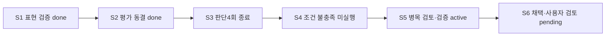

# Current Plan

## Active Lane

Lane: `BI-search-revision` — active, 2026-11-05 사용자 goal 승인.
기준 main `dd6559f`(PR156 병합), 브랜치 `codex/pok-search-revision`.
이 작업 트리는 `.local/pok-search-revision`이며 원래 폴더 WIP는 보존한다.
[실행 계획](POK_SEARCH_REVISION_PLAN.md), [검토 근거](POK_GENERATION_SEARCH_REVIEW_FINDINGS.md).
기존 기록은 [원문 보존](POK_SEARCH_PREVIOUS_PLAN.md)으로 이동했다.

## Status Graph

## Baseline Structure

| 단계 | 상태 | 종료 기준 |
|---|---|---|
| S1 | done | 기존 필드로 가정·근거·선택·재검토를 표현하고 연결/누락을 검증 |
| S2 | done | 새 과제·입력·대조 정책·판정·예산 고정 |
| S3 | done: 3 timeouts / 1 submission | 동일 조건 판단4회, 각45분 이내, 실제 PoB 평가 |
| S4 | not run: condition unmet | S3 성과가 조건을 충족하면 추가4회 이하 |
| S5 | active | 확인된 부족만 수정·해당 검증 |
| S6 | pending | 사용자 실물 검토와 채택/보류 판단, PR 준비 |

## Canonical Next Step

**최종 제출물의 선택/근거와 실패 경로를 검토하고, 검증된 수정·보류할 정책 및 시험 준비 교정을 정리한다. 원래 시험은 재실행하지 않는다.**

## Deferred Candidates

pok-ui 개발, 승인 밖 모델 시험, 새 솔버/대형 스키마는 범위 밖이다.

## Verification

최신 코드의 기존 단위4개(공급자 변경·condition scope·evidence scope·질문 재개방)가 통과했다.
pytest 캐시 생성 권한 경고가 있었으나 검사 실패는 없었다. 이 검사는 실제 모델의 판단 개선 증명이 아니다.
신규 모델 실행 0/8. 판단4회 승인, 추가 발견4회는 조건부이며 총6시간 한도를 유지한다.
PR 병합은 사용자만 수행한다. governance npm 명령은 package.json이 없어 실행 불가하며
진행 문서의 필드와 그래프를 직접 확인한다. 제품 코드는 아직 변경하지 않았다.

S1 합성3경로 결과는 [보고서](POK_SEARCH_S1_RESULTS.md)에 있다. 연결된 근거 변경은 의존 선택으로 전파됐고 질문만 닫는 경우는 전파되지 않았다. 새 스키마/솔버 추가 없이 S2로 진행한다. [평가 정책 초안](POK_SEARCH_EVAL_POLICY.md)은 아직 동결 전이다.

S2 환경 확인: 최신 코드의 별도 MCP loaded/source dd6559f와 source root를 저장 결과
회수로 확인했다. 기존 기본 MCP9f016e3은 평가에 사용하지 않는다. PoB 핀/LuaJIT/CLI
실행 파일을 확인했고, [S2 사전 점검](POK_SEARCH_S2_PREFLIGHT.md)에 오류·미완료를
구분했다. 신규 후보 T1 소환수 자원 배분, T2 충전 소비 공격은 아직 확정 전이다.
다음은 후보별 측정 경로와 같은 재료 팩을 검증한 뒤 평가를 동결하는 것이다. 모델0/8.

S2 사전 native 계산에서 #219를 재현했다. 소환수 점유39는 반환되지만 플레이어
CombinedDPS0만 노출되고 실제 PoB의 Minion.CombinedDPS63.537773978654는 누락된다.
동일 입력의 직접 native 진단으로 확인했으며 모델 시험 전에 별도 출력 계약을 보완한다.
이 결함은 generic actor 출력 경로이며 참고 빌드 맞춤 해결책으로 처리하지 않는다.
Falling Thunder 최소 입력은 무기가 없어 피해 평가 불가였으므로 올바른 무기 입력과
명시 모드로 확인해야 한다. 모델 실행0/8, S2 진행 중.

#219 보완 구현: player 수치 보존, Minion.* 별도 출력, native 소환수 선택 문맥,
기본 MCP 지표와 캐시 protocol7, POWER 명시 미지원 안내를 추가했다. 관련 단위8개와
native1개가 통과했다. native는 driver/daemon 수치 동일 및 소환수 없는 입력으로 전환
후 잔여값 없음까지 확인했다. 초기 native 실패는 마지막 fixture의 ascendancy 누락이며
수정 후 동일 검사가 통과했다. Ruff도 통과했다. 공개 MCP 기본 반환 확인을 마친 뒤
과제 재료/무기·효과 입력 검증과 동결을 계속한다. 모델0/8이며 품질 개선 인증은 아니다.

S2 입력 팩 준비 완료(아직 소스/실행기 동결 전): T1 Infernalist 소환수 자원 배분,
T2 Invoker 충전 소비 공격. 판단4회 순서는 T1-B/T2-P/T1-P/T2-B, 같은 코어와
재료·gpt-6-astra/ultra·2700초 상한을 사용한다. 실제 모델 실행은0회다.
[평가 명세](POK_SEARCH_EVALUATION_SPEC.md)에 사전 판정과 추가 발견 시험 조건을 적었다.
자료/프롬프트/최종 출력 계약은 artifacts/reviews/search-revision-inputs에 준비하고 SHA를
기록했다. 동일 과제의 두 프롬프트는 공통 부분이 정확히 같고 제안 안내만 추가됐다.
최종 계약의 format 누락은 실행기 사전 검증에서 발견해 수정·재검증했다.
#219 공개 MCP 기본 반환은 Minion.CombinedDPS63.53777398과 FireBombSkeletonMinion
선택 문맥을 포함함을 확인했다. 정상 육척봉 장착 입력은 피해99.593213을 반환했으나
이는 초기 Monk1(Martial Artist) 입력의 경로 진단이다. 평가 Invoker ID는 KB상Monk2로
확인했고 그 구분을 유지한다. 평가 대상의 성능이나 가동률로 이 숫자를 사용하지 않는다.
다음은 소스·바이너리·snapshot 해시와 실행 명령 검증 후 판단4회 시작이다.

S2 동결 완료 및 S3 시작 — 2026-11-05. 소스/PoB2859파일·입력·바이너리·런타임
패키지/실행 명령을 artifacts/reviews/search-revision-frozen.json에 고정했다.
manifest SHA256: cb40f10c19d24e7477ba97745fbe9e5eaad7a18692991827426b829edafbf864.
실행기: artifacts/reviews/run_search_judgment.py run (동일 manifest로 기존
product_campaign 경로 재사용). 캠페인: artifacts/reviews/search-judgment-campaign-v1.
실행 tool session83825, 첫 시험01-T1-B-B-1의 process PID18288, 명시 deadline은
phase-1/process.json에 있다. 새 thread/turn 시작과 실제 MCP 호출을 확인했다.
첫 시험 시작1/4, 완료0/4. 조건부 발견 시험은0/4이며 자동으로 시작하지 않는다.
Under-development code_mode 경고와 일부 결과 조회 실패는 원래 이벤트에 보존한다.
참가자의 복구에 개입하지 않는다. 운영자는 통계·상태만 확인하고 평가 기준을 변경하지 않는다.

S3 첫 시험 종료 — T1 기존군01-T1-B-B-1은2694.984초 후 timed_out, 유효 최종
응답 없음(answer_valid=false/turn_completed=false), Windows job 정리 confirmed.
종료 후 소스2859파일 검증 verified. 중간 빌드를 최종으로 대체하거나 품질0점으로
처리하지 않는다. 고정 순서의 두 번째02-T2-P-P-1은 같은 캠페인에서 실행 중이다.
첫 시험의 원본 감사/실행/프롬프트/이벤트 SHA와 호출 요약은
artifacts/reviews/search-judgment-T1-B-outcome.json에 보존했다.
get_tool_result653회 중613회가 /result 전체 경로였고, 초기 limit범위 위반과
build_spec 형식 오류도 기록됐다. 회수 부담의 관측이며 이것만으로 시간 초과 원인을
확정하지 않는다. 참가자나 평가 조건을 수정하지 않는다. 시작2/4, 종료1/4, 최종 제출0.

종료된 T1-B 읽기 전용 회수 감사: evaluate_delta4결과를 /result 전체 JSON으로
80+68+62+33=243회에 걸쳐 회수했다. JSON mode의 limit100은100자 페이지를 뜻하지
않으며 실제 chunk는 byte budget에 따른다. 반복 동일 offset이 아니라 각 결과의
연속 페이지를 읽었다. 전체52개 결과를 건너뛰라고 임의 처방하지 않고, 필요한
근거 선택/응답 구조의 부담 가설로 남긴다. 파일 search-judgment-T1-B-retrieval-audit.json은
실제52개 result ID와 원본 SHA를 보존한다. 소요 벽시계/단독 인과는 아직 미확정이다.

S3 두 번째 시험 종료 — T2 제안군02-T2-P-P-1은2695.0초 후 timed_out,
answer_valid=false/turn_completed=false, 프로세스 정리 confirmed. 종료 후 및 다음
시험 전2859파일 검증 verified. 세 번째03-T1-P-P-1이 동일 조건으로 시작했다.
종료2/4, 유효 최종 제출0, 재시도/개입0. 첫 두 건은 서로 다른 과제/정책이므로
이들끼리 품질 우열을 판정하지 않는다. 원본 SHA와 호출 요약은
artifacts/reviews/search-judgment-T2-P-outcome.json에 보존했다.

시험 준비 한계 확인: 첫 두 시험의 실제 prompt.txt에는45분/2700초 한도를 명시한
문구가 없었다. 실행기는2699.906초 예산을 적용했다. 운영자가 입력 준비에서 시간
한도 전달을 누락한 것이며 모델의 기한 인지를 전제로 시간 초과 원인을 해석하지 않는다.
두 정책에 공통인 조건이지만 종료율/설계 능력의 인과 해석에 한계가 있다. 원문 SHA와
대조는 artifacts/reviews/search-judgment-budget-communication-audit.json에 보존했다.
진행 중 시험의 입력을 뒤늦게 수정하지 않는다. 이후 평가 설계 교정과 추가 시험 필요성은
현 결과와 분리하며 승인 밖 재시도를 하지 않는다.

S3 세 번째 시험 종료 — T1 제안군03-T1-P-P-1은2694.984초 후 timed_out,
answer_valid=false/turn_completed=false, 프로세스 정리 confirmed. 소스2859파일
검증 verified. 마지막04-T2-B-B-1이 고정 순서로 실행 중이다. 종료3/4, 유효 최종
제출0, 재시도0. 원본 SHA/호출 요약은 search-judgment-T1-P-outcome.json에 보존.
prepare_pob_delivery3회가 있어도 유효 최종 제출을 대체하지 않는다. 파생 파일은
중간/미제출 기록으로 보존하고 공식 비교의 최종안으로 승격하지 않는다.

S4 조건부 발견 시험은 실행하지 않음: 사전 고정한 발동 기준은 제안군이 두 과제에서
실제 최종물을 제출하고 핵심 판단 가능성을 보이는 것이며, T1-P 최종 미제출로
조건이 불충족이다. 승인된 마지막 판단 시험을 마친 뒤 결과·준비 한계·병목을 정리한다.

T1 두 군의 종료 기록을 대조했다. 기존군은927호출 중 get_tool_result653회,
제안군은1156호출 중938회였다. 이는 품질 점수가 아니며 벽시계 인과를 뜻하지 않는다.
제안군의 evaluate_delta 한 결과는1,536,680바이트, 그중 variant_reviews1,157,638바이트.
comparison1369바이트/deltas4022바이트의 선택 참조가 실제 안내에 있었지만 /result
전체를441회 회수했다. 기존 read_page로 두 경로를 그대로 재생하면 각각1/2페이지였다.
이3페이지가 최종 판단의 모든 근거를 대체한다는 뜻은 아니다. 관련 후보 진단과 선택
근거가 추가로 필요할 수 있다. 선택 조회 경로 부재 가설은 이 사례에서 지지되지 않는다.
결과는 search-judgment-retrieval-comparison.json, search-judgment-T1-P-large-comparison.json,
search-judgment-selective-read-replay.json에 저장했다. 진행 중 마지막 시험은 변경하지 않았다.

S3 전체 종료 — 캠페인 session83825 exit0/collected4 확인. 마지막 T2-B만2014.266초에
completed, answer_valid/turn_completed=true, 정리confirmed. 전후 소스2859파일 검증
전부verified. 나머지3건 timed_out/최종 미제출. 최종 inventory 진단0, 유효 제출1.
유일한 최종 PoB/XML/설계를 search-judgment-user-review에 바이트 그대로 복사하고
해시 검증했다. 공개 사용자 검토 질문을 보냈으며 답변은 아직 기다리는 중이다.

독립 원본 XML 재계산: 일반123/전직8, Life2636, ES2729, 모든 저항75,
SpiritUnreserved30, StormWave CombinedDPS66919.91122. 파일
search-judgment-T2-B-native-final.json에 원문 SHA/전체 stats/meta를 보존했다.
검사자의 최초 read_text 개행 정규화 때문에 코드/XML 동등성 assert가 실패했으나,
원본 bytes를 decode해 비교하면 정확히 일치했다. 원본을 수정한 것이 아니며 빌드 결함으로
세지 않는다. 결과 목록 검사는 시스템 Python의 jsonschema 부재로 한 번 실패했으며
프로젝트 venv에서 완료됐다. 모두 모델 시험 외 운영자 검사 오류로 구분한다.

추가 모델 호출 없음. S4 미실행 유지. 최종 실물의 가격·게임 유지율·품질 개선은
미입증이며, 사용자 피드백/실패 분석/PR 준비·필수 검증은 남아 있다.

S5/S6 기술 보고서 초안: [판단 평가 결과](POK_SEARCH_JUDGMENT_RESULTS.md)에
4회 종료, 준비 누락, 유일한 최종물의 잠정 기술 판단, 채택/보류 방향을 정리했다.
PR 전 필수 통합검사는 session53611로 진행 중이다. 새로운 모델 호출은 없다.
캠페인 실제 소스963파일(외부 PoB 제외)을 원래 해시와 전수 대조한 ZIP으로 보존했다.
source archive SHA256 d6047e56cf11a5815b8b1d2a2e0cdc89a4737cac8cfad147951c9f05cf296f59.
원문 PoB snapshot은 기존 전체해시/pin을 유지한다. 사용자 실물 피드백은 대기 중이다.

S5 #220 교정: run_trial의 실제 remaining 값을 trial_prompt에 함께 전달한다.
기존 모의 실행 검사가 두 단계 모두 안내 값과 timeout_s 일치를 확인하며18단위가
통과했다. 이 변경은 완료된 캠페인 이후이며 원래4회 프롬프트를 바꾸지 않는다.
진행 중 통합 검사는 이 실행기/단위 파일을 import하지 않고 native 해시 대상도 아니므로
PoB 소스는 검증 중 불변이다. 기존 캠페인 소스는 사전에 ZIP/해시로 보존했다.
전체 CI 경로 Ruff check/format476파일 통과. 변경 Python 및 실행기 Mypy는
session23297로 진행 중이며 통합53611은 계속 실행 중이다. BLUEPRINT/ROADMAP에
미입증/보류·교정 범위와 후속 단계 결과를 반영했다. 사용자 피드백은 아직 대기 중이다.

PR 준비: 최신 origin/main은 여전히dd6559f이며 추가 통합할 변경이 없다.
artifacts/reviews/search-revision-pr-body.md에 실제 수정과 미입증/보류를 구분한
PR 본문을 준비했다. 원격 push/PR 생성은 아직 하지 않았다. diff --check 통과.
결과 보고서에 입력 계약/구체화 오류와 트리·룬 제한 시간의 관측을 추가했다.
진행 중 통합53611은43% 이후 계속 통과 출력이 있으며 최종 완료는 아직 미확인이다.
사용자 실물 피드백은 대기 중이고, 확인 전 goal을 완료로 표시하지 않는다.

PR 사전 의존 검사: import-linter181파일/547의존 분석,1계약 kept/0broken.
이전 Current Plan 보존본은 HEAD의 원문과 checkout 개행 형식을 제외하고 정확히 같음을
확인했다. 통합53611은 동일 핸들로 계속 실행 중이며 아직 전체 통과로 보고하지 않는다.

PR 전 통합 session53611 exit0: JUnit167tests/0failures/0errors/0skipped,963.286초.
#219는 해결 표로 이동했다. 관련 최소 단위 및 전체 native 검증을 완료했으며 이를
새 생성 정책의 품질 개선으로 해석하지 않는다. 현재 변경을 draft PR로 준비한다.
사용자 실물 피드백과 원격 CI 확인은 남아 있어 goal은 active로 유지한다.
