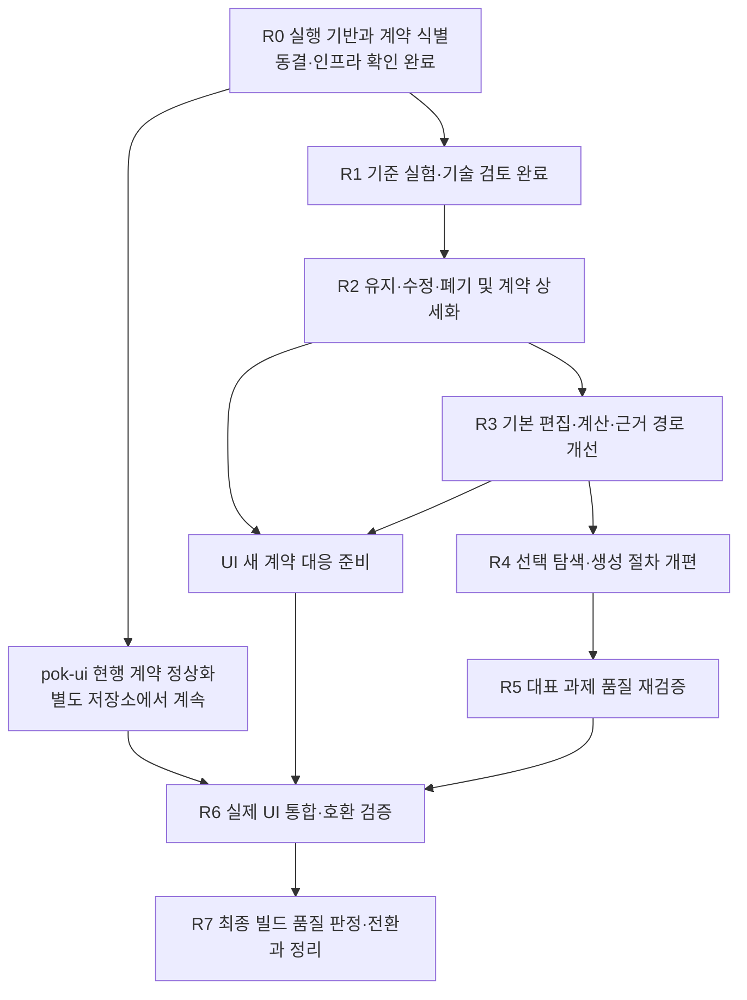

# PoK 개선 로드맵 — 원인 검증에서 제품 전환까지

개정: 2026-10-30. 사용자 승인 방향: 청사진과 개선 로드맵 전면 개정.
정책: [BLUEPRINT](BLUEPRINT.md). 현재 실행 권한·상태: [Current Plan](CURRENT-PLAN.md).
실험 설계: [원인 분리 검증](POK_REDESIGN_VALIDATION.md).
이 문서는 의존 관계·개선 범위·완료 기준을 정의한다. 단계별 착수는 Current Plan에 반영한다.
새 버전명·일정·품질 개선 효과를 미리 확정하지 않는다.

## 1. 현재 위치와 최종 목표

기준 엔진은 #149 병합 `e7bd429`다. 청사진·실험 계획·UI 경계의 초기 감사는 작성됐지만,
R0 실행 기반과 R1 첫 과제8회·추가 본 비교16회·앵커4회의 기준 실험/초기 기술 검토를 마쳤다.
[R1 결론](POK_REDESIGN_R1_FINDINGS.md)에 따라 R2 계약 상세화에 착수했다(현재 상태는 Current Plan).
사용자 선호·실전 효과·개선판 품질 검증은 남아 있고 #188은 계속 미해결이다.
기존 C에 사후 수정을 소급하지 않는다. 과거 기능 완료를 현재 생성 품질의 증거로 사용하지 않는다.

목표는 에이전트가 메커니즘·장비·패시브·젬·유틸을 함께 설계하고,
PoK가 적은 비용으로 가설을 시험하게 하며, pok-ui에서 같은 근거를 검토·적용할 수 있는 상태다.
성공은 사용자 목적에 맞는 빌드 실물, 재현 가능한 계산, 조건/미측정의 정직한 표시로 판정한다.
규칙 수·도구 수·완료 도장·테스트 개수·단일 DPS 상승으로 대신하지 않는다.

## 2. 단계와 의존 관계

품질 개선과 생성 과정의 일관성은 같은 설계 리비전과 근거를 통해 연결한다.
앵커 기반 설계 기록은 채택한 방향이지만 특정 스키마/도구와 효과는 미확정이다.
원인 분리 실험을 새 기록 방식으로 대체하지 않고 다음 순서로 검증·구현한다.

| 단계 | 앵커 기반 설계와 연결할 작업 |
| --- | --- |
| R0 | 현행 design.md·build_spec·근거 저장·UI 소비의 식별 및 원본 보존 |
| R1 | F/O/P/R 기준 비교를 유지하고 앵커 기록의 별도 소규모 후속 시험 |
| R2 | 조건/공급자 분리, 설계 정본·구성·측정·표현의 소유/리비전·이행 계약 |
| R3 | 설계 기록 갱신·일관된 문서 생성·계산 근거 연결·변경 영향 검사 |
| R4 | 누락/미해결 질문을 AI가 처리하는 지침과 대체 근거를 허용하는 추천 판정 |
| R5 | 빌드 품질·사용자 진행 지시·누락·문서 일관성과 관리 비용을 함께 평가 |
| R6 | 동일 기록으로 앵커/후보/검증/재검토 대상을 UI에 표시 |
| R7 | 실제 생성물의 최종 품질을 판정하고 기존 문서/PoB 보존·공유 계약을 검증한 뒤 전환 |

| 단계 | 현재 상태 | 주요 산출물 | 통과 기준 |
| --- | --- | --- | --- |
| R0 실행 기반 | 완료(자료 범위 한계 공개) | 버전/스키마/브리프/도구군 manifest·최소 왕복 | 실제 로드 버전·격리·입출력·모델 확인 |
| R1 원인 분리 | 기준 실험·초기 기술 검토 완료(한계 공개·효과 미입증) | [가설/우선순위](POK_REDESIGN_R1_FINDINGS.md)·원본·실물/비용/실패 원장 | 원인별 지지/반증/미결과 개선 우선순위 |
| R2 계약 설계 | 계약/실패 fixture·소비자/구버전 매핑 확정. 구현 완료와 구분 | [식별/근거/이행 계약](POK_REDESIGN_CONTRACTS.md)·기준판 보존·R5 입력 동결 | 변경마다 관측 근거·시험·소비자 영향 명시 |
| R3 기본 경로 | 범위별 구현·전량 검증 완료. 단위2509통과/기존 fixture2skip·실제 PoB 통합149통과. 런타임 한계는 R3 감사에 공개 | 독립 편집/계산/진단·작은 반환·격리/복구 | 상위 생성 절차 없이 실제 변경/계산/복구 |
| R4 탐색/절차 | 명시 계산/조립·저장 비교·설계 참조·자율 스킬·공동 재투자 구현. 일반 생성 행동은 R5에서 검증 중 | 선택 탐색·묶음 재설계·개정 스킬/판정 | 초기 선택 재개방과 유효한 대체 근거 허용 |
| R5 품질 | 초기 동결8회와 후속 최종12회 수집/초기 검토 완료. 사용자 품질 미충족 판정. #213 결과 개요와 #215/#216/#218 기반 수정의 효과는 구분 | 실물/실패 원장·참고 사례와 생성/탐색 검토 | 새 사례에서 실제 제안·선택 품질을 검증하며 해답 재현과 분리 |
| R6 UI 통합 | 독립 worker A안 승인·코어 PR #153 병합. UI는 별도 세션 담당이며 여기서는 상세 구현 보류. 전체 UI/모델/배포 검증은 미완료 | 실제 앱/모델/런타임 호환 시험 | XML·리비전·제안·진단·복구 실제 검증 |
| R7 최종 판정/전환 | 참고 실물 복원·고유 구성 준비 검증. 과적합 위험에 따라 생성/탐색 접근 검토를 우선하며 기본 전환/배포·폐기는 미완료 | 실제 PoB·품질/실패 원장·검토안·전환/복귀 기록 | 사용자 요구의 빌드 품질을 판정하고 계산/재현과 구분 |

R3/R4는 구현 승인이 아니라 원인에 따른 개선 대상이다. R1에서 근거가 약하면
범위를 줄이거나 추가 실험한다. 긴급한 데이터 손상·계산 오염은 재현 후 독립 수정할 수 있으나
실험 도중 버전을 섞지 않는다. UI 현행 계약 정상화는 R1 종료를 기다릴 필요가 없다.

## 3. R0 — 믿을 수 있는 비교 기반

작업:

- 실제 MCP 실행 파일/작업폴더/커밋·KB·PoB·서버 노출 스키마를 식별한다.
  세션에 도구 48개가 보이는 것만으로 #149 로드를 인증하지 않는다.
- 응답하지 않은 `server_info`를 재현하고 시작/연결/응답 문제를 구분한다.
  관측 없이 #189의 과거 timeout과 같은 원인으로 묶지 않는다.
- 과제 브리프를 해시 고정하고 군별 도구 callable을 실제 등록부로 확정한다. 원문은 다른 PC에 있어 현재 제공 불가라는 사용자 확인에 따라 [새 브리프](POK_REDESIGN_BRIEF.md)를 사용하며 과거 실행의 동일 재현으로 세지 않는다.
- 독립 세션·프로젝트 지침 상속·스킬 자동 주입·하위 작업·공유 데몬 상태를 점검한다.
- 동일 공개/합성 입력으로 복원→계산→명시적 변경→재계산→원본 복구를 확인한다.
- gpt-6-astra/ultra의 실행 가능성과 사용량 수집 범위를 확인한다.
- pok-ui의 현재 HEAD·사용 도구·입출력·번들/개발 런타임 식별 방식을 기록한다.

산출물은 기존 artifacts 영역에 원본과 해시를 보존한다. 실행 버전 불명·새 브리프 미동결·
군별 지침 누출이 있으면 품질 실험을 시작하지 않는다. 누락을 기본값으로 덮지 않는다.

## 4. R1 — 품질 저하 원인 분리

[실험 계획 §3~5](POK_REDESIGN_VALIDATION.md#3-실험-설계)를 따른다.
F는 기본 조회/편집/계산, O는 F+선택 최적화, P는 O+현행 절차/관문,
R은 공통 원자료/기본 PoB 경로의 참고군이다.
첫 과제는 기존 이동 맵핑 과제로 각 군 2회, 같은 모델/추론·90분 상한을 사용한다.
서로의 답안·중간 평가를 공유하지 않으며 반복별 순서·부하를 통제한다.

구체적으로 볼 것:

- 핵심 장비 변경 뒤 마나/저항/속성 여유를 노드·보조·접사에 재투자했는가.
- 최적화 결과를 받은 뒤 기존 선택을 다시 열었는가, 제한된 탐색을 완료로 오인했는가.
- 실제 측정 입력과 최종 XML이 연결되는가, 계산/조회/복구/증빙 비용은 얼마인가.
- 이동·회복·조건 유지·보스 지속성과 메커니즘이 사용자 과제에 맞는가.

미제출·timeout·not_ready도 원본 결과로 평가한다. 합법성/측정 신뢰성과 설계 품질을 분리한다.
최종 산출물을 군 이름 없이 비교하고 축별 평가와 사용자 순위, 기각 근거를 보존한다.
2회 반복은 통계적 확증이 아니다. 차이가 뒤집히거나 도구 미사용/누출이 있으면 추가 검증한다.

완료물: 가설별 관측·반증·혼란 변수·우선순위, 과제별 오류 원장,
유지/수정/폐기 후보와 예상 효과. 원인 하나를 확정하는 것을 완료의 필수 조건으로 삼지 않는다.
판단 불가한 결과라면 그에 맞춰 후속 실험을 정하고 전면 교체를 보류한다.

별도 후속 시험: 앵커 설정→초안→핵심 장비 변경→재검토 대상 도출→문서 갱신을
기존 기능과 가벼운 기록 양식으로 먼저 수행한다. 새 대형 관리 도구를 먼저 만들지 않는다.
사용자가 결정한 취향/관측과 AI 누락을 보완한 진행 지시를 분리해서 기록한다.
사용자 고정/필수 조건/잠정 구현/성능 후보의 구별, 오래된 근거와 변경 영향 발견,
관리 비용을 관측한다. 새 방식과 기존 방식은 같은 변경 과제로 비교하고 결과를 F/O/P/R에 합산하지 않는다.
이 시험만으로 일반 생성 품질 효과를 확정하지 않으며, R5에서 새로운 빌드 과제로 검증한다.

## 5. R2 — 계약과 책임 재설계

현행 기능을 다음 역할로 분류하되 폴더나 별도 서비스로 즉시 분리하지 않는다:
지식/관계 조회, 입력/문서, 명시적 변경, 계산/비교, 선택 탐색, 사실 검증, 추천 설명/기록.

각 변경 제안에는 문제 사례, R1 근거, 현재 입출력, 목표 의미, 미지원 범위,
변경 전후 fixture, UI 소비자, 구버전 대응, 복귀 방법을 함께 적는다.
실제 모듈 경계·저장 위치·의존 방향 변경이 필요하면 구조 문서 개정과 사용자 합의를 선행한다.

중점 계약:

- 기본 계산 가능성과 최종 추천 근거 충족을 분리한다.
- `ready` 하나에 입력 무결성·성립성·측정 범위·탐색·선택 품질을 합치지 않는다.
  현행 필드의 뜻과 새 진단의 대응을 정의한 후 이행한다.
- 도구 호출 이력보다 실제 입력에 결박된 근거를 요구한다.
  다른 유효한 검증 경로를 허용하고 근거를 재계산 없이 위조할 수 없게 한다.
- 결과 크기·탐색 범위·시간 제한·취소·실패·부분 결과·원본 복구의 의미를 정의한다.
- capability/schema와 지원 엔진/PoB 조합을 소비자가 판별할 계약을 정한다.

출구는 확정된 계약/시험 명세와 작은 구현 묶음의 순서다.
새 거대 통합 도구나 전면 재작성 자체를 목표로 삼지 않는다.

설계 기록 계약도 여기서 확정한다: 기존 BUILD_DESIGN/design.md 파서·build_spec·증빙의
필드별 소유와 중복, 앵커의 유형/의존/대체/근거/비용/재검토 관계,
미해결 질문의 판정 조건, 설계/구성/측정 리비전 연결을 명시한다.
구조화 정본에서 design.md를 생성하는 경로와 기존 문서 가져오기/손실 진단을 설계한다.
모호한 옛 기록을 임의의 확정 앵커로 변환하지 않는다. 새 저장 위치/모듈 경계가 필요하면 합의한다.

## 6. R3 — 가설을 싸게 시험하는 기본 경로

우선순위는 R1/R2에서 결정하며 다음 후보를 다룬다.

| 개선 묶음 | 구체적 동작 | 검증 예 |
| --- | --- | --- |
| 문서/의미 편집 | 원본에서 변경 대상만 지정, 전체 구성 묶음 반환, 차이/손실 명시 | 장비+노드+젬 변경 후 원본·미지/비활성 세트 보존 |
| 독립 계산 | 생성 스킬/추천 도장 없이 명시적 입력 계산 | 불완전 탐색안 계산과 추천 근거 부족이 구분됨 |
| 결과/근거 전달 | 요약·실패·한계 우선, 상세는 해시/참조로 회수 | 큰 후보 결과의 후속 재사용·누락 감지 |
| 격리/수명 | 요청 소유·취소·기한·재시작/복구, 캐시 완성 게시 | 서로 다른 빌드 교차 요청, 취소 후 상태/원본 불변 |
| 진단 | 성립 불가·정보 부족·미모델링·미측정 구분 | 알려진 실패와 UNKNOWN의 오통과/거짓 차단 구분 |

#149의 구현을 먼저 재사용·실측한다. 같은 기능을 새 이름으로 복제하지 않는다.

설계 기록 갱신·검사·문서 렌더 기능은 R2 계약에 따라 기존 경계에서 구현한다.
최소 회귀는 앵커 대체 후 의존 결정 재검토, 최종 구성과 근거 리비전 연결,
같은 기록의 안정적인 문서 출력, 기존 문서 가져오기와 미지 정보 보존이다.
누락 검사는 감지 가능한 필드/관계만 신고하며 다음 해법을 엔진이 결정하지 않는다.
#189 자동 기한/재시작 등 잔여 문제는 실패 재현과 소비자 계약을 갖춰 이 단계에 배치한다.
지표는 가설 하나를 시험하는 시간/입력량/반환량/복구 비용과 정확성이다.
절대 성능 목표는 R0/R1의 같은 환경 기준값을 얻은 뒤 구현 전에 고정한다.

## 7. R4 — 선택 탐색과 생성 절차 개편

- `optimize_tree/items/rare` 등의 실제 탐색 범위·고정 기반·미지원 조건을 감사한다.
  기존 좋은 기능은 유지하고 전체 최적성으로 읽히는 계약을 고친다.
- 기존 노드 유지 성장과 제거/재성장/완성 묶음 비교를 구별한다.
  핵심 장비 변화가 다른 부위의 선택을 다시 여는 경로를 제공한다.
- 중간 단계에서 약해지는 조합도 구성 묶음으로 실측할 수 있게 한다.
  유한 탐색은 한계와 비용을 반환하며 엔진이 일반 빌드 설계 판단을 대신하지 않는다.
- 생성/조립 스킬과 훅의 필수 호출·3티어·문서화·증빙 요구를 전수 대조한다.
  사실 확인 의무는 유지하고 해법 탐색 순서의 불필요한 강제를 제거한다.
- 미리 정한 도구 호출 여부 대신 최종 주장에 필요한 실제 근거와 문맥을 검증한다.
  누락을 허용하는 우회가 되지 않도록 거짓 완료와 유효한 대체 경로를 함께 회귀 시험한다.
- AI는 사용자에게 매 단계 지시를 요구하지 않고 미해결 질문·변경 영향을 읽어 진행한다.
  대화/자동 모드에서 같은 기록을 쓰고 취향 선택·고정 조건 변경·인게임 시험만 필요한 때 사용자에게 요청한다.
  공격→방어를 불변 순서로 강제하지 않으며 조기 계산과 핵심 선택 재개방을 허용한다.

출구: 마나 해결 장비를 바꾼 뒤 비용 보조/접사/노드 공동 재투자,
저항 공급 변경 뒤 다른 부위 재배분, 핵심 메커니즘 변경 뒤 완성 트리 교체를
실제 입력/출력과 대안 기각 사유로 확인한다. 고정 예제를 통과한 것과 일반 품질 개선은 구분한다.

## 8. R5 — 대표 과제에서 품질 확인

R1 과제로 원인 수정 효과를 확인하고, 튜닝에 쓰지 않은 두 과제를 추가한다:
다부위 재배분이 중요한 과제, 상태 전이/조건 유지가 중요한 과제.
원본 브리프·평가 기준·반복/예산·교체 기준을 결과 열람 전에 동결한다.
동일 모델·원자료·PoB에서 기준판과 개선판을 비교하며 최종 제출물과 부분 결과를 모두 남긴다.

채택 판단에는 메커니즘·장비·패시브·젬/유틸·공동 재설계·과제 적합성 평가,
치명적 오류, 완주율과 비용, 동일 config 계산/왕복을 함께 사용한다.
사용자의 필수 선호 선택과 불필요한 진행 지시를 구분하고, 누락 보완 횟수·미해결 질문 방치,
문서/실제 구성 불일치·오래된 근거 인용·기록 비용을 추가 평가한다.
지시 횟수가 줄어도 잘못된 자동 확정이 늘면 개선으로 판정하지 않는다.
개선된 축과 악화된 축을 공개하고 사용자 평가로 선택한다.
미측정 게임 동작·실전 체감은 계산 수치로 대체하지 않는다.
차이가 없거나 과제별 회귀가 있으면 영향 묶음을 되돌리거나 추가 분리한다.
테스트 통과만으로 #188을 닫거나 새 경로를 기본으로 올리지 않는다.

## 9. R6 — pok-ui 실제 통합

2026-11-02 A안 승인: PoB 코어는 기존 `src/pok/pob`가 소유하고 UI는 독립 worker를
번들한다. PoK/KB/AI는 수동 작업의 선택 연결이며 새 공용 패키지를 분리하지 않는다.
명시적 자산 경로·실제 runtime/catalog 출처·소유 실행 수명을 먼저 연결하고, PoK 없는
수동 동선과 선택 PoK의 일치/불일치·모델 제안 흐름을 각각 검증한다.

[UI 인계 지침](POK_UI_REDESIGN_HANDOFF.md)을 별도 저장소의 구현 기준과 대조한다.
초기 관측 HEAD는 `d3817f6`이며 다른 세션의 후속 변경은 착수 시 재확인한다.
현재 현행 계약 정상화는 진행 가능하다. 이후 새 계약 대응은 R2/R3 결과를 소비한다.

| 항목 | PoK | pok-ui |
| --- | --- | --- |
| PoB 입출력 | 복원·편집·계산·손실/미지원 진단 | 가져오기/저장·활성 선택·원본 보존 |
| 변경/계산 | 입력 식별·버전·실제 근거/오류 | buildId/baseRevision 결박·이전 결과 구분 |
| AI 제안 | 비교 가능한 변경안과 근거 | 검토·적용·undo, 자동 적용 금지 |
| 실행/배포 | 상태·취소/기한·호환 계약 | 진행/오류·재연결·개발/번들 런타임 식별 |

기존 UI의 XML 편집/정적 트리 표시는 유지하고 게임 규칙·별도 PoB 계산기를 추가하지 않는다.
설계 기록의 목표·앵커·잠정 선택·미검증·재검토 대상을 같은 리비전으로 표시한다.
편집 제안이 설계와 PoB 양쪽에 영향을 주면 적용 단위를 계약으로 정하고 부분 적용 불일치를 막는다.
UI에 별도 앵커 상태 기계나 게임 판단을 복제하지 않는다.
엔진의 추가형 변경부터 소비하고 필수 변경은 호환 범위/폐기 예고와 fixture를 먼저 제공한다.
새 API가 배포됐다고 가정하지 않는다. UI 작업 결과를 이 저장소에서 완료 처리하지 않는다.

필수 실제 흐름: 가져오기→세트 선택→계산, 계산 중 편집과 늦은 응답,
실제 모델 제안→검토→적용→undo, 취소/기한/재연결,
미지원/손실 진단, 구버전 엔진 거부/대응, 원본·미지 필드·비활성 세트 왕복.
합성 어댑터·headless·실제 모델·GUI·번들 런타임의 검증 범위를 각각 표시한다.
공개 fixture에는 개인 XML/대화를 넣지 않는다.

## 10. R7 — 최종 빌드 품질 판정·기본 전환과 정리

- [최종 품질 비교](POK_FINAL_BUILD_QUALITY_PROTOCOL.md)로 실제 생성물·선택 근거·대가를 판정한다. 코드/CI·문서/ready·UI 설치는 빌드 품질을 대신하지 않는다.
- R5의 중간/기존 결과를 변경 후 품질 효과로 소급하지 않는다. 최신판이 회귀하면 #188을 닫거나 기본 전환을 완료하지 않는다.
- 실행 소스/상주 프로세스 정렬은 지원 작업이다. 격리 실행기로 대상 코드를 고정할 수 있으므로 전역 설정 변경을 품질 시험의 선행조건으로 삼지 않는다.
- 검증된 엔진/PoB/스키마/UI 조합을 고정하고 개발판과 배포판 로드를 확인한다.
- README·Codex/Claude 스킬·도구 설명·UI 설정/진단을 같은 계약으로 정렬한다.
- 원본 XML·설계 문서·기존 산출물을 보존하는 이행/복귀를 실제 시험한다.
- 기존 경로 폐기는 대체 경로와 소비자 전환이 검증된 뒤 수행한다.
  미지원 항목은 지원 범위로 명시하며 잠재 실패를 완료로 숨기지 않는다.
- 단위 검사와 PR 직전 통합을 수행한다. 사용자 병합 후 로컬 동기화 및 실제 프로세스 재시작을 확인한다.
- 완료 범위와 남은 문제를 기록하고 #188의 종료 여부를 실물 품질 근거로 별도 판단한다.

## 11. 백로그와 기존 성과의 처리

[BACKLOG](BACKLOG.md)는 결함/제안의 정본이며 이 문서가 개별 상태를 덮어쓰지 않는다.
#188은 R1~R5, #189 잔여 수명/기한 문제는 R0 조사와 R3 구현,
#199/#200의 기존 수정은 회귀 기반으로 연결한다.
#197/#198 등의 별도 문제는 새 실험 영향 여부를 먼저 분류하고 원인으로 미리 섞지 않는다.
동일 기능·규칙을 추가하기 전에 기존 구현과 실패 원장을 확인한다.

기존 P0~P6·M1~M6·P4.5 잔여 표 및 실측 전문은
[개정 전 로드맵](ROADMAP_PRE_REDESIGN.md)에 보존한다.
과거 성과와 승인 기록을 취소하지 않으며, 현재 생성 품질의 충분조건으로 해석하지 않는다.
반사실 캠페인/M5 설계의 기술 참조는 그 보존 문서를 사용한다.
기존 M5/S7/M6 대기 상태는 Current Plan에 보존하고 사용자 지시 S55를 우선한다.
새 캠페인 확대·학습량 확대·위키/챗봇·배포 꾸미기는 생성 품질과 소비 계약의 원인을
해결하는 작업을 대신하지 않는다. 관련성이 입증된 KB 보완은 영향 범위를 명시해 수행한다.

## 12. 진행 기록 규칙

현재 실행 단계와 단 하나의 다음 행동은 Current Plan에만 둔다.
새로운 관측으로 순서/통과 기준을 바꾸면 근거와 영향, 원본 보존 및 재실험 범위를 함께 기록한다.
시간 추정은 R0/R1 실측 뒤 작성하며 장시간 작업을 개선 효과의 증거로 삼지 않는다.
이 로드맵 개정은 개선 구현·새 생성 실험·UI 통합 완료를 뜻하지 않는다.

## 13. 생성·탐색 보완 단계 결과 — 2026-11-05

[실행 계획](POK_SEARCH_REVISION_PLAN.md)과 [결과](POK_SEARCH_JUDGMENT_RESULTS.md)를
연결한다. R0–R7을 처음부터 다시 구현하지 않는다.

- S1: 기존 기록의 의존/근거 연결 검증 완료. 새 스키마 없이 표현 가능.
- S2/S3: 새 과제2개×정책2개의 판단 평가 완료. 최종 제출1/4, 시간 초과3/4.
- S4: 사전 조건 불충족으로 미실행. 남은 승인 횟수를 임의 재시험에 전용하지 않는다.
- S5: 소환수 출력 #219와 실행 한도 안내 누락의 결정적 교정. 출력/기록 검증과 정책 효과를 구분.
- S6: 사용자 실물 피드백과 PR 필수 검증 후 채택/보류 정리. 제안 정책 기본 전환은 보류.

다음 모델 시험은 시간 안내 교정, 결과 회수 부담과 선택 판단의 분리, 과제/비용을
구체화한 뒤 별도 결정한다. 같은 참고 정답을 반복해 고치는 일을 일반화 검증으로 부르지 않는다.
실시간 다음 작업과 검증 상태는 Current Plan을 따른다.
